# skill-manager 系统架构设计文档

| 项目 | 内容 |
|---|---|
| 文档名称 | skill-manager 系统架构设计文档 |
| 文档路径 | `docs/architecture.md` |
| 当前阶段 | 一期（基础能力） |
| 文档状态 | 待评审 |
| 上游需求 | [`docs/requirements.md`](requirements.md) |
| 元数据规范 | [`docs/specification/skill-meta-spec.md`](specification/skill-meta-spec.md) |
| 索引格式规范 | [`docs/specification/index-format.md`](specification/index-format.md) |
| 指令契约 | [`docs/specification/cli-contract.md`](specification/cli-contract.md) |
| 结果与退出码规范 | [`docs/specification/result-and-exit-codes.md`](specification/result-and-exit-codes.md) |
| 宿主注册表规范 | [`docs/specification/host-registry.spec.md`](specification/host-registry.spec.md) |
| 插件格式规范 | [`docs/specification/plugin-format.md`](specification/plugin-format.md) |
| 界面设计 | [`docs/ui-design.md`](ui-design.md) |
| 下游调研 | [`docs/research/skill-plugin-manager-research.md`](research/skill-plugin-manager-research.md) |
| 需求评审 | [`docs/reviews/2026-10-12-requirements-review.md`](reviews/2026-10-12-requirements-review.md) |
| 一致性核对 | [`docs/reviews/2026-10-13-consistency-check.md`](reviews/2026-10-13-consistency-check.md) |

> 本文档只定义架构分层、模块划分、数据流、目录规划、通信契约与扩展预留，**不包含任何业务代码**。文中出现的接口结构、字段名与指令名均为契约定义。

---

## 0. 文档说明与架构决策

### 0.1 设计与既有需求的差异说明

本文档的上游是 `requirements.md`。在架构设计过程中，有若干处需求未定义、或与本次架构任务描述不一致。为避免架构文档自身含糊，本文档做出明确决策并在此集中登记。表中标注「已回写」的项目，需求文档已完成同步修订。

| 编号 | 差异点 | requirements.md 现状 | 本文档决策 | 处理建议 |
|---|---|---|---|---|
| AD-01 | 索引与 Skill 配置的关系 | 4.2 节把 Skill 的完整配置嵌入索引文件，导致索引膨胀与并发写入冲突 | 索引只保留最小引用字段；每个 Skill 的完整配置存于其独立目录下的元文件 `skill_meta.yaml` | **已回写**。需求文档 4.2、4.3、4.4 节已同步 |
| AD-02 | 索引的可编辑性与分区 | FR-02 称索引可「完整重建」，4.3 节称来源与落位信息不可重建，两处矛盾 | 索引内部划分为「声明区」与「派生区」；声明区为元文件的引用投影，派生区由内核写入 | **已回写**。需求文档 4.2 节与 4.3 节已同步 |
| AD-03 | 工作区文件布局 | 全文未定义索引与配置的存放位置 | 定义工作区目录布局：根目录放索引文件，`skills/` 下每个 Skill 独占子目录，另有文档目录与规范目录 | **已回写**。需求文档 4.3 节已同步 |
| AD-04 | 更新能力 | 原 3.13 节把「Skill 的自动更新与版本升级流程」列为二期不实现 | **已裁决：保留**。一期包含用户显式触发的更新，通过 K-04 承载；自动更新与后台升级仍属二期 | **已回写**。需求文档新增 FR-12 与 `update` 指令，原 3.13 节顺延为 3.14 |
| AD-05 | 图形界面 | 附录 B 原把「图形界面」列为不实现 | **已裁决：纳入一期**。GUI 作为 Electron 视图层，只调用内核指令，不改变内核逻辑 | **已回写**。需求文档 1.2、1.4、5.5、7.3 与附录 B 已同步 |
| AD-06 | 冲突检测的归属 | 冲突处理散落在 FR-04 与 FR-11 的要求中，无独立定义 | 抽为独立内核模块，统一服务安装、导入与校验三条路径 | 回写 FR-04、FR-11 的引用 |

> 另有 AD-07 至 AD-09 三项打包工具与内核分发形态的选型决策，登记于 6.4 节末尾。

### 0.2 架构设计原则

| 原则 | 说明 |
|---|---|
| 单一内核 | 业务规则只能存在于元数据内核层。GUI 与 CLI 均为内核的宿主，不得各自实现业务判定 |
| 单向依赖 | 依赖方向只能是 GUI 视图层、指令调度层、元数据内核层、文件存储层自上而下，禁止反向依赖 |
| 契约稳定 | 指令名、参数、输出结构与退出码是对外契约，只增不改 |
| 变更安全 | 一切写操作经由存储层的原子写入与备份回滚，失败不留半成品 |
| 可重建 | 索引的派生部分可随时重建；声明部分必须持久保存并可随备份迁移 |
| 可替换 | 视图层、目标适配、输出渲染均可替换或增补，不影响内核其余部分 |
| 只读优先 | 校验、检查、查询类能力不得产生任何写入 |

---

## 1. 架构总览

### 1.1 整体分层架构

架构分为四层，自外向内依次为 GUI 视图层、指令调度层、元数据内核层、文件存储层。

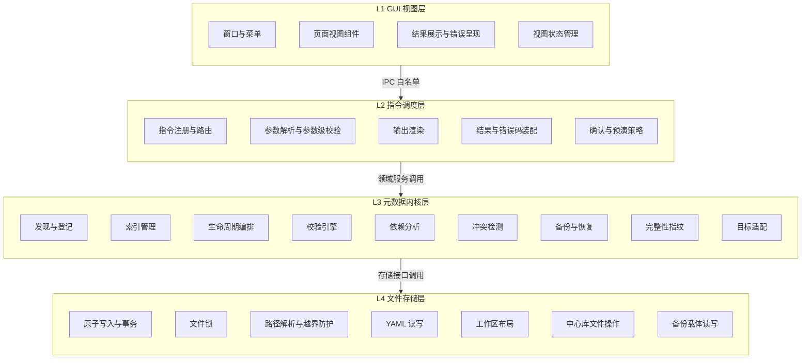

CLI 入口不构成独立层，它是指令调度层的另一个宿主，与 GUI 位于同一位置：

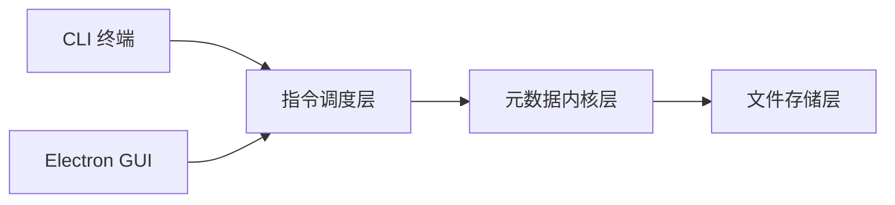

### 1.2 各层职责与边界

| 层级 | 核心职责 | 明确不负责 |
|---|---|---|
| L1 GUI 视图层 | 呈现状态、收集用户操作意图、把点击翻译为一次内核指令调用、展示结果与错误 | 不读写文件系统；不实现任何业务判定；不直接调用内核内部模块；不解释 Skill 内容 |
| L2 指令调度层 | 指令注册与路由、参数解析与参数级校验、确认与预演策略、调用内核服务、装配统一结果结构与退出码、渲染输出 | 不实现领域规则；不直接访问文件存储层；不绕过内核服务做判定 |
| L3 元数据内核层 | 元信息的发现、索引、生命周期编排、校验、依赖分析、冲突检测、备份恢复、指纹计算、目标适配 | 不执行任何被管理 Skill 的业务逻辑；不解释 Skill 正文；不做界面呈现；不直接操作文件句柄 |
| L4 文件存储层 | 原子写入、备份回滚、文件锁、路径解析与越界防护、YAML 序列化、工作区布局、中心库与备份载体的读写 | 不做业务判定；不感知指令语义；不感知具体宿主 |

### 1.3 跨层规则

| 规则编号 | 规则内容 |
|---|---|
| R-LAYER-01 | 依赖方向只能是 L1 到 L2、L2 到 L3、L3 到 L4，禁止任何反向依赖 |
| R-LAYER-02 | 禁止跨层调用，例如 L1 直接调用 L3 或 L4 |
| R-LAYER-03 | 同层内模块之间的调用必须声明依赖，禁止隐式访问其他模块的内部状态 |
| R-LAYER-04 | 只有 L4 允许接触文件系统，其余各层一律通过 L4 提供的接口进行持久化 |
| R-LAYER-05 | L2 是内核的唯一对外入口；任何宿主都必须经由 L2 发起操作 |
| R-LAYER-06 | L3 的各服务之间不得互相写入对方负责的持久化结构，跨领域数据交换通过只读视图完成 |

---

## 2. 模块划分

### 2.1 模块总览

#### L1 GUI 视图层

| 模块 | 名称 | 职责 | 允许依赖 |
|---|---|---|---|
| G-01 | 主进程与窗口管理 | 创建与管理窗口、菜单、托盘、生命周期事件 | Electron 运行时、G-02 |
| G-02 | 内核桥接器 | 接收渲染层请求、执行白名单校验、调用指令调度层、把内核结果原样回传 | 指令调度层、G-01、原生文件对话框 |
| G-03 | 预加载白名单桥 | 在隔离上下文中暴露受限的调用接口给渲染层 | G-02 |
| G-04 | 视图组件 | 页面与控件，负责把用户操作翻译为一次指令调用 | G-05、G-03 |
| G-05 | 视图状态管理 | 保存列表、详情、当前选中项与最近一次调用结果 | 无业务依赖 |

#### L2 指令调度层

| 模块 | 名称 | 职责 | 允许依赖 |
|---|---|---|---|
| C-01 | 指令注册与路由 | 维护指令清单与别名，把请求分发到对应处理器 | C-02、C-03、C-04、C-05、内核服务 |
| C-02 | 参数解析与校验 | 解析参数与选项，执行参数级校验（必填、取值域、互斥） | 内核只读接口 |
| C-03 | 确认与预演策略 | 决定是否需要用户确认、是否以预演方式执行 | 无 |
| C-04 | 结果装配与错误码 | 把内核结果统一装配为结果封装，映射退出码 | 无 |
| C-05 | 输出渲染 | 渲染人类可读文本、结构化输出、机器可读表格 | C-04 |

#### L3 元数据内核层

| 模块 | 名称 | 职责 | 允许依赖 |
|---|---|---|---|
| K-01 | 元数据模型服务 | 元数据块的解析、规范化、序列化与字段映射 | K-09、存储层只读接口 |
| K-02 | 发现与登记服务 | 遍历根目录、识别 Skill、登记来源未知状态、产出登记摘要 | K-01、K-03、K-07 |
| K-03 | 索引服务 | 索引的读取、派生区重建、声明区维护、查询与过滤 | K-01、K-09、存储层索引接口 |
| K-04 | 生命周期编排服务 | 编排安装、卸载、启用、禁用、更新的多步骤流程与回滚 | 其余全部内核服务 |
| K-05 | 校验引擎 | 元数据、配置、索引三类对象的只读校验与分级报告 | K-01、K-03、K-09 |
| K-06 | 依赖分析服务 | 依赖存在性、版本满足、环路检测、影响面分析 | K-03、存储层只读接口 |
| K-07 | 冲突检测服务 | 同名冲突、落位映射冲突、目标占用冲突、索引与磁盘不一致的检测与报告 | K-03、K-10、存储层只读接口 |
| K-08 | 备份与恢复服务 | 导出的组装与敏感信息剥离、导入的前置校验、冲突策略应用 | K-01、K-03、K-07、K-09 |
| K-09 | 完整性指纹服务 | 内容指纹的计算与比对，只计算不判定 | 存储层只读接口 |
| K-10 | 目标适配服务 | 解析目标位置、生成落位计划、判定目标的生效方式 | K-01、存储层只读接口 |
| K-11 | 中心库服务 | 中心库原件的落位、回收、孤儿识别 | K-09、存储层中心库接口 |

#### L4 文件存储层

| 模块 | 名称 | 职责 | 允许依赖 |
|---|---|---|---|
| S-01 | 工作区布局与配置读写 | 解析工作区根目录、读写配置文件 | S-03、S-04、S-05、S-06 |
| S-02 | 索引持久化 | 读写索引文件，保留未识别字段 | S-03、S-04、S-05、S-06 |
| S-03 | 原子写入与事务 | 临时写入、校验、原子替换、失败回滚 | S-05、S-06 |
| S-04 | 文件锁 | 提供工作区级与对象级锁 | S-05 |
| S-05 | 路径解析与越界防护 | 路径规范化、根目录约束、可移植路径表达 | 无 |
| S-06 | YAML 序列化 | 文本序列化与反序列化，统一编码与换行 | 无 |
| S-07 | 中心库文件操作 | 中心库目录的增删查与移动 | S-03、S-05、S-06 |
| S-08 | 备份载体读写 | 备份文件的组装与解析 | S-03、S-05、S-06 |
| S-09 | 跨层契约词汇 | 问题码常量与结果形状的唯一定义处；被各层共同引用，本身不含存储逻辑。实现阶段新增的模块，落位理由见 AD-12 | 无 |

### 2.2 模块依赖关系

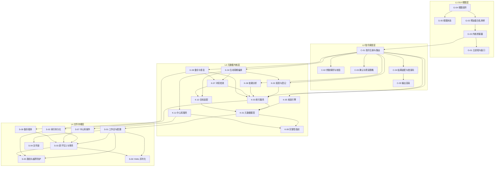

依赖方向自上而下，图中不存在反向箭头，这是 R-LAYER-01 的图形化表达。

### 2.3 模块越权规则

| 规则编号 | 禁止事项 | 违规示例 |
|---|---|---|
| R-MOD-01 | GUI 视图层不得直接调用内核层与存储层的任何模块 | 渲染层直接读取工作区目录下的索引文件 |
| R-MOD-02 | GUI 视图层不得实现业务判定 | 视图层自行判断「该 Skill 能否禁用」并置灰按钮，而不是依据内核返回的判定结果 |
| R-MOD-03 | 内核层不得调用指令调度层 | 内核服务直接构造命令行文本或复用参数解析器 |
| R-MOD-04 | 存储层不得调用内核层 | 索引持久化模块自行判断某条记录是否应标记为失效 |
| R-MOD-05 | 校验、依赖分析、冲突检测、指纹四个模块必须只读 | 校验过程中顺手修复索引 |
| R-MOD-06 | 冲突检测与校验引擎只报告，不处置 | 冲突检测模块自行删除冲突文件 |
| R-MOD-07 | 只有生命周期编排服务可以编排多步骤写入 | 备份恢复模块绕过编排服务直接改写索引 |
| R-MOD-08 | 除存储层外，任何模块不得直接使用文件系统接口 | 内核服务直接拼接路径并写文件 |
| R-MOD-09 | 目标适配服务只产出计划，不执行落位 | 适配模块自行把文件复制到目标目录 |
| R-MOD-10 | 指令调度层不得包含领域规则 | 在参数校验里硬编码「哪些 Skill 名称合法」的业务规则 |

### 2.4 自动依赖图（生成物）

架构依赖图由 `npm run arch:graph` 从 `scripts/check-layer.mjs` 的同一份相对 import 解析生成，入库于
[`docs/architecture/dependency-graph.json`](architecture/dependency-graph.json)。图包含每个源码文件的
`layer` / `region`、解析到的非源码资产叶节点（例如 renderer 的 CSS）、每条 import 的
`from` / `to` / `specifier`，以及按层汇总的文件数与跨层边数；不包含时间戳或绝对路径，
同一棵源码树在三个平台上生成相同字节。

图的层标签为 `contract`、`store`、`core`、`dispatch`、`entry`、`public`、`gui`、`scripts`。其中 kernel 的
`store → core` 反向边、GUI 对 kernel 内部的引用和 scripts 对 kernel 内部的引用仍是 `check:arch` 的
失败条件；图中的跨层边只用于审阅，不构成放行名单。

`npm run check` 调用 `npm run check:arch-graph` 比较入库图与当前源码生成结果；源码改动后未重新生成、
或手工修改生成物都会失败。生成物因此**不手工维护**：改动 import 后运行生成命令并审阅 diff。

---

## 3. 核心数据流

### 3.1 通用流转模型

所有操作遵循同一条主干链路：用户意图经宿主进入指令调度层，由内核层处理，最终由存储层落盘。

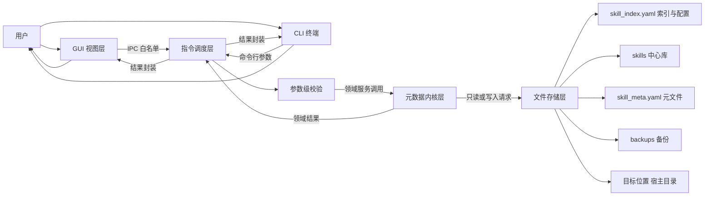

### 3.2 读路径：列表查询与详情查看

读路径不获取写锁，不产生任何变更。

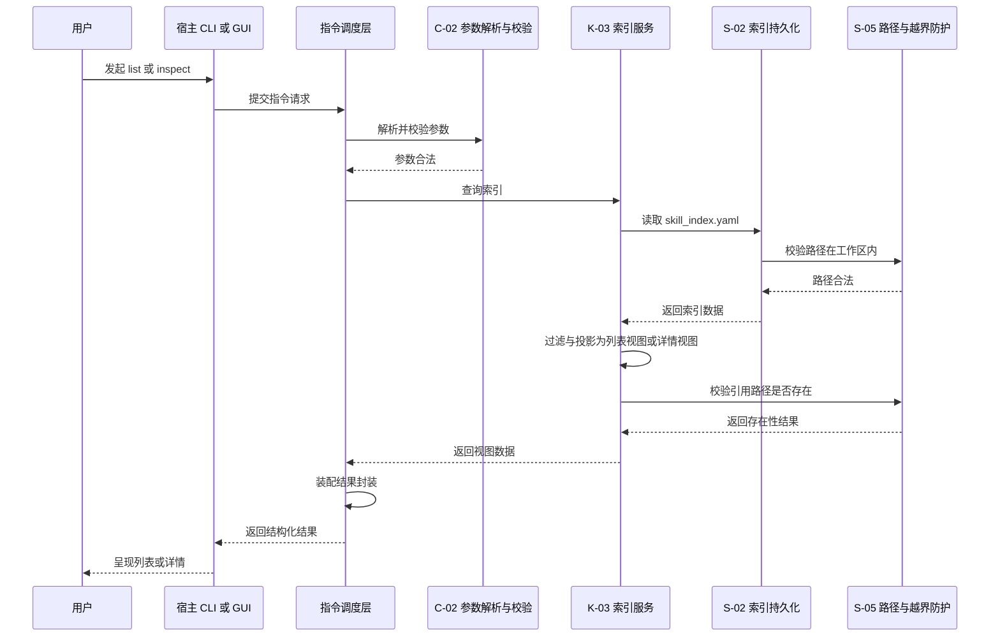

读路径中若发现索引不存在，内核返回带引导建议的结果，由调度层渲染提示，不抛出异常。

### 3.3 写路径：以安装为例

写路径必须经过冲突检测、计划生成、预演判断、原子写入与索引更新五个阶段。

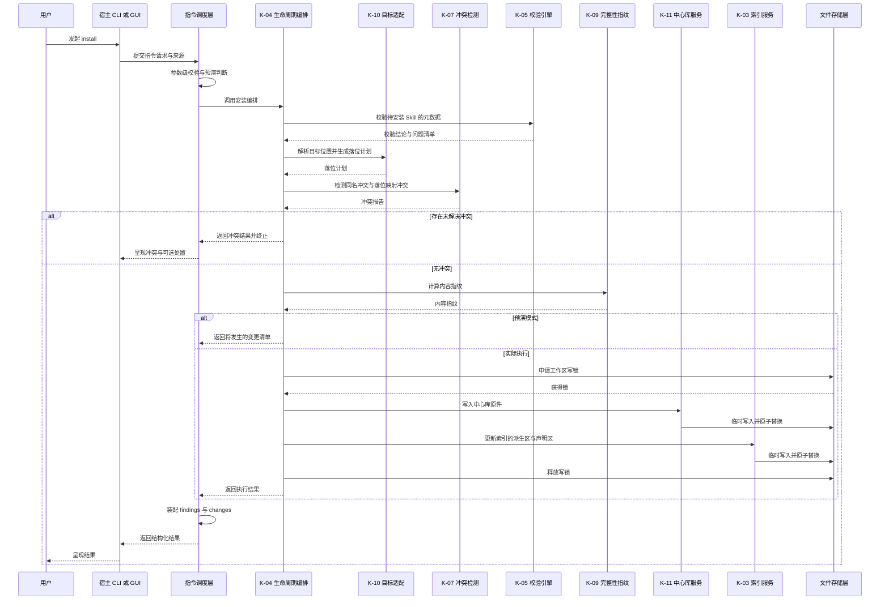

### 3.4 GUI 点击路径

GUI 路径与 CLI 路径在指令调度层汇合，二者共用同一套内核逻辑，区别只在于结果的呈现方式。

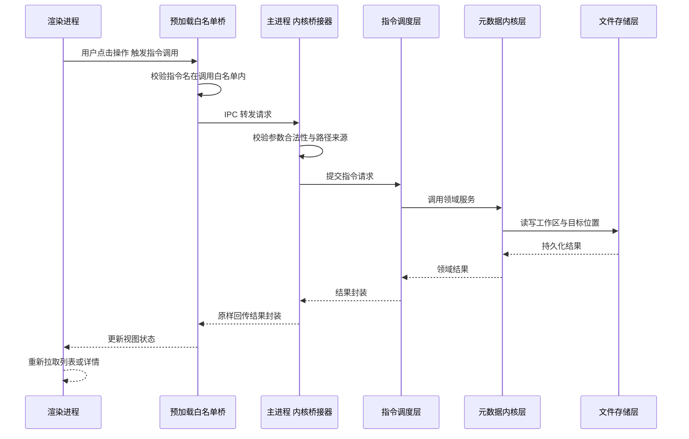

### 3.5 一次完整写操作的阶段划分

以安装为例，完整的流转分为下列阶段。每个阶段的失败都必须使环境回到起点。

| 阶段 | 执行模块 | 输入 | 输出 | 失败时的行为 |
|---|---|---|---|---|
| 1 意图收集 | 宿主 | 用户操作 | 指令名与参数 | 提示参数缺失 |
| 2 参数校验 | C-02 | 指令请求 | 规范化参数 | 返回输入错误，退出码 2 |
| 3 元数据校验 | K-05、K-01 | 待安装内容 | 校验结论 | 返回校验错误，不产生写入 |
| 4 目标解析与计划 | K-10 | 目标参数 | 落位计划 | 返回目标无效错误 |
| 5 冲突检测 | K-07 | 落位计划与索引 | 冲突报告 | 返回冲突结果并终止 |
| 6 指纹计算 | K-09 | 待安装内容 | 内容指纹 | 返回读取失败错误 |
| 7 预演判定 | C-03、K-04 | 请求选项 | 预演或执行 | 预演在此终止并返回变更清单 |
| 8 加锁 | S-04 | 工作区 | 写锁句柄 | 返回并发冲突，退出码 5 |
| 9 内容落位 | K-11、S-03 | 落位计划 | 中心库原件 | 回滚已写入内容 |
| 10 索引更新 | K-03、S-03 | 记录与指纹 | 新索引 | 回滚内容与索引 |
| 11 解锁与收尾 | S-04 | 写锁句柄 | 释放完成 | 记录日志并报告锁残留 |
| 12 结果装配 | C-04、C-05 | 全部阶段结果 | 结果封装与退出码 | 不适用 |

### 3.6 变更安全机制

| 机制 | 承载模块 | 说明 |
|---|---|---|
| 预演 | C-03 与 K-04 | 预演在第 7 阶段终止，只返回变更清单，不进入加锁与写入 |
| 原子写入 | S-03 | 写入临时文件、校验后原子替换，中途中断不产生半成品 |
| 备份回滚 | K-08 与 S-08 | 破坏性操作前生成备份；失败时按备份还原 |
| 并发保护 | S-04 | 写操作获取工作区写锁；读操作不取锁 |
| 只读隔离 | K-05、K-06、K-07、K-09 | 四个模块不持有写接口，从类型层面杜绝误写 |
| 索引分区 | K-03 | 派生区可重建，声明区变更必须经编排服务，避免局部改写破坏一致性 |

---

## 4. 项目目录总体规划

### 4.1 仓库目录树

下列为仓库的目录规划，已按内核技术选型（TypeScript / Node.js）与界面框架裁决（Electron）落地。仓库采用**工作区结构**：根目录声明两个工作区，`kernel/` 为内核包、`gui/` 为桌面外壳包，二者各有独立的依赖清单与编译配置。这样安排的目的有二：其一，内核包完全不依赖任何界面框架，该约束可由依赖清单直接保证，而不是靠人工约定；其二，内核与桌面外壳是两个独立的构建目标，需要各自的打包配置。

```
skill-manager/
├── README.md
├── LICENSE
├── CHANGELOG.md
├── package.json                     根工作区：声明 workspaces 与统一脚本
├── package-lock.json
├── tsconfig.base.json               两个工作区共享的编译选项
├── .gitignore
├── .editorconfig
├── .prettierrc
├── eslint.config.mjs
├── .nvmrc                           锁定的 Node 主版本
├── docs/
│   ├── requirements.md              需求规格文档
│   ├── architecture.md              本文件
│   ├── ui-design.md                 界面设计文档
│   ├── specification/               元数据规范、索引格式规范、指令契约、结果与退出码规范、宿主注册表规范
│   │   ├── skill-meta-spec.md
│   │   ├── index-format.md
│   │   ├── cli-contract.md
│   │   ├── result-and-exit-codes.md
│   │   ├── host-registry.spec.md
│   │   └── plugin-format.md
│   ├── research/                    同类项目调研
│   └── reviews/                     评审记录与一致性核对报告
│
├── schemas/                         JSON Schema 定义，供校验与编辑器提示使用
│   ├── skill-frontmatter.schema.json
│   ├── skill-meta.schema.json
│   ├── skill-index.schema.json
│   ├── backup.schema.json
│   ├── plugin_manifest.schema.json
│   └── plugin_index.schema.json
│
├── kernel/                          元数据内核
│   ├── package.json                 内核包：零界面依赖，可独立构建为可执行文件
│   ├── tsconfig.json                内核编译选项，继承 tsconfig.base.json
│   ├── dispatch/                    L2 指令调度层
│   │   ├── registry/                指令注册表与别名
│   │   ├── parsers/                 参数解析与参数级校验
│   │   ├── policy/                  确认与预演策略
│   │   ├── result/                  结果装配与错误码映射
│   │   └── render/                  文本、结构化、表格三种渲染
│   ├── core/                        L3 元数据内核层
│   │   ├── metadata/                K-01 元数据模型服务
│   │   ├── discovery/               K-02 发现与登记服务
│   │   ├── index/                   K-03 索引服务
│   │   ├── lifecycle/               K-04 生命周期编排（install/uninstall/toggle/update/restore + shared/types）
│   │   ├── validation/              K-05 校验引擎
│   │   ├── dependency/              K-06 依赖分析服务
│   │   ├── conflict/                K-07 冲突检测服务
│   │   ├── backup/                  K-08 备份与恢复服务
│   │   ├── integrity/               K-09 完整性指纹服务
│   │   ├── targets/                 K-10 目标适配服务
│   │   │   ├── resolver/            目标位置解析
│   │   │   └── planners/            落位计划生成
│   │   └── library/                 K-11 中心库服务
│   ├── store/                       L4 文件存储层
│   │   ├── workspace/               S-01 工作区布局与配置读写
│   │   ├── registry-store/          S-02 索引持久化
│   │   ├── atomic/                  S-03 原子写入与事务
│   │   ├── locking/                 S-04 文件锁
│   │   ├── paths/                   S-05 路径解析与越界防护
│   │   ├── yaml/                    S-06 YAML 序列化
│   │   ├── library-fs/              S-07 中心库文件操作
│   │   └── backup-fs/               S-08 备份载体读写
│   ├── entry/                       宿主适配层：命令行与子进程两种入口，不含业务规则
│   │   ├── cli.ts                   命令行宿主入口
│   │   └── stdio.ts                 子进程标准输入输出协议适配，供桌面外壳调用
│   └── index.ts                     内核对外接口，只暴露调度层入口
│
├── gui/                             Electron 可视化外壳
│   ├── package.json                 桌面外壳包：依赖 Electron，不反向被内核依赖
│   ├── tsconfig.json                桌面外壳编译选项
│   ├── electron.vite.config.ts      主进程、预加载脚本与渲染层的统一构建配置
│   ├── main/                        G-01 主进程与窗口管理
│   ├── bridge/                      G-02 内核桥接器
│   ├── preload/                     G-03 预加载白名单桥
│   ├── renderer/                    G-04 视图组件与 G-05 视图状态
│   │   ├── views/
│   │   ├── components/
│   │   └── state/
│   ├── assets/
│   └── packaging/                   打包配置与平台相关资源
│
├── contract/                        跨层纯契约包：类型与常量，零运行时依赖
│   ├── package.json                 包声明：exports 指向 src/index.ts
│   ├── tsconfig.json                无 Node / 无 kernel / 无 gui 依赖
│   └── src/                         问题码、结果类型、文件常量、插件纯结构类型
│
├── scripts/                         构建、打包、发布、校验脚本，不含业务逻辑
│   ├── build-kernel.mjs             内核构建为各平台可执行文件
│   ├── build-desktop.mjs            桌面外壳构建与打包
│   ├── check-contract.mjs           构建期校验指令清单与结果结构未被破坏
│   ├── check-layer.mjs              分层、依赖方向、循环与 allowlist 校验
│   ├── check-complexity.mjs         复杂度与文件规模棘轮
│   └── architecture/
│       └── complexity-baseline.json 棘轮基线（只减不增）
├── tests/
│   ├── fixtures/                    正例与反例样本
│   ├── unit/                        模块级测试
│   ├── contract/                    指令契约与结果结构测试
│   └── e2e/                         端到端场景测试
└── build/                           构建输出，不纳入版本控制
```

### 4.2 目录用途说明

| 目录 | 用途 | 对应架构层 |
|---|---|---|
| `docs/` | 需求、架构、规范、调研与评审文档 | 无（文档） |
| `docs/specification/` | 元数据规范、索引格式、指令契约、结果与错误码规范、宿主注册表规范、插件格式规范的正式定义 | 无（规范） |
| `schemas/` | JSON Schema，作为校验能力的规则来源与编辑器提示来源 | 无（契约） |
| `kernel/dispatch/` | 指令注册、参数处理、确认策略、结果装配与输出渲染 | L2 |
| `kernel/core/` | 全部领域服务，业务规则的唯一归属地 | L3 |
| `kernel/store/` | 全部文件系统交互，其余各层不得直接访问文件系统 | L4 |
| 仓库根配置文件 | `package.json` 声明 kernel / gui / contract 三个工作区与统一脚本；`tsconfig.base.json` 提供共享编译选项；`.nvmrc` 锁定 Node 主版本 | 构建 |
| `contract/` | 跨层纯契约包：结果类型、问题码、共享常量与插件纯结构类型；零运行时依赖，不 import kernel / gui | L0 契约 |
| `kernel/` | 内核包根目录，含独立的依赖清单与编译配置。该包**不依赖任何界面框架**，约束由依赖清单直接保证 | L2 至 L4 |
| `kernel/entry/` | 宿主适配层：命令行入口与子进程入口，不含业务规则 | L2 宿主 |
| `kernel/index.ts` | 内核对外接口，只暴露调度层入口 | L2 |
| `gui/` | 桌面外壳包根目录，含独立的依赖清单与构建配置 | L1 |
| `gui/main/` | Electron 主进程、窗口、菜单、原生对话框 | L1 |
| `gui/bridge/` | 渲染层请求到指令调度层的唯一通道 | L1 |
| `gui/preload/` | 隔离上下文中的受限接口暴露 | L1 |
| `gui/renderer/` | 视图组件与视图状态 | L1 |
| `gui/packaging/` | 打包配置与图标等平台资源 | 构建 |
| `scripts/` | 构建与发版脚本 | 构建 |
| `scripts/check-contract.mjs` | 构建期强制检查：指令清单与结果结构未被破坏 | 构建 |
| `scripts/check-layer.mjs` | 构建期强制检查：分层依赖方向、循环依赖、跨层深引用、allowlist 与工作区声明 | 构建 |
| `scripts/check-complexity.mjs` | 复杂度 / 文件规模棘轮：新代码红线、基线只减不增、拆分后残留基线条目报错 | 构建 |
| `scripts/build-kernel.mjs` | 把内核构建为各平台可执行文件 | 构建 |
| `tests/fixtures/` | 校验所需的正例与反例 | 测试 |
| `tests/contract/` | 保证指令契约与结果结构不被破坏 | 测试 |

### 4.3 运行期数据布局

运行期数据位于用户级工作区根目录，与仓库目录严格分离。该布局为架构决策（对应 AD-03），已回写需求文档。

```
用户主目录/
└── .skill-manager/
    ├── skill_index.yaml    全局索引：声明区与派生区；全局运行配置亦位于此文件之内
    ├── skills/             中心库，每个 Skill 独占一个子目录，内含该 Skill 的元文件与附属资源
    ├── backups/            破坏性操作前的自动备份
    ├── locks/              锁文件
    └── logs/               运行日志，不含明文凭据
```

说明：全局运行配置不再单独设立配置文件，其唯一位置是索引文件内的配置区。`skills/` 即此前所称的中心库，术语对应关系见需求文档 4.3 节。备份目录、锁目录与日志目录已回写需求文档 4.3 节的工作区布局表与 4.4 节的数据模型约束。

#### 索引文件的内部分区

`skill_index.yaml` 内部划分两个逻辑区，可编辑性与维护责任不同：

| 区域 | 内容 | 维护责任 |
|---|---|---|
| 声明区 | 标识、名称、版本、描述、作者、许可证、状态、路径、触发关键词、依赖标识列表，以及来源类型摘要与落位目标摘要 | 由用户或安装流程声明；索引中的取值为该 Skill 元文件对应字段的引用投影 |
| 派生区 | 首次登记时间、最近变更时间、内容指纹 | 由内核在安装、更新、校验时写入，禁止用户手动修改 |

该划分对应 AD-02。由于来源与落位信息已移入各 Skill 的元文件，索引中的 Skill 记录区成为元文件的投影，可完整重建；而索引顶层的配置区不可由元文件推导，删除索引会一并丢失全局运行配置。因此配置区与各 Skill 的元文件同为必须持久保存的内容，二者均随备份一并迁移。

---

### 4.4 初始化骨架清单

仓库初始化时应当创建的文件，以及明确暂不创建的内容。

**根目录**

| 文件 | 用途 |
|---|---|
| `package.json` | 声明两个工作区，并提供根级脚本：构建、测试、静态检查、契约与分层校验 |
| `package-lock.json` | 由依赖安装生成，纳入版本控制 |
| `tsconfig.base.json` | 两个工作区共享的编译选项：严格模式、目标语言级别、模块解析方式 |
| `.nvmrc` | 锁定 Node 主版本，并与根清单中的引擎约束保持一致 |
| `.gitignore` | 忽略构建输出、依赖目录、本地工作区数据 |
| `.editorconfig` | 统一缩进与换行 |
| `.prettierrc` | 格式化规则 |
| `eslint.config.mjs` | 静态检查规则 |

**内核包**

| 文件 | 用途 |
|---|---|
| `kernel/package.json` | 内核依赖清单。**不得出现任何界面框架依赖**，该约束由校验脚本断言 |
| `kernel/tsconfig.json` | 继承根配置，输出到构建目录下的内核子目录 |

**桌面外壳包**

| 文件 | 用途 |
|---|---|
| `gui/package.json` | 桌面外壳依赖清单 |
| `gui/tsconfig.json` | 继承根配置，输出到构建目录下的桌面子目录 |
| `gui/electron.vite.config.ts` | 主进程、预加载脚本与渲染层三者合一的构建配置 |

**校验与构建脚本**

| 文件 | 职责 |
|---|---|
| `scripts/check-contract.mjs` | 构建期断言指令清单与结果结构未被破坏 |
| `scripts/check-layer.mjs` | 构建期断言内核产物不依赖任何界面框架，且界面未直接引用内核内部模块 |
| `scripts/build-kernel.mjs` | 把内核构建为各平台可执行文件 |
| `scripts/build-desktop.mjs` | 桌面外壳的构建与打包 |

**明确不创建的内容**

| 项 | 原因 |
|---|---|
| `schemas/` 下的四个 Schema 文件 | 属实现阶段的交付物，随校验能力一并产出 |
| 运行期工作区目录及其内容 | 由初始化指令在用户目录创建，不进仓库 |
| 桌面外壳的 Electron 相关依赖 | 骨架阶段不引入，避免在界面实现开始前拉入大体量依赖；引入时机为界面实现启动时 |
| 任何业务逻辑实现 | 本次只落骨架，实现严格按契约推进 |

**初始化顺序**

1. 创建根目录的八个文件；
2. 创建两个工作区的依赖清单与编译配置；
3. 按第 4.1 节的目录树创建源码目录骨架，空目录以占位文件保持可提交；
4. 安装依赖，确认两个工作区各自可独立解析；
5. 执行两个校验脚本，确认骨架自身通过契约与分层检查；
6. 首次提交。

**提交粒度建议**：骨架与配置作为首次提交；此后每个指令或每个内核服务一次提交，提交信息中标注其所依据的契约章节。

---

## 5. GUI 与内核通信方案

### 5.1 设计前提

通信方案建立在两条前提之上：

1. **单一内核**：GUI 不复制任何业务逻辑，它只负责把用户意图翻译成一次内核指令调用，并把返回的结果呈现出来；
2. **统一入口**：内核必须提供「单入口加结构化输出」的能力，CLI 与 GUI 都是这一入口的宿主。

因此，GUI 与内核之间传递的不是任意函数调用，而是**指令请求**，其结构与 CLI 收到的东西同构。

### 5.2 进程模型与通信拓扑

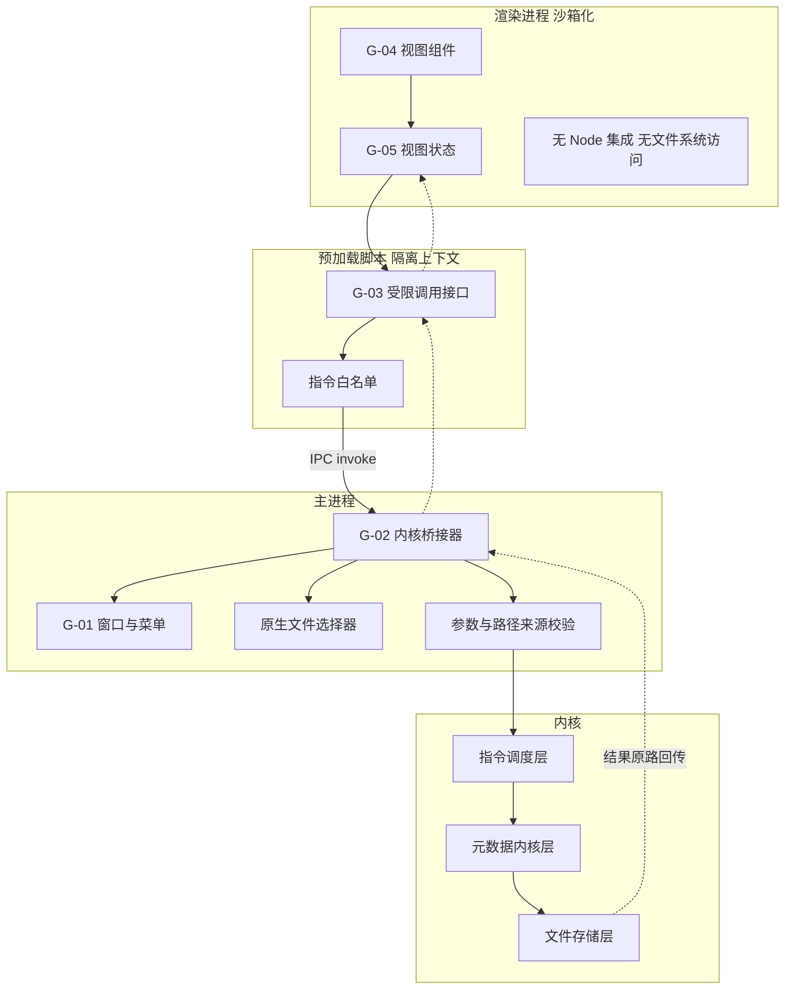

拓扑要点：

1. 渲染进程不开启 Node 集成，不能直接访问文件系统；
2. 渲染进程只能通过预加载脚本暴露的受限接口发起调用；
3. 指令名必须在预加载白名单内，白名单与需求文档 5.2 节的指令清单一一对应；
4. 一切内核调用发生在主进程，主进程是渲染层的唯一出口。

### 5.3 指令转发机制

#### 请求结构

| 字段 | 必需 | 说明 |
|---|---|---|
| 请求标识 | 是 | 每次调用的唯一标识，用于结果配对 |
| 指令名 | 是 | 必须是白名单内的指令，与 CLI 指令名完全一致 |
| 位置参数 | 否 | 指令的目标对象，例如 Skill 标识或来源 |
| 选项 | 否 | 预演、跳过确认、目标、作用域等 |
| 调用来源 | 是 | 标识本次调用来自 GUI 或 CLI，用于日志与呈现策略 |

#### 响应结构

响应结构与 CLI 的结构化输出完全一致，包含执行结果、指令信息、问题列表、变更列表与退出码五部分。

| 字段 | 说明 |
|---|---|
| 请求标识 | 与请求配对 |
| 执行结果 | 成功或失败 |
| 指令信息 | 指令名与目标对象 |
| 问题列表 | 每条含问题码、严重级别、来源、目标、说明、修复建议 |
| 变更列表 | 本次实际发生的变更 |
| 退出码 | 与执行结果一致的数值 |
| 视图数据 | 查询类指令的结果载荷，写类指令通常为空 |

#### 转发规则

| 规则编号 | 规则内容 |
|---|---|
| R-IPC-01 | 指令名不做任何映射或改写，GUI 与 CLI 使用同一套指令名 |
| R-IPC-02 | 主进程不得在转发前修改参数语义，只允许做参数合法性与路径来源校验 |
| R-IPC-03 | 主进程不得在回传前修改结果的语义，只允许做呈现所需的分组与排序 |
| R-IPC-04 | 涉及文件路径的参数必须来自主进程的原生文件选择器，渲染层不得自行构造绝对路径 |
| R-IPC-05 | 一次调用对应一次内核调用，GUI 不得把多个指令合并为一次转发 |
| R-IPC-06 | 预演与确认选项由主进程透传，判定仍由内核的确认与预演策略模块执行 |

### 5.4 错误信息回传规则

错误分为两个来源，回传时统一为同一种结构，保证视图层只需处理一种形态。

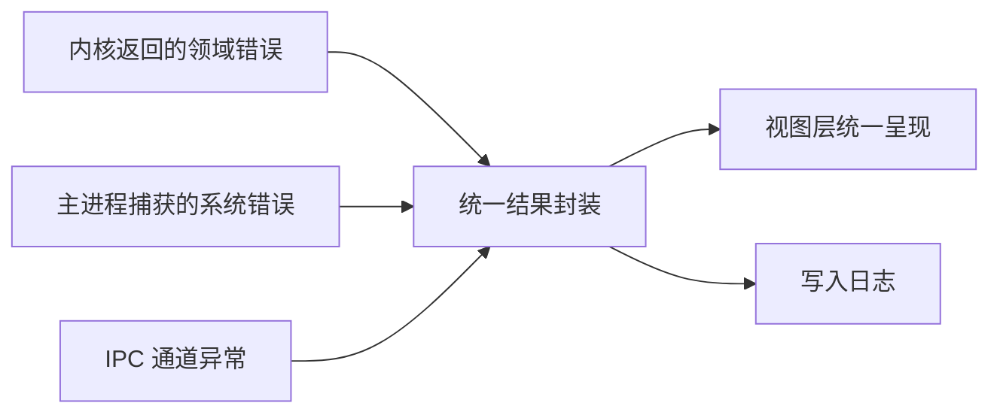

| 错误来源 | 示例 | 回传方式 |
|---|---|---|
| 内核领域错误 | 校验未通过、存在未解决冲突、依赖缺失 | 内核原生返回，问题码与修复建议原样保留 |
| 输入错误 | 参数缺失、取值非法、指令不在白名单 | 主进程生成同结构结果，归入输入错误类问题码 |
| 系统错误 | 目标目录不可写、锁获取失败、存储层异常 | 主进程包装为同结构结果，保留原始说明 |
| 通道异常 | 主进程不可用、调用超时 | 主进程或预加载桥生成同结构结果，标记为通道类问题 |

呈现规则：

1. 视图层不解析自然语言，一律依据问题码与严重级别决定呈现方式；
2. 每条错误必须完整展示修复建议，供用户直接复制为命令行执行；
3. 失败结果不得以弹出异常的方式中断界面，必须回到可继续操作的状态；
4. 涉及并发或锁的失败必须提示重试，而非提示数据损坏。

### 5.5 安全与隔离约束

| 约束 | 说明 |
|---|---|
| 上下文隔离 | 渲染进程与预加载脚本必须开启上下文隔离，渲染层无法访问主进程对象 |
| 最小暴露面 | 预加载脚本只暴露一个调用接口与一个指令清单查询接口 |
| 无沙箱逃逸 | 内核不向渲染层暴露任何文件句柄、进程句柄或原始路径拼接能力 |
| 路径收敛 | 所有路径由内核与主进程共同校验，必须落在工作区或用户显式选择的目标内 |
| 不执行内容 | GUI 可展示 Skill 的元数据与文件结构，但不得执行 Skill 内容 |

### 5.6 一期不提供的通信能力

1. 长任务的实时进度流与阶段性事件推送；
2. 指令执行的中途取消；
3. 内核主动向视图层推送的状态变更事件；
4. 除 GUI 与 CLI 之外的第三种宿主接入方式。

上述能力在架构上均有预留位置，见第 8 章。

---

## 6. 编译打包架构（Electron）

### 6.1 运行模式

| 模式 | 用途 | 内核形态 | 界面形态 | 数据目录 |
|---|---|---|---|---|
| 开发模式 | 日常开发与联调 | 内核以源码方式加载，支持改动即生效 | 渲染层由开发服务器提供，支持热更新 | 指向独立的开发工作区，避免污染真实数据 |
| 调试模式 | 定位问题 | 内核输出详细日志到独立文件 | 主进程开启调试端口，渲染层开启开发者工具 | 独立调试工作区 |
| 命令行模式 | 自动化与无界面环境 | 内核直接以 CLI 运行 | 无界面 | 真实工作区或由参数指定 |
| 打包模式 | 交付 | 内核随应用一同分发 | 原生窗口加载打包后的静态资源 | 真实工作区 |

### 6.2 构建流水线

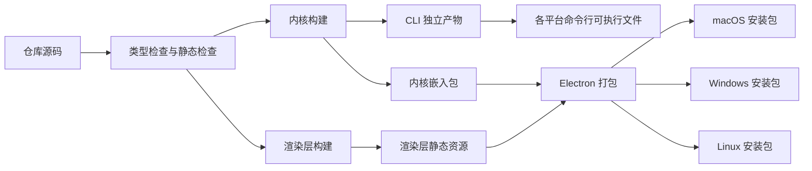

### 6.3 产物类型

| 产物 | 内容 | 依赖 GUI | 用途 |
|---|---|---|---|
| 命令行可执行文件 | 内核与指令调度层，不含界面代码 | 否 | CI 集成、脚本调用、无界面环境 |
| 桌面应用安装包 | 内核、指令调度层与 GUI 视图层 | 是 | 面向使用者的图形化操作 |
| 便携版桌面应用 | 同上，免安装形式 | 是 | 免安装场景 |
| 规范与模式文件 | 元数据规范、索引格式、Schema | 否 | 供外部工具与编辑器使用 |

### 6.4 打包工具选型说明

**选型总原则**：界面构建产物与内核构建产物解耦，任何一方更换工具都不影响另一方；选型不得反向影响分层结构。

#### 界面构建工具

| 候选 | 评价 | 结论 |
|---|---|---|
| Vite | 启动与热更新快，配置简单，生态成熟，与主流前端框架配合良好 | 推荐 |
| webpack | 能力全面但配置复杂，构建速度慢于 Vite | 备选，仅在遇到 Vite 无法覆盖的定制需求时考虑 |
| electron-vite | 在主进程、预加载脚本与渲染层三者之间提供统一构建入口，内置三者协同的开发服务器 | 推荐作为整体集成方案 |

#### 桌面打包工具

| 候选 | 评价 | 结论 |
|---|---|---|
| electron-builder | 单套配置覆盖 macOS、Windows、Linux；原生支持安装包与免安装两种形态；对代码签名、公证、多架构目标支持完善 | 推荐 |
| electron-forge | 与 Electron 官方生态结合紧密，插件式构建管线清晰；多目标打包配置分散度较高 | 备选 |
| 自行组装脚本 | 灵活但需自行处理签名、公证与多平台差异，维护成本高 | 不采用 |

选择依据：

1. 需要同时产出安装包与免安装形态，且覆盖三个桌面平台；
2. 需要与代码签名、公证流程衔接，预留二期自动更新的接入点；
3. 打包配置应与内核构建完全解耦，单独执行也能完成打包。

#### 内核构建产物形态

内核实现语言已选定为 TypeScript，分发形态已选定为下表三种情形中的第二种。三种情形仍完整保留，以便未来更换内核语言时对照：

| 情形 | 内核形态 | 随桌面应用分发方式 | 对通信方案的影响 |
|---|---|---|---|
| 内核与界面同为同一运行时 | 内核以模块形式被主进程直接加载 | 随应用代码一同打包 | 主进程内直接调用调度层，延迟最低 |
| 内核为独立可执行文件 | 内核编译为各平台可执行文件 | 作为应用资源随包分发，主进程以子进程方式调用 | 主进程通过标准输入输出以结构化文本通信，契约不变 |
| 内核为需要运行时的脚本形态 | 内核以脚本分发，依赖目标机运行时 | 随包分发脚本，由主进程调用目标机运行时 | 同上一情形，需在安装阶段校验运行时可用性 |

无论采用哪种情形，对上层的要求都一致：内核必须提供「单入口加结构化输出」的能力，见 5.1 节。

#### 签名、公证与分发

| 事项 | 一期 | 说明 |
|---|---|---|
| macOS 代码签名 | 需要 | 未签名应用会被系统拦截 |
| macOS 公证 | 需要 | 与签名同属交付门槛 |
| Windows 代码签名 | 需要 | 避免安装时的安全警告 |
| Linux 分发 | 提供安装包与免安装包 | 不做系统级仓库分发 |
| 应用商店分发 | 不纳入一期 | 二期评估 |
| 增量更新通道 | 不纳入一期 | 二期评估，见第 8 章 |

#### 构建渠道

| 渠道 | 用途 | 版本标识 | 数据目录 |
|---|---|---|---|
| 开发渠道 | 日常开发与联调 | 开发版本号 | 开发工作区 |
| 预发布渠道 | 内部验证与回归 | 预发布版本号 | 预发布工作区 |
| 正式渠道 | 对外交付 | 语义化版本号 | 真实工作区 |

渠道差异只影响版本标识与默认数据目录，不影响功能与代码路径。

#### 构建期强制检查

下列检查纳入构建流水线，任一项失败即终止构建：

1. 指令清单与需求文档 5.2 节一致，且未删除既有指令；
2. 结果结构与问题码定义未被破坏；
3. 元数据规范与 Schema 文件可被解析且相互一致；
4. GUI 未引入对内核内部模块的直接引用（越权检查）；
5. 内核产物不依赖任何界面框架。

#### 选型决策登记

| 编号 | 决策点 | 本文档建议 | 状态 |
|---|---|---|---|
| AD-07 | 界面构建工具 | 采用 Vite，必要时配合 electron-vite 统一三进程构建 | 待确认 |
| AD-08 | 桌面打包工具 | 采用 electron-builder | 待确认 |
| AD-09 | 内核分发形态 | **已选定：独立可执行文件形态**（即上文三种情形中的第二种）。内核编译为各平台可执行文件，随应用资源分发，由主进程以子进程方式调用，两者通过标准输入输出以结构化文本通信 | 已选定 |
| AD-10 | 内核实现语言 | **已选定：TypeScript 运行于 Node.js**。理由：契约与元数据处理是本项目核心工作量，类型系统可由 JSON Schema 直接生成，迭代速度优先；代价是打包体积偏大，由独立可执行文件形态承接 | 已选定 |
| AD-11 | 界面框架 | **已裁决：维持 Electron**，不改为其他桌面框架。裁定理由：AD-05 已回写三份文档，维持现状的文档成本最低；内核为 TypeScript，与 Electron 的主进程运行时同源，子进程调用与进程间通信均为原生能力，无需跨语言桥接；一期以跑通内核指令与外壳可用为目标，成熟方案的开发路径最短 | 已关闭，见 P-03 |
| AD-12 | 跨层契约词汇的落位 | 实现 K-01 与存储层时暴露出一处 1.3 节未覆盖的疏漏：问题码与结果形状被存储层、内核层与指令调度层共同引用，而依赖方向只允许自上而下。若把它们定义在指令调度层（`kernel/dispatch/result/`），存储层的路径防护等模块就必须反向依赖调度层，违反 R-LAYER-04 | 新增存储层模块 **S-09 跨层契约词汇**（`kernel/store/contract.ts`），把问题码常量与结果形状放在依赖方向的最底层。本模块不含存储逻辑，只是共享契约的唯一定义处；两处需求文档不涉及本次调整 |

### 6.5 CLI 与 GUI 的产物关系

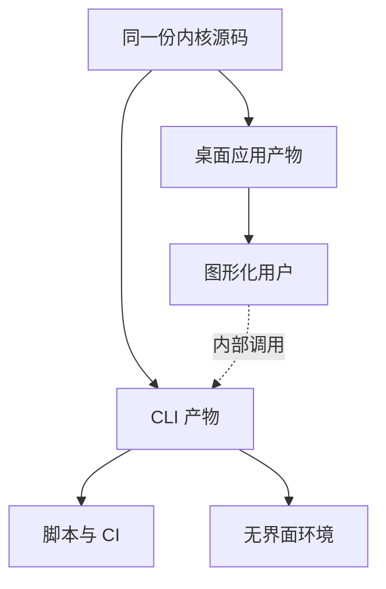

两条产物线共用同一份内核源码，只是宿主与打包方式不同。这保证了「GUI 仅作为视图层」在构建层面也成立：GUI 产物中不存在内核逻辑的第二份实现。

---

## 7. 系统约束与边界

### 7.1 内核边界

内核只管理 Skill 元数据，不运行任何被管理 Skill 的业务逻辑。该边界在架构上由三处强制：

1. **能力约束**：内核模块清单中不存在任何执行、解释、调用类模块；
2. **数据约束**：内核只读取元数据块与文件清单，不读取也不解释指令正文；
3. **依赖约束**：内核不依赖任何模型、网络服务或脚本执行环境。

| 事项 | 内核是否负责 | 架构承载 |
|---|---|---|
| 读取与解析元数据块 | 是 | K-01 |
| 校验元数据与配置 | 是 | K-05 |
| 维护索引 | 是 | K-03 |
| 安装、卸载、启用、禁用、更新 | 是 | K-04 |
| 检查依赖声明 | 是 | K-06 |
| 检测命名与落位冲突 | 是 | K-07 |
| 备份与恢复元信息 | 是 | K-08 |
| 读取并执行指令正文 | 否 | 无对应模块 |
| 运行 Skill 目录内的脚本 | 否 | 无对应模块 |
| 调用模型或外部服务完成任务 | 否 | 无对应模块 |
| 自动安装缺失依赖 | 否 | K-06 只报告 |
| 托管或索引公网 Skill | 否 | 无对应模块 |

### 7.2 GUI 可选与 CLI 独立

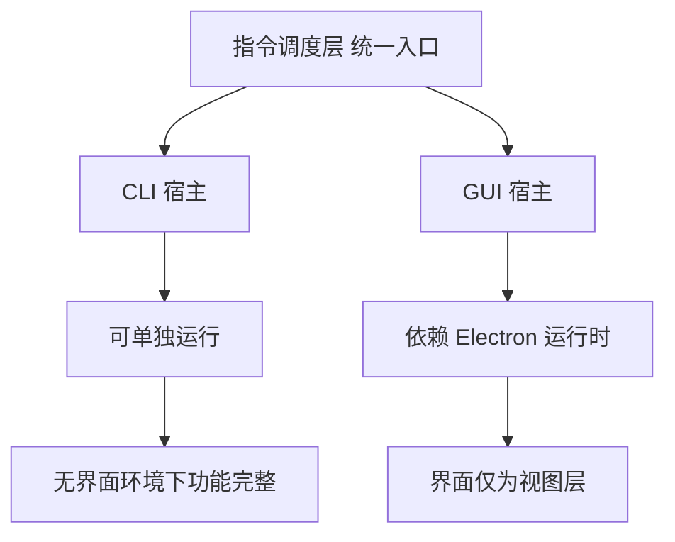

| 约束编号 | 约束内容 |
|---|---|
| R-BOUND-01 | 移除 GUI 不影响任何功能，CLI 具备完整能力 |
| R-BOUND-02 | GUI 不可用时，所有操作仍可通过 CLI 完成 |
| R-BOUND-03 | GUI 不得成为任何能力的唯一入口 |
| R-BOUND-04 | CLI 产物不依赖 Electron 运行时 |
| R-BOUND-05 | 两种宿主的行为差异只允许存在于呈现层，不允许存在于判定层 |

### 7.3 一期范围限制

一期范围以需求文档第 3 章的功能清单为准。本架构的范围限制如下：

| 限制项 | 说明 |
|---|---|
| 内核能力 | 覆盖发现登记、索引、安装、卸载、启用、禁用、更新、校验、依赖检查、冲突检测、备份导入导出；其中更新仅由用户显式触发，不含自动更新（见 AD-04 与需求 FR-12） |
| 目标适配 | 一期默认采用副本落位；链接方式与跨目标能力探测不在本期 |
| 索引形态 | 单一索引文件，内部划分派生区与声明区；不做索引分片与独立锁定快照 |
| 视图层 | 仅提供桌面外壳与既有指令的图形化入口，不引入新的业务能力 |
| 通信 | 仅支持请求响应式调用，不支持进度流、取消与事件推送 |
| 打包 | 不引入自动更新机制 |
| 来源类型 | 本地目录、Git 仓库、本地归档；不接入在线市场 |
| 依赖处理 | 只检查与报告，不自动安装 |

### 7.4 需求到架构的追踪

| 需求章节 | 需求内容 | 架构承载 |
|---|---|---|
| 3.2 FR-01 | 元数据登记与发现 | K-02、K-01、K-03 |
| 3.3 FR-02 | 索引生成与刷新 | K-03、S-02 |
| 3.4 FR-03 | 索引查询 | K-03、K-10、C-05 |
| 3.5 FR-04 | 安装 | K-04、K-05、K-07、K-09、K-10、K-11 |
| 3.6 FR-05 | 卸载 | K-04、K-11、K-08 |
| 3.7 FR-06 | 启用 | K-04、K-10 |
| 3.8 FR-07 | 禁用 | K-04、K-10 |
| 3.9 FR-08 | 元数据与配置校验 | K-05、K-01、K-03、K-09 |
| 3.10 FR-09 | 依赖检查 | K-06、K-03 |
| 3.11 FR-10 | 备份导出 | K-08、S-08 |
| 3.12 FR-11 | 备份导入与恢复 | K-08、K-07、K-03 |
| 3.13 FR-12 | Skill 更新 | K-04、K-09、K-03、K-11、K-08 |
| 3.14 | 一期明确不实现的功能 | 见 7.3 一期范围限制 |
| 4.1 数据模型 | 元数据字段与约束 | K-01、`schemas/` |
| 4.2 数据模型 | 全局索引字段 | K-03、S-02、`schemas/` |
| 4.3 数据模型 | 事实源与优先级 | K-03 的派生区与声明区划分 |
| 4.4 数据模型 | 数据模型约束 | K-03、S-02、S-05、S-06 |
| 5.2 指令清单 | 十七条指令 | C-01 指令注册表，映射见附录 A |
| 5.3 输出契约 | 统一结果结构 | C-04 结果装配 |
| 5.4 退出码 | 六类退出码 | C-04 错误码映射 |
| 6.1 至 6.8 | 非功能需求 | 见下表 |

#### 非功能需求的架构承载

| 非功能需求 | 承载方式 |
|---|---|
| 校验完备性 | K-05 为独立模块且不持有写接口，规则来源于 `schemas/` |
| 稳定性与变更安全 | S-03 原子写入、S-04 文件锁、K-08 备份回滚、C-03 预演策略 |
| 兼容性 | S-05 可移植路径表达、S-06 统一编码与换行、目标适配与平台无关 |
| 可扩展性 | 见第 8 章扩展点清单 |
| 性能与规模 | 索引单文件读取、读路径不取写锁、列表查询不触发全量文件读取 |
| 安全与隐私 | 内核无执行能力、渲染层无文件系统访问、日志不写明文凭据 |
| 可观测性与错误处理 | C-04 问题码与修复建议、日志按详细与错误分离 |
| 可维护性与文档 | `docs/specification/` 与 `schemas/` 作为契约来源，纳入构建期校验 |

---

## 8. 扩展预留设计

### 8.1 扩展点清单

| 扩展点 | 预留方式 | 不破坏分层的保证 |
|---|---|---|
| 新增指令 | 指令注册表按清单注册，指令名与参数只增不改 | 新指令只需在调度层注册并调用既有内核服务，不触碰其他层 |
| 新增内核服务 | 内核服务之间通过只读视图交换数据，新增服务不修改既有服务的持久化结构 | 符合 R-LAYER-06 |
| 新增目标类型 | 目标适配服务采用「解析器与计划器」结构，新增目标只新增一个实现与一条配置 | 内核其余模块只依赖落位计划的抽象结构 |
| 新增来源类型 | 来源信息采用「类型加定位信息」的可扩展结构，新增来源只新增一个解析实现 | 索引的声明区结构不变 |
| 新增输出形态 | 输出渲染为独立模块，按形态注册 | 内核返回的领域结果不随输出形态变化 |
| 新增宿主 | 调度层已是统一入口，新增宿主只需提供一个适配器 | 符合 R-MOD-01 与 R-LAYER-05 |
| 索引结构演进 | 索引带格式版本号，读取时保留未识别字段 | 旧版本索引可被识别并迁移，不静默丢弃数据 |
| 元数据字段扩展 | 自研字段统一收纳在扩展元数据映射下 | 不破坏元数据白名单与规范兼容性 |
| 存储形态演进 | 存储层按「工作区、索引、中心库、备份」四类接口抽象 | 上层只依赖接口，替换实现不影响内核与调度层 |
| GUI 能力增强 | 视图组件与视图状态分离，新增页面不新增业务判定 | 符合 R-MOD-02 |

### 8.2 二期功能落点

下表说明二期功能在现有分层中的落点。列出的能力均属于后续迭代，本期不实现。

| 二期能力 | 架构落点 | 是否需要改动既有分层 |
|---|---|---|
| 在线检索与市场接入 | 新增来源类型与远端索引读取器，位于内核层与存储层 | 否，仅新增实现 |
| 分组与预设 | 新增内核服务与对应指令组，复用索引的声明区 | 否 |
| 多 Agent 自动分发同步 | 扩展目标适配的计划器为批量计划，新增同步状态记录 | 否，声明区新增字段 |
| 多设备协同与合并 | 新增存储层的同步适配器与内核层的合并服务 | 否 |
| 审计与统计 | 新增只读观察者，订阅调度层的调用事件 | 否，内核与调度层的契约不变 |
| 对外接口层 | 新增第三个宿主适配器，复用调度层 | 否，这正是「单内核多宿主」的收益 |
| 自动更新 | 新增构建期的更新通道配置，不进入内核 | 否 |
| 长任务进度与取消 | 扩展调度层的返回形态为可流式，新增任务句柄概念 | 是，需扩展调度层契约，属受控扩展 |
| 可复现锁定快照 | 新增存储层的锁定文件实现，复用声明区数据 | 否 |

### 8.3 扩展时的架构红线

| 红线 | 说明 |
|---|---|
| 不得在视图层实现业务判定 | 任何「能不能做」的判断必须由内核返回 |
| 不得新增反向依赖 | 扩展只能新增上层对下层的调用，不能新增反向箭头 |
| 不得绕过统一入口 | 新宿主必须经由指令调度层，不得直接调用内核服务 |
| 不得在存储层引入业务规则 | 存储层只做持久化，不判断业务含义 |
| 不得破坏既有契约 | 指令名、参数、结果结构与退出码只增不改 |
| 不得让 GUI 成为必需 | 任何新增能力都必须同时具备 CLI 通路 |

---

## 附录 A 指令与模块映射

| 序 | 指令 | 调度层处理器 | 主要内核服务 | 是否写操作 |
|---|---|---|---|---|
| 1 | `init` | C-01 | S-01 工作区与配置 | 是 |
| 2 | `config get` | C-01 | S-01 | 否 |
| 3 | `config set` | C-01 | S-01 | 是 |
| 4 | `scan` | C-01、C-03 | K-02、K-03、K-07 | 是 |
| 5 | `list` | C-01、C-05 | K-03、K-10 | 否 |
| 6 | `inspect` | C-01、C-05 | K-03、K-10、K-09 | 否 |
| 7 | `install` | C-01、C-03 | K-04、K-05、K-07、K-09、K-10、K-11、K-03 | 是 |
| 8 | `uninstall` | C-01、C-03 | K-04、K-11、K-08、K-03 | 是 |
| 9 | `enable` | C-01、C-03 | K-04、K-10、K-03 | 是 |
| 10 | `disable` | C-01、C-03 | K-04、K-10、K-03 | 是 |
| 11 | `validate` | C-01、C-05 | K-05、K-01、K-03、K-09 | 否 |
| 12 | `deps` | C-01、C-05 | K-06、K-03 | 否 |
| 13 | `export` | C-01、C-03 | K-08、K-03、K-01 | 是 |
| 14 | `import` | C-01、C-03 | K-08、K-07、K-03、K-04 | 是 |
| 15 | `update` | C-01、C-03 | K-04、K-09、K-03 | 是 |
| 16 | `restore` | C-01、C-03 | K-04、K-08、K-11、K-03、K-09 | 是 |
| 17 | `reconcile` | C-01、C-03 | 盘点快照 / L-4 对账、K-04、K-15、账本 store | 是（T0~T5：预览、共享根整组、插件 x-、分类批量、GUI 确认） |

第 16 条 `restore` 为二期备份恢复批次新增：卸载产出的备份载体首次有了恢复通道。它落在既有的分层与模块之内——由 K-08 读取并校验载体、K-04 编排「写回原件、重分发副本、刷新或重建记录」，未引入新模块，也未改变任何层的职责边界。

关于冲突检测的说明：一期不新增独立的冲突检测指令，该能力由 K-07 模块承载，并被 `install`、`import`、`scan`、`validate` 四条指令在内部调用。这是对需求文档第 5.2 节指令清单的忠实实现，未引入新指令。

## 附录 B 术语表

| 术语 | 含义 |
|---|---|
| 指令调度层 | 内核的统一对外入口，负责路由、参数处理、结果装配与输出 |
| 领域服务 | 内核层中承担单一业务职责的模块 |
| 结果封装 | 指令执行的统一返回结构，含问题列表、变更列表与退出码 |
| 派生区 | 索引中可由元数据与磁盘内容重建的部分 |
| 声明区 | 索引中无法从元数据推导、必须持久保存的部分 |
| 落位计划 | 目标适配服务产出的文件部署方案，含来源与目标路径对应关系 |
| 预演 | 只生成并返回变更清单，不执行写入的执行方式 |
| 宿主 | 调用指令调度层的外部形态，一期为 CLI 与 GUI |
| 工作区 | 用户级数据根目录，存放配置、索引、中心库与备份 |
| 问题码 | 结果封装中标识问题类型的稳定标识，不随文案变化 |

---

## 备注区

### 遗留待处理项

三项架构议题均已完成回写，另有两项新发现的问题待处理。

#### 已回写项

| 编号 | 议题 | 本文档决策位置 | 回写落点 | 状态 |
|---|---|---|---|---|
| AD-01 | 索引与 Skill 配置的关系 | 0.1 节、4.3 节 | `requirements.md` 4.2、4.3、4.4 节 | 已回写 |
| AD-02 | 索引划分声明区与派生区 | 0.1 节、4.3 节 | `requirements.md` 4.2、4.3 节 | 已回写 |
| AD-03 | 工作区文件布局 | 0.1 节、4.3 节 | `requirements.md` 4.3 节 | 已回写 |

#### 已回写项（第二批）

| 编号 | 问题 | 处置结果 |
|---|---|---|
| P-01 | 本文档 4.3 节定义的工作区布局含备份目录、锁目录与日志目录，而需求文档的工作区布局表未列出这三项 | 已回写 `requirements.md` 4.3 节的工作区布局表与布局硬约束，并在 4.4 节补充工作区目录归属约束；同时把备份、锁、日志三处具名写入 FR-05 与 NFR-02、NFR-07 |
| P-02 | 仓库文档目录 `docs/spec/` 与工作区内的规范目录 `./spec/` 同名不同物 | 已确定以「仓库侧 `docs/specification/`、工作区侧 `./spec/`」区分，仓库文档目录已改名并同步更新相关引用 |

#### 待处理项

| 编号 | 问题 | 影响 | 建议处置 |
|---|---|---|---|
当前无待处理项。

已关闭项 P-03：界面框架口径冲突曾在本文档第 6 章与 AD-05 按 Electron 编写的情况下出现改用其他桌面框架的口径。经裁决**维持 Electron**，本项关闭，见选型决策登记的 AD-11 行。后续如需评估其他桌面框架，属二期优化项，须先修订 AD-05 与第 6 章，不在本期范围。

#### 命名统一说明

本文档此前使用 `registry.yml` 与 `library/` 指代索引文件与中心库，与需求文档及元数据规范文档采用的 `skill_index.yaml` 与 `skills/` 不一致。已统一为后者：索引文件统一称 `skill_index.yaml`，中心库统一称 `skills/` 目录，全局运行配置统一位于索引文件的配置区内。术语「中心库」保留，其指向即 `skills/` 目录。

模块源码目录 `kernel/core/library/` 与 `kernel/store/library-fs/` 保持原名称，二者是 K-11 与 S-07 两个模块的源码目录名，属模块命名，不是运行期目录。

路径命名区分：仓库侧的文档目录统一为 `docs/specification/`，工作区内的规范目录统一为 `./spec/`，二者不再重名。

### 约束说明

1. `docs/reviews/2026-10-12-requirements-review.md` 为带时间戳的评审快照，**不修改原文件**；
2. 该快照中记录的 47 项问题（含对旧 3.13 节的引用）保留原始评审状态，以保证变更可追溯；
3. 若需记录问题的解决情况，应新增独立的修订说明文档，不修改原始评审报告。

---

## 变更日志

### 修订批次 2026-10-12（架构文档与需求文档对齐）

| 序号 | 位置 | 改动前 | 改动后 | 依据 |
|---|---|---|---|---|
| 1 | 0.1 节 AD-04 行 | 状态为「需裁决」，处理建议为「若维持二期，则本文档删除更新模块」 | 状态改为「已裁决：保留」；写明一期包含用户显式触发的更新、由 K-04 承载、自动更新仍属二期 | 修订清单 1 |
| 2 | 0.1 节 AD-05 行 | 状态为「需裁决」 | 状态改为「已裁决：纳入一期」；写明 GUI 作为 Electron 视图层、只调用内核指令、不改变内核逻辑 | 修订清单 1 |
| 3 | 0.1 节 AD-04 行、AD-05 行 | 处理建议列未记录回写去向 | 补充回写去向：AD-04 已回写需求文档 FR-12 与 `update` 指令，原 3.13 节顺延为 3.14；AD-05 已回写需求文档 1.2、1.4、5.5、7.3 与附录 B | 修订清单 1 |
| 4 | 0.1 节 AD-04 行 | 引用了第 2 章并不存在的子节编号，属失效引用 | 删除该失效引用，改为指向 7.3 与需求 FR-12 | 修订清单 2 |
| 5 | 0.1 节引言 | 「供回写需求文档时对齐」 | 改为「表中标注『已回写』的项目，需求文档已完成同步修订」 | 配套调整 |
| 6 | 7.3 节内核能力条目 | 条目末尾附带状态标注，表述为该能力尚待决定 | 移除状态标注，改为「……备份导入导出；其中更新仅由用户显式触发，不含自动更新（见 AD-04 与需求 FR-12）」 | 修订清单 3 |
| 7 | 附录 A 第 15 条 | `update` 行附带状态标注与交叉引用 | 移除状态标注，仅保留 `update` | 修订清单 4 |
| 8 | 7.4 节追踪表 | 无 FR-12 与 3.14 行 | 新增「3.13 FR-12 / Skill 更新 / K-04、K-09、K-03、K-11、K-08」与「3.14 / 一期明确不实现的功能 / 见 7.3 一期范围限制」 | 修订清单 5 |
| 9 | 全文 | 存在四类过期表述残留：一类状态标注表述，三类界面排除表述 | 已全部清除，全文无残留 | 全局清理规则 1 |
| 10 | 文档末尾 | 无备注区、无变更日志 | 新增「备注区」（含遗留待处理项与约束说明）与「变更日志」 | 本次输出要求 |

### 计数校验

| 校验项 | 结果 |
|---|---|
| 指令总数 | 15（附录 A 第 1 至 15 条） |
| 功能需求编号 | FR-01 至 FR-12，连续无缺号 |
| 与 `requirements.md` 的对齐 | 指令数 15 与需求文档 5.2 节一致；功能需求 FR-01 至 FR-12 与需求文档 3.1 节总览一致 |
| 过期表述残留 | 无。扫描覆盖正文与附录全部章节。被清除的关键词清单记录于本次修订说明，不写入本文档，以避免关键词在文档内复现 |

### 修订批次 2026-10-12（命名统一与决议回写同步）

| 序号 | 位置 | 改动前 | 改动后 | 依据 |
|---|---|---|---|---|
| 1 | 0.1 节 AD-01 行 | 议题表述为「配置文件与索引文件的关系」，决策为「配置独立为 `config.yml`」 | 议题改为「索引与 Skill 配置的关系」，决策改为「索引只保留最小引用字段，各 Skill 完整配置存于其独立目录下的元文件」，并标注已回写 | 需求文档回写结果 |
| 2 | 0.1 节 AD-02 行 | 决策表述为「派生区与声明区分别定义重建语义」 | 改为「声明区为元文件的引用投影，派生区由内核写入」，并标注已回写 | 元数据规范文档 |
| 3 | 0.1 节 AD-03 行 | 决策表述为「定义用户级工作区根目录与固定文件名」 | 改为按目录说明布局，并标注已回写 | 需求文档 4.3 节 |
| 4 | 4.3 节运行期数据布局 | 列出 `config.yml`、`registry.yml` 与 `library/` | 改为 `skill_index.yaml`、`skills/`，并说明全局配置位于索引文件的配置区内 | 需求文档 4.3 节 |
| 5 | 4.3 节索引文件的内部分区 | 声明区含来源信息与落位映射，派生区含名称与描述等字段 | 二者内容按最终契约调整：声明区为引用投影，派生区仅含时间与内容指纹 | 元数据规范文档第 4 章 |
| 6 | 3.1 节数据流图 | 节点标注为 `config.yml`、`registry.yml`、`library` | 改为 `skill_index.yaml`、`skills`、`skill_meta.yaml` | 本批次命名统一 |
| 7 | 3.2 节读路径时序图 | 步骤文字为「读取 `registry.yml`」 | 改为「读取 `skill_index.yaml`」 | 本批次命名统一 |
| 8 | 备注区 | 遗留待处理项列出 AD-01 至 AD-03 未回写 | 改为已回写项清单，并新增 P-01、P-02 两项待处理项与命名统一说明 | 本批次回写结果 |
| 9 | 正文与附录 | 存在旧命名引用 | 已统一为 `skill_index.yaml` 与 `skills/`；本变更日志与命名统一说明为保留可追溯性，按需引用旧标识 | 本批次命名统一 |
| 10 | 4.3 节索引分区收尾说明 | 表述为「索引整体成为元文件的投影，可完整重建」 | 改为区分两部分：Skill 记录区可由元文件重建，配置区不可由元文件推导、须随备份迁移 | 一致性修正 |

#### 计数校验（本批次）

| 校验项 | 结果 |
|---|---|
| 指令总数 | 15，未变动 |
| 功能需求编号 | FR-01 至 FR-12，未变动 |
| 与 `requirements.md` 的命名一致性 | 索引文件、中心库目录、配置文件位置三处口径一致 |
| 运行期命名残留 | 无。扫描范围为运行期命名，即索引文件、配置文件与工作区目录 |
| 源码树模块目录 | `kernel/core/library/` 与 `kernel/store/library-fs/` 是 K-11 与 S-07 两个模块的源码目录名，属模块命名，不在本次统一范围；变更日志的「改动前」列与命名统一说明为保留可追溯性，按需引用旧标识，不计入残留 |

### 修订批次 2026-10-12（工作区目录补齐与路径命名统一）

| 序号 | 位置 | 改动前 | 改动后 | 依据 |
|---|---|---|---|---|
| 1 | 4.1 节仓库树 `docs/specification/` 项 | 列出 `skill-metadata.md` 与 `registry-format.md` | 改为 `skill-meta-spec.md` 与 `index-format.md`，与实际存在的文件一致 | P-02 |
| 2 | 4.1 节仓库树 `schemas/` 项 | 列出 `registry.schema.json` 与 `config.schema.json` | 改为 `skill-meta.schema.json` 与 `skill-index.schema.json`，与元文件、索引文件一一对应 | 命名统一 |
| 3 | 4.3 节布局说明 | 称备份目录、锁目录与日志目录为需求侧待补充项 | 改为已回写需求文档 4.3 节与 4.4 节 | P-01 |
| 4 | 备注区 | 待处理项列出 P-01 与 P-02 | 改为「已回写项（第二批）」，待处理项清零 | P-01、P-02 |
| 5 | 备注区命名统一说明 | 仅覆盖索引文件与中心库的命名 | 补充说明模块源码目录不在统一范围，并明确仓库侧 `docs/specification/` 与工作区侧 `./spec/` 的区分 | P-02 |

#### 计数校验（本批次）

| 校验项 | 结果 |
|---|---|
| 指令总数 | 15，未变动 |
| 功能需求编号 | FR-01 至 FR-12，未变动 |
| 目录命名一致性 | 仓库侧 `docs/specification/`、工作区侧 `./spec/`、索引与元文件命名，三份文档口径一致 |
| 待处理项 | 0 |

### 补充记录 2026-10-12（规范目录补齐）

| 序号 | 位置 | 说明 |
|---|---|---|
| 1 | 4.1 节仓库树 `docs/specification/` 项 | 该目录下规划的四份规范文件已全部建立：`skill-meta-spec.md`、`index-format.md`、`cli-contract.md`、`result-and-exit-codes.md`，仓库树与实际文件一致 |
| 2 | 4.1 节仓库树 `schemas/` 项 | 仍为规划状态，尚未建立，实际文件为后续实现阶段的交付物 |
| 3 | 契约关系 | 指令契约与结果封装契约已明确指向元数据规范与索引格式规范，四份规范之间的引用关系闭合 |

### 修订批次 2026-10-13（关联文档与仓库树补齐）

来源：全库文档一致性核对报告中的 C-03 与 C-05。

| 序号 | 位置 | 改动前 | 改动后 | 依据 |
|---|---|---|---|---|
| 1 | 文档头部信息表 | 只链接需求文档、调研报告与需求评审快照 | 补入四份规范、界面设计文档与一致性核对报告的链接 | C-05 |
| 2 | 4.1 节仓库树 `docs/` 项 | 未列出界面设计文档 | 补入 `ui-design.md` 及其用途说明 | C-03 |
| 3 | 4.1 节仓库树规范目录注释 | 写作「元数据规范、索引规范、结果与错误码规范」，遗漏指令契约 | 改为「元数据规范、索引格式规范、指令契约、结果与退出码规范」 | C-03 |
| 4 | 4.1 节仓库树 `reviews/` 注释 | 写作「评审记录」 | 改为「评审记录与一致性核对报告」，与该目录现有内容一致 | 本批次 |
| 5 | 范围约束 | 全文 | 未改动任何模块、数据流、指令与契约定义，仅补齐文档引用与目录树条目 | 本批次 |

#### 计数校验（本批次）

| 校验项 | 结果 |
|---|---|
| 指令总数 | 15，未变动 |
| 功能需求编号 | FR-01 至 FR-12，未变动 |
| 仓库树与实际文件的一致性 | `docs/` 项下的条目与磁盘实际存在的文件逐条对应 |
| 头部链接可达性 | 八条链接指向的文档均实际存在 |

### 裁决批次 2026-10-14（内核技术栈与分发形态）

| 序号 | 位置 | 改动前 | 改动后 | 依据 |
|---|---|---|---|---|
| 1 | 6.4 节选型决策登记 | AD-09 标注为待确认，依赖内核技术选型 | AD-09 改为已选定独立可执行文件形态；新增 AD-10 记录内核实现语言为 TypeScript；新增 AD-11 登记界面框架口径冲突 | 内核技术栈裁决 |
| 2 | 6.4 节内核构建产物形态 | 表述为内核实现语言在一期未锁定 | 改为已选定 TypeScript 与独立可执行文件形态，同时保留三种情形，以便未来更换语言时对照 | 同上 |
| 3 | 4.1 节仓库树说明 | 表述为内核实现语言在一期未锁定 | 改为已选定 TypeScript，并说明仓库根配置与源码目录布局待界面框架裁决后一次性落地 | 同上 |
| 4 | 备注区待处理项 | 登记为无待处理项 | 新增 P-03：界面框架口径冲突，待裁决 | 同上 |

#### 计数校验（本批次）

| 校验项 | 结果 |
|---|---|
| 指令总数 | 15，未变动 |
| 功能需求编号 | FR-01 至 FR-12，未变动 |
| 分层与契约 | 未改动任何模块、数据流与通信契约；本次只登记选型并标注一项待裁决 |
| 待处理项 | 1 项（P-03） |

### 落地批次 2026-10-14（界面框架裁决与仓库布局落地）

| 序号 | 位置 | 改动前 | 改动后 | 依据 |
|---|---|---|---|---|
| 1 | 6.4 节选型决策登记 AD-11 行 | 标注为待确认，记录界面框架口径冲突 | 改为已裁决：维持 Electron，并写明三条裁定理由 | 界面框架裁决 |
| 2 | 备注区待处理项 | 登记 P-03 界面框架冲突 | P-03 关闭，待处理项归零；并说明后续评估其他框架属二期优化项 | 同上 |
| 3 | 4.1 节仓库树说明 | 表述为目录布局待界面框架裁决后落地 | 改为已按内核选型与框架裁决落地，并说明采用工作区结构的两个理由 | 同上 |
| 4 | 4.1 节仓库树 | 无根配置与工作区清单 | 补入根目录八个配置文件、内核包的清单与编译配置及其对外接口、宿主适配层的两个入口、桌面外壳包的三份配置、四个构建与校验脚本 | 同上 |
| 5 | 4.2 节目录用途说明 | 未覆盖工作区根配置与校验脚本 | 补入仓库根配置、内核包根、桌面外壳包根、内核对外接口四行，并补充三个脚本行；更新宿主适配层的用途描述 | 同上 |
| 6 | 新增 4.4 节 | 无此节 | 新增初始化骨架清单：十四份文件按四组列出，另含明确不创建的内容、六步初始化顺序与提交粒度建议 | 同上 |

#### 计数校验（本批次）

| 校验项 | 结果 |
|---|---|
| 指令总数 | 15，未变动 |
| 功能需求编号 | FR-01 至 FR-12，未变动 |
| 目录树对齐 | 树内说明列统一对齐至第 37 列，逐行校验无错位 |
| 待处理项 | 0 |
| 文档章节 | 第 4 章由三节增至四节，其余章节编号未变 |

### 实现回写批次 2026-10-14（跨层契约词汇的落位）

来源：实现 L4 存储层与 K-01 元数据模型时发现的 1.3 节疏漏，已获裁决同意。

| 序号 | 位置 | 改动前 | 改动后 | 依据 |
|---|---|---|---|---|
| 1 | 2.1 节 L4 模块表 | 只列出 S-01 至 S-08 | 新增 S-09 跨层契约词汇，说明其被各层共同引用且不含存储逻辑 | AD-12 |
| 2 | 6.4 节选型决策登记 | 无此条目 | 新增 AD-12，记录落位理由与所暴露的疏漏 | AD-12 |
| 3 | 1.3 节跨层规则 | 未覆盖「跨层共享的契约常量应放在哪一层」 | 通过 AD-12 与 S-09 补齐；规则本身未改，由新增模块满足 | AD-12 |

#### 计数校验（本批次）

| 校验项 | 结果 |
|---|---|
| 指令总数 | 15，未变动 |
| 功能需求编号 | FR-01 至 FR-12，未变动 |
| 分层方向 | 新增模块位于依赖方向最底层，不引入任何反向依赖；由 check-layer 断言 |
| 待处理项 | 0 |

### 补充记录 2026-10-15（第五份契约规范：宿主注册表）

来源：后续阶段 M5 宿主适配层的设计决策 DP-03（新增第五份规范而非并入既有规范）。本次为**追加记录**，不改写任何既有条目。

| 序号 | 位置 | 改动前 | 改动后 | 依据 |
|---|---|---|---|---|
| 1 | 文档头部信息表 | 列四份规范 | 新增「宿主注册表规范」一行，指向 `docs/specification/host-registry.spec.md` | DP-03 |
| 2 | 4.1 节仓库树 `docs/specification/` 项 | 列四份规范文件 | 补入 `host-registry.spec.md`，目录说明同步为五份 | DP-03 |
| 3 | 4.2 节目录用途说明 | 列出四类规范的正式定义 | 补入宿主注册表规范 | DP-03 |
| 4 | 契约来源 | `docs/specification/` 与 `schemas/` 作为契约来源 | 不变；第五份规范与其 schema 同样纳入构建期校验 | 既有约定 |

#### 计数校验（本批次）

| 校验项 | 结果 |
|---|---|
| 指令总数 | 16，未变动 |
| 功能需求编号 | FR-01 至 FR-12，未变动 |
| 契约规范份数 | 由四份增至**五份**（新增宿主注册表规范）；既有四份的内容与版本未改动 |
| 架构层次与模块 | 未变动；宿主注册表属内核侧契约资产，不新增架构层 |
| 待处理项 | 0 |

### 补充记录 2026-10-17（第六份契约规范：插件格式）

来源：后续阶段 M4b 声明式插件生态的 T0 批次。本次为**追加记录**，不改写既有条目；插件与 Skill 使用独立数据模型，不改变一期与 M5 的架构层次。

| 序号 | 位置 | 改动前 | 改动后 | 依据 |
|---|---|---|---|---|
| 1 | 文档头部信息表 | 列五份规范 | 新增「插件格式规范」，指向 `docs/specification/plugin-format.md` | M4b T0 |
| 2 | 4.1 节仓库树 `docs/specification/` 项 | 列五份规范文件 | 补入 `plugin-format.md` | M4b T0 |
| 3 | 4.1 节仓库树 `schemas/` 项 | 未列插件 schema | 补入 `plugin_manifest.schema.json` 与 `plugin_index.schema.json` | M4b T0 |
| 4 | 4.2 节目录用途说明 | 列出五类规范的正式定义 | 补入插件格式规范 | M4b T0 |

#### 计数校验（本批次）

| 校验项 | 结果 |
|---|---|
| 指令总数 | 16，未变动 |
| 契约规范份数 | 由五份增至**六份**（新增插件格式规范） |
| JSON Schema 份数 | 由五份增至**七份**（新增 manifest 与插件索引 schema） |
| 对象模型 | 插件独立于 Skill；新增 `plugins/` 与 `plugin_index.yaml`，不改变 Skill 索引结构 |
| 架构层次与模块 | 未变动；插件能力位于内核领域层与独立存储模块 |
| 待处理项 | 0 |

### 补充记录 2026-10-18（第七份契约规范：内置宿主分发账本）

来源：M4c 前置账本批次 L-1。本次为**追加记录**，不改写既有条目；账本仍是工作区级数据，不新增架构层或内核模块。

| 序号 | 位置 | 改动前 | 改动后 | 依据 |
|---|---|---|---|---|
| 1 | 契约来源 | 六份规范 | 新增 `docs/specification/host-landings.spec.md`，作为第七份契约规范 | L-1 |
| 2 | 机器可读形态 | 七份 JSON Schema | 新增 `schemas/host_landings.schema.json`，作为第八份 schema | L-1 |
| 3 | 工作区布局 | `skill_index.yaml` + `plugin_index.yaml` | 新增与两者同级的 `host_landings.yaml`；`skill_index.targets[]` 语义不变 | L-1 |
| 4 | 依赖方向 | 契约层最底层 | 新规范与 schema 不引入代码依赖；`check:arch` 规则不变 | 既有 AD 约束 |

#### 计数校验（本批次）

| 校验项 | 结果 |
|---|---|
| 指令总数 | 16，未变动 |
| 契约规范份数 | 由六份增至**七份**（新增内置宿主分发账本规范） |
| JSON Schema 份数 | 由七份增至**八份**（新增 `host_landings.schema.json`） |
| 问题码 | 由 64 个增至**66 个**（新增 `E-LANDING-001` / `E-LANDING-002`，新增 `LANDING` 类别） |
| 测试总数 | 常规套件 569 → **573 项**（572 通过 + 1 项平台条件跳过） |
| 架构层次与模块 | 未变动；账本属工作区存储数据，不是新架构层 |
| 待处理项 | 0 |

### 补充记录 2026-10-18（L-2 内置宿主账本写路径）

来源：M4c 前置账本批次 L-2。本次为**追加记录**，不改写既有条目；新增模块均落在既有分层内，依赖方向不变。

| 序号 | 位置 | 新增 / 调整 | 所属层 | 依据 |
|---|---|---|---|---|
| 1 | `kernel/store/host-landings/` | 账本原子读写、结构校验、主键 CRUD、共享路径同步 | L4 存储层 | L-2 |
| 2 | `kernel/core/host-landings/` | 记录构造、adopted、账本提交与物理回滚编排 | L3 内核领域层 | L-2 |
| 3 | `kernel/dispatch/host/` | 宿主通道、落位结果与账本接线；从 `dispatch/registry` 抽出 | L2 指令调度层 | L-2 |
| 4 | `kernel/dispatch/registry/index.ts` | 只保留路由、确认与 init；宿主通道改为引用 `dispatch/host` | L2 指令调度层 | L-2 |

#### 计数校验（本批次）

| 校验项 | 结果 |
|---|---|
| 指令总数 | 16，未变动 |
| 契约规范份数 / Schema 份数 | 7 份 / 8 份，未变动 |
| 依赖方向 | `dispatch/host → core/host-landings → store/host-landings`；store 不依赖 core；`check:arch` 134 文件 / 377 边 / 0 循环 / 0 allowlist |
| 复杂函数基线 | 99 → **96**（宿主通道拆分与渲染输入拆分后减少） |
| 规模热点 | `dispatch/registry` 2621 → **2419** 行；`dispatch/host` 三个新文件均低于 500 行 |
| 测试总数 | 573 → **591 项**（590 通过 + 1 项平台条件跳过） |
| 待处理项 | 0 |

### 补充记录 2026-10-18（L-3 宿主副本卸载与原件闭环）

来源：M4c 前置账本批次 L-3。新增模块仍在既有分层内，依赖方向不变。

| 序号 | 位置 | 新增 / 调整 | 所属层 | 依据 |
|---|---|---|---|---|
| 1 | `kernel/core/host-landings/uninstall.ts` | 两账本统一视图、物理副本分组、孤儿化与 host 孤儿清理 | L3 内核领域层 | L-3 |
| 2 | `kernel/dispatch/host/uninstall-types.ts` | 卸载计划 / 执行结果类型；断开 plan 与 execute 的类型循环 | L2 指令调度层 | L-3 |
| 3 | `kernel/dispatch/host/uninstall-options.ts` | `--host` 参数与工作区前置校验 | L2 指令调度层 | L-3 |
| 4 | `kernel/dispatch/host/uninstall.ts` | 计划、原件阻断、`--host` / `all` 命令编排 | L2 指令调度层 | L-3 |
| 5 | `kernel/dispatch/host/uninstall-execute.ts` | 临时改名、两账本提交、删除与逐组失败恢复 | L2 指令调度层 | L-3 |

#### 计数校验（本批次）

| 校验项 | 结果 |
|---|---|
| 指令总数 | 16，未变动 |
| 契约规范份数 / Schema 份数 | 7 份 / 8 份，未变动 |
| 依赖方向 | `dispatch/host/uninstall* → core/host-landings → store/host-landings`；类型文件不反向依赖执行文件；`check:arch` 139 文件 / 407 边 / 0 循环 |
| 复杂函数基线 | 96 → **95** |
| 规模热点 | `dispatch/registry` 保持 **2419** 行；`dispatch/host/uninstall*` 四个文件均低于 500 行 |
| 测试总数 | 591 → **603 项**（602 通过 + 1 项平台条件跳过） |
| 待处理项 | 0 |

### 补充记录 2026-10-18（L-4 对账纯函数与 export 边界）

来源：M4c 对账纯函数批次 L-4。分类器只消费调用方提供的事实，不新增扫描/IO 模块，也不改变架构分层。

| 序号 | 位置 | 新增 / 调整 | 所属层 | 依据 |
|---|---|---|---|---|
| 1 | `contract/src/host-reconciliation.ts` | 观察副本、两账本记录、工作区基线、三轴证据与分类输出类型 | 契约层 | L-4 |
| 2 | `kernel/core/host-landings/reconcile.ts` | `reconcileHostCopy` 纯函数与判定表辅助函数 | L3 内核领域层 | L-4 |

#### 计数校验（本批次）

| 校验项 | 结果 |
|---|---|
| 指令总数 | 16，未变动 |
| 契约规范份数 / Schema 份数 | 7 份 / 8 份，未变动；新增 contract 纯类型 |
| 依赖方向 | 内核分类器只依赖 contract；不访问存储/宿主目录；`check:arch` 141 文件 / 408 边 / 0 循环 |
| 复杂函数基线 | 保持 **95** |
| 规模热点 | `reconcile.ts` ≤ 500 行；`dispatch/registry` 保持 2419 行 |
| 测试总数 | 603 → **616 项**（615 通过 + 1 项平台条件跳过） |
| 待处理项 | 0 |

### 补充记录 2026-10-18（L-5 v0.3.0 旧工作区兼容）

来源：账本批次 L-5。本批不新增模块或架构层，只调整旧工作区的读取与懒初始化口径。

| 序号 | 位置 | 调整 | 依据 |
|---|---|---|---|
| 1 | `kernel/store/host-landings/` | 缺失返回 `exists:false/index:null/无 findings`；存在但损坏返回 `E-LANDING-001` | L-5 |
| 2 | `kernel/dispatch/host/landing-result.ts` | 写命令首次遇到缺失账本时幂等补建空文件；dry-run 不写 | L-5 |
| 3 | 升级路径 | 不扫描宿主、不批量写记录；历史副本只走 inferred，主动 enable/disable 时 adopted | L-5 |

#### 计数校验（本批次）

| 校验项 | 结果 |
|---|---|
| 指令总数 | 16，未变动 |
| 契约规范份数 / Schema 份数 | 7 份 / 8 份，未变动 |
| 架构层次与模块 | 未变动 |
| 依赖方向 | `check:arch` 141 文件 / 408 边 / 0 循环 / 0 allowlist |
| 复杂函数基线 | 保持 **95** |
| 规模热点 | `dispatch/registry` 保持 2419 行 |
| 测试总数 | 616 → **621 项**（620 通过 + 1 项平台条件跳过） |
| 待处理项 | 0 |

### 补充记录 2026-10-19（P1-a 宿主三处合一与盘点根）

来源：可维护性 P1-a。本批为**纯重构 + 注册表契约扩展**，不改分发默认根、命令输出或退出码；不实现宿主目录扫描。

| 序号 | 位置 | 新增 / 调整 | 所属层 | 依据 |
|---|---|---|---|---|
| 1 | `contract/src/host-roots.ts` | `HostLandingRootDefinition` / `InventoryRootDefinition` / `InventoryRootView` 与 role / depth / origin 枚举 | 契约层 | P1-a、M5-R7 |
| 2 | `kernel/core/hosts/host-root-models.ts` | 六类可落位宿主的 `adapter_forms` / `landing_roots` / `inventory_roots` 数据；注册表单点引用 | L3 内核领域层 | P1-a |
| 3 | `kernel/core/hosts/registry-data.ts` | 删除分散的形态与默认根第二定义，仅组合根模型与宿主语义字段 | L3 内核领域层 | P1-a |
| 4 | `kernel/core/adapters/index.ts` / `roots.ts` | `formImplementationOf` 从 `adapter_forms` 派生；`defaultRootFor` 从 `landing_roots` 展开 | L3 内核领域层 | M5-R7 |
| 5 | `kernel/core/hosts/inventory.ts` | 内置宿主静态根展开、平台筛选、config 覆盖根追加；不访问文件系统 | L3 内核领域层 | M4c-2 前置 |
| 6 | `kernel/core/plugins/inventory.ts` | 已启用插件 catalog 的 `x-` 宿主根展开为同一 `InventoryRootView` | L3 内核领域层 | M4c-2 前置 |

#### 关键边界

1. `landing_roots[]` 只驱动现有分发默认根；Codex 仍分发到 `~/.agents/skills`，豆包仍分发到 `.user_skills`。
2. `inventory_roots[]` 只驱动盘点枚举；Codex `.codex/skills` 标 `legacy`，`.codex/skills/.system` 标 `system`，豆包 `.skills` 标 `platform`。
3. `config host.<id>.root` / `.rules_root` 由 selector 以 `origin: config`、`role: user` 追加，不写回注册表。
4. 第三方 `x-` 宿主不进入内置注册表；插件 selector 输出相同视图形状，未配置 global 根时显式 `configured:false`。
5. macOS / Linux 候选根先带 `pending_verification`；M4c-7 CI 探针验证机制后，Claude / Cursor 三根移除标记，三个 Codex 事实根保留并登记 TD-02 / TD-07。

#### 计数校验（本批次）

| 校验项 | 结果 |
|---|---|
| 指令总数 | 16，未变动 |
| 契约规范份数 / Schema 份数 | 7 份 / 8 份，未变动；宿主注册表规范扩展至 HR-15 |
| 依赖方向 | `contract` 为最底层；内核 selector 只依赖 contract 与宿主注册表；store 不依赖 core |
| 分层检查 | `check:arch` 146 文件 / 416 条相对 import 边 / 0 循环 / 0 allowlist |
| 复杂函数基线 | 95 → **94** |
| 规模热点 | `registry-data.ts` 428 行；`host-root-models.ts` 204 行；`hosts/inventory.ts` 117 行；`plugins/inventory.ts` 89 行 |
| 测试总数 | 621 → **627 项**（单元 400、契约 123、端到端 104；626 通过 + 1 项平台条件跳过） |
| 待处理项 | 0；分发根是否修正仍待 Codex 官方口径 / 多版本证据，不混入本批 |

### 补充记录 2026-10-19（P1-b dispatch scan 段拆分）

来源：可维护性 P1-b。本批为**纯重构**：现有 `scan` / `scan --kind plugin` 的索引更新、`last_scan_at`、输出、退出码与锁行为不变；不新增 `--inventory` 参数。

| 序号 | 位置 | 新增 / 调整 | 所属层 | 依据 |
|---|---|---|---|---|
| 1 | `kernel/dispatch/scan/index.ts` | 插件分支、扫描计划入口与 M4c-1 inventory 分流点 | L2 指令调度层 | P1-b |
| 2 | `kernel/dispatch/scan/types.ts` | `ScanMode` / `WorkspaceScanPlan` / 扫描结果数据类型 | L2 指令调度层 | P1-b |
| 3 | `kernel/dispatch/scan/options.ts` | 现有 `--root` / `--dry-run` / 工作区参数计划；不解析 inventory | L2 指令调度层 | P1-b |
| 4 | `kernel/dispatch/scan/workspace.ts` | Skill 扫描：索引检查、加锁、discovery、写索引 | L2 指令调度层 | P1-b |
| 5 | `kernel/dispatch/scan/plugin.ts` | 插件扫描：无锁刷新插件索引与候选区 | L2 指令调度层 | P1-b |
| 6 | `kernel/dispatch/scan/result.ts` | 未初始化、坏索引、skill / plugin 结果组装 | L2 指令调度层 | P1-b |
| 7 | `kernel/dispatch/shared/options.ts` | 工作区定位、插件分支与插件选项拒绝的共享辅助 | L2 指令调度层 | P1-b |
| 8 | `kernel/dispatch/plugins/state.ts` | 插件索引读取状态与不可读结果；registry 与 scan 共用 | L2 指令调度层 | P1-b |

#### 分流与行为边界

1. `scanHandler` 在任何工作区索引存在性检查之前形成扫描计划；M4c-1 的 inventory 分支将从该位置进入。
2. workspace 分支继续使用 `withLock` 并写 `last_scan_at`；插件分支继续不加 Skill 索引锁。
3. `dispatch/registry/index.ts` 只保留 `scanHandler` 导入与注册，不再持有 Skill / 插件扫描实现。
4. 结构测试锁定 registry 无残留 scan 实现、workspace 加锁、插件无锁与 inventory 分流点位置。

#### 计数校验（本批次）

| 校验项 | 结果 |
|---|---|
| 指令总数 | 16，未变动 |
| 契约规范份数 / Schema 份数 | 7 份 / 8 份，未变动 |
| 依赖方向 | `registry → scan`；`scan → shared/plugins + core/store`；无反向引用与循环 |
| 分层检查 | `check:arch` 154 文件 / 462 条相对 import 边 / 0 循环 / 0 allowlist |
| 复杂函数基线 | 保持 **94** |
| 规模热点 | `dispatch/registry` 2419 → **2172** 行；`dispatch/scan/*` 最大 121 行；`shared/options.ts` 33 行；`plugins/state.ts` 64 行 |
| 测试总数 | 627 → **629 项**（单元 400、契约 125、端到端 104；628 通过 + 1 项平台条件跳过） |
| 待处理项 | 0 |

### 补充记录 2026-10-19（M4c-1 `scan --inventory` 骨架）

来源：M4c-1。本批新增只读盘点入口，只展开宿主候选根；不读宿主目录、不发现技能、不做对账，也不写工作区。

| 序号 | 位置 | 新增 / 调整 | 所属层 | 依据 |
|---|---|---|---|---|
| 1 | `kernel/dispatch/parsers/index.ts` | 登记 `--inventory` 布尔选项 | L2 指令调度层 | M4c-R6 |
| 2 | `kernel/dispatch/scan/options.ts` | `ScanPlan` 增加 inventory 变体；只解析 workspace 定位 | L2 指令调度层 | M4c-1 |
| 3 | `kernel/dispatch/scan/index.ts` | 在 workspace 索引检查前分流 inventory；互斥错误先行返回 | L2 指令调度层 | M4c-R6 |
| 4 | `kernel/dispatch/scan/inventory.ts` | 互斥白名单、工作区状态、内置根 + 已启用插件根展开、只读结果组装 | L2 指令调度层 | M4c-1/2 前置 |
| 5 | `kernel/dispatch/scan/types.ts` | inventory 计划、根条目与 `mode / workspace / roots[]` 数据类型 | L2 指令调度层 | M4c-1 |
| 6 | `kernel/entry/cli.ts` | help 登记 `--inventory` | 入口层 | M4c-1 |

#### 边界

1. inventory 不调用 `withLock`、`saveIndex`、`savePluginIndex`、`scanWorkspace`，也不写 `last_scan_at`。
2. 未初始化工作区仍返回 exit 0；`workspace.state` 区分 `ok` / `uninitialized` / `unreadable`。
3. 根来源为 `inventoryRootsForAll` 与 `inventoryRootsForPluginCatalog`；不判断根是否存在，不读目录。
4. `root_role`、`recursive`、`origin`、`is_x_host`、`consumed_by`、`configured` 与降级 `reason` 是输出字段；共享根按宿主各列一条。

#### 计数校验（本批次）

| 校验项 | 结果 |
|---|---|
| 指令总数 | 16，未变动；`--inventory` 为 scan 选项 |
| 契约规范份数 / Schema 份数 | 7 份 / 8 份，未变动 |
| 依赖方向 | `scan/inventory → core/hosts + core/plugins + store`；无写路径、无环 |
| 分层检查 | `check:arch` 155 文件 / 474 条相对 import 边 / 0 循环 / 0 allowlist |
| 复杂函数基线 | 保持 **94** |
| 测试总数 | 629 → **634 项**（单元 402、契约 125、端到端 107；633 通过 + 1 项平台条件跳过） |
| 待处理项 | 0；目录发现归 M4c-2，对账归 M4c-3 |

### 补充记录 2026-10-19（M4c-2 宿主目录发现与物理去重）

来源：M4c-2。本批在 M4c-1 根清单上读取宿主目录并产出物理副本观察；不做对账分类、不写缓存或索引。

| 序号 | 位置 | 新增 / 调整 | 所属层 | 依据 |
|---|---|---|---|---|
| 1 | `contract/src/host-inventory.ts` | 根状态、副本观察、损坏副本、去重摘要的跨层纯类型 | 契约层 | M4c-2 |
| 2 | `kernel/core/inventory/discover.ts` | 目录遍历、SKILL.md/规则识别、可见性、摘要、realpath 去重 | L3 内核领域层 | M4c-2 |
| 3 | `kernel/dispatch/scan/inventory.ts` | M4c-1 根清单接入 discovery，输出 roots/copies/corrupt/summary | L2 指令调度层 | M4c-2 |
| 4 | `tests/helpers/env.ts` | e2e 将 HOME/LOCALAPPDATA 指向临时根，避免读取真实宿主目录 | 测试基建 | M4c-2 |

#### 发现与去重边界

1. direct 根只枚举一级子目录；recursive 才做任意深度查找；`references` / `examples` 等无 `SKILL.md` 目录不产生副本。
2. `.disabled` 映射为 disabled；同一目录同时存在可见与禁用标记进入 corrupt。
3. 规则根只识别 `.mdc`；agents-md 的 entry 根标记为 not_applicable，不伪造规则副本。
4. 物理键为 `realpath + Windows casefold`；重叠根和共享根合并为一条，多宿主聚合到 `consumed_by` / `root_ids` / `sources`；同 skill_id 不同物理根不合并。
5. 损坏与不可读副本进入 `corrupt[]`，有效副本进入 `copies[]`；根状态与计数在 `roots[]` 和 `summary` 中可复核。

#### 计数校验（本批次）

| 校验项 | 结果 |
|---|---|
| 指令总数 | 16，未变动 |
| 契约规范份数 / Schema 份数 | 7 份 / 8 份；新增 contract 纯类型，不新增规范 / schema |
| 依赖方向 | `dispatch/scan/inventory → core/inventory → core/integrity`；无写盘、无反向依赖 |
| 分层检查 | `check:arch` 157 文件 / 480 条相对 import 边 / 0 循环 / 0 allowlist |
| 复杂函数基线 | 保持 **94** |
| 规模热点 | `kernel/core/inventory/discover.ts` 457 行；`kernel/dispatch/scan/inventory.ts` 146 行；均低于 core 500 行 |
| 性能观察 | 200 技能 × 10 references 文件（2200 文件）Windows 本机 **214 ms**；无缓存 |
| 测试总数 | 634 → **639 项**（单元 406、契约 125、端到端 108；638 通过 + 1 项平台条件跳过） |
| 待处理项 | 0；对账归 M4c-3，聚合归 M4c-4 |

### 补充记录 2026-10-19（M4c-3 双源双向对账）

来源：M4c-3。本批把 M4c-2 的物理观察接入 L-4 `reconcileHostCopy`，并增加账本→磁盘的 active 记录反查；只读、不写缓存，不输出 M4c-4 聚合统计。

| 序号 | 位置 | 新增 / 调整 | 所属层 | 依据 |
|---|---|---|---|---|
| 1 | `contract/src/host-inventory.ts` | `ReconciledInventoryCopy` / `ReconciledInventoryCorruptCopy` / `MissingInventoryCopy` 与 reconciliation 输出类型 | 契约层 | M4c-3 |
| 2 | `kernel/dispatch/scan/reconcile.ts` | 两账本读取、workspace baseline、正反向组装、插件重渲染与 degraded 标记 | L2 指令调度层 | M4c-3 |
| 3 | `kernel/dispatch/scan/inventory.ts` | M4c-2 discovery 结果接入 reconciliation，输出 copies/corrupt/missing/degradation | L2 指令调度层 | M4c-3 |

#### 对账边界

1. 正向：每个 valid/corrupt 物理观察调用 L-4；分类、ledger_source、三轴 evidence、reasons 与 drift_reasons 原样暴露。
2. 反向：只遍历两账本 active 记录，规范化 target_path 不在 observed 集合时生成 missing；orphaned 不产生 missing。
3. 插件 active：managed / missing 为权威；content/source 通过现有 profile 与渲染核心重渲染为 inferred，无基线时 undetermined，绝不写 authoritative。
4. workspace baseline 从只读 `skill_index` 与工作区源文件构造 checksum/version/source_ref/expected digest；未初始化映射为无工作区，索引不可读保持 `unreadable`。
5. `degradation` 显式给出 host_landings / plugin_landings 的 `ok|missing|unreadable`；根不可读、工作区不可读与账本降级进入 L-4 reasons。

#### 计数校验（本批次）

| 校验项 | 结果 |
|---|---|
| 指令总数 | 16，未变动 |
| 契约规范份数 / Schema 份数 | 7 份 / 8 份，未变动；新增 contract 纯类型 |
| 依赖方向 | `dispatch/scan/reconcile → core/host-landings + core/plugins + dispatch/host`；无写盘 |
| 分层检查 | `check:arch` 158 文件 / 496 条相对 import 边 / 0 循环 / 0 allowlist |
| 复杂函数基线 | 保持 **94**；`reconcile.ts` 474 行 |
| 测试总数 | 639 → **644 项**（单元 408、契约 125、端到端 111；643 通过 + 1 项平台条件跳过） |
| 待处理项 | 0；主计数与呈现聚合归 M4c-4 |

### 补充记录 2026-10-19（M4c-4 结构化聚合与最终统计）

来源：M4c-4。本批只聚合 M4c-3 已产生的对账明细，不改变发现与对账规则；输出增加 role 主计数、分类分组、宿主层级和人类可读摘要。

| 序号 | 位置 | 新增 / 调整 | 所属层 | 依据 |
|---|---|---|---|---|
| 1 | `kernel/dispatch/scan/aggregate.ts` | role 计数、unique skills、classification groups、hosts→roots→copies 聚合 | L2 指令调度层 | M4c-4 |
| 2 | `contract/src/host-inventory.ts` | 聚合 summary / role / host 节点纯类型 | 契约层 | M4c-4 |
| 3 | `kernel/dispatch/render/index.ts` | inventory 人类摘要、role 分组、默认宿主摘要与 `--verbose` 明细 | L2 输出层 | M4c-4 |
| 4 | `kernel/dispatch/scan/inventory.ts` | discovery + reconciliation + aggregate 串联 | L2 指令调度层 | M4c-4 |

#### 计数边界

1. `summary.main` 只计 `root_role=user` 的有效物理副本；`unique_skills` 按 `skill_id` 去重。
2. `system/platform/project` 独立分组，不进入 user 主计数；共享根在扁平 copies 中已去重，不重复计数。
3. corrupt 只进 `corrupt_count`，不进 total_copies / unique_skills / by_classification 有效计数。
4. `by_classification` 保留 L-4 原分类；`groups` 保留 managed/drift 的 authoritative/inferred 区分，missing/untracked/undetermined/unreadable/not_distributed/orphaned 单列，orphaned 分工作区在/不在。
5. `hosts` 是跨宿主展示视图，共享根副本可出现在多个宿主下；扁平 `copies` 是去重后的下钻依据。

#### 计数校验（本批次）

| 校验项 | 结果 |
|---|---|
| 指令总数 | 16，未变动 |
| 契约规范份数 / Schema 份数 | 7 份 / 8 份，未变动 |
| 依赖方向 | `dispatch/scan/aggregate` 只消费 contract 类型；renderer 只消费结果 data |
| 分层检查 | `check:arch` 159 文件 / 498 条相对 import 边 / 0 循环 / 0 allowlist |
| 复杂函数基线 | 94 → **93**（renderer 拆分为 append helpers） |
| 规模热点 | `aggregate.ts` 253 行；`render/index.ts` 176 行；`reconcile.ts` 474 行 |
| 测试总数 | 644 → **647 项**（单元 410、契约 125、端到端 112；646 通过 + 1 项平台条件跳过） |
| 待处理项 | 0；只读系统化归 M4c-5，GUI 归 M4c-6 |

### 补充记录 2026-10-19（M4c-5 只读保证系统化）

来源：M4c-5。本批不新增功能，增加盘点只读静态守卫与动态全状态快照。

| 序号 | 位置 | 新增 / 调整 | 所属层 | 依据 |
|---|---|---|---|---|
| 1 | `scripts/check-layer.mjs` | `checkInventoryReadonly`：盘点源码只允许只读 fs API，拒绝写调用与写索引 / 锁 / 落位 / 账本提交导入 | 构建期门禁 | M4c-5 |
| 2 | `tests/helpers/snapshot.ts` | 递归快照：相对路径、类型、mtime、大小、SHA-256；不跟随符号链接 | 测试基建 | M4c-5 |
| 3 | `tests/e2e/scan-inventory-readonly.test.ts` | 多宿主/共享根/x- 宿主、未初始化、损坏账本、缺失/非目录根、100 副本快照 | 测试 | M4c-5 |
| 4 | `tests/contract/scan-split.test.ts` | synthetic 写调用 / 写模块反例验证静态守卫可失败 | 契约测试 | M4c-5 |

#### 只读验证边界

1. 静态守卫在 `npm run check` 中执行，盘点 fs 调用仅允许 `existsSync` / `statSync` / `lstatSync` / `readFileSync` / `readdirSync` / `realpathSync`。
2. 动态快照覆盖工作区根与全部已配置宿主根；`mtime`、大小、内容哈希、目录项与文件清单均参与比较。
3. 损坏 `host_landings` 只作为输入，不被修复；未初始化工作区不创建索引；缺失/非目录根不写父目录。
4. 快照无锁文件、临时文件、缓存文件或 `last_scan_at` 变化；单根失败不改变整体只读结论。

#### 计数校验（本批次）

| 校验项 | 结果 |
|---|---|
| 指令总数 | 16，未变动 |
| 契约规范份数 / Schema 份数 | 7 份 / 8 份，未变动 |
| 分层检查 | `check:arch` 159 文件 / 498 条相对 import 边 / 0 循环 / 0 allowlist |
| 复杂函数基线 | 保持 **93** |
| 测试总数 | 647 → **652 项**（单元 410、契约 126、端到端 116；651 通过 + 1 项平台条件跳过） |
| 待处理项 | 0；GUI 盘点视图归 M4c-6 |

### 补充记录 2026-10-19（M4c-6 GUI 盘点视图）

来源：M4c-6。GUI 只消费 `scan --inventory` 的 contract 结果，不新增 IPC 通道、不推导对账状态。

| 序号 | 位置 | 新增 / 调整 | 所属层 | 依据 |
|---|---|---|---|---|
| 1 | `gui/renderer/src/components/HostInventoryView.vue` | 盘点视图：加载 / 刷新、工作区状态、账本降级、未纳管清单、损坏与缺失副本 | GUI renderer | M4c-6 |
| 2 | `gui/renderer/src/components/host-inventory/InventorySummary.vue` | user 主计数置顶；system/platform/project 折叠分组；分类分布保留 authoritative/inferred | GUI renderer | M4c-6 |
| 3 | `gui/renderer/src/components/host-inventory/InventoryHostGroups.vue` | 内置宿主 / 第三方 x- 宿主分区；根状态、role、深度、共享根 `consumed_by` | GUI renderer | M4c-6 |
| 4 | `gui/renderer/src/components/host-inventory/InventoryCopyDetails.vue` | 副本 / 损坏 / 缺失明细下钻；分类、权威等级、账本来源与判定依据 | GUI renderer | M4c-6 |
| 5 | `gui/renderer/src/host-inventory-presentation.ts` | 角色、分类、权威等级、根状态与分类分组的纯展示映射 | GUI renderer | M4c-6 |
| 6 | `contract/src/host-inventory.ts` | `InventoryScanData` 迁入 contract；内核 scan 类型改为 re-export，GUI 与内核同源 | contract | M4c-6 |
| 7 | `kernel/core/inventory/discover.ts` | 插件 rules 根兼容 `.md`；内置 Cursor 规则仍只识别 `.mdc` | kernel core | M4c-6 冒烟发现 |
| 8 | `scripts/gui-smoke-fixtures.mjs` / `gui-smoke-inventory.mjs` | 隔离 HOME/LOCALAPPDATA 宿主夹具、树哈希快照与盘点界面断言 | 冒烟基建 | M4c-6 |

#### 界面边界

1. 盘点视图只调用 `kernel.invoke(['scan','--inventory'])`，不使用 `preview` / `execute` / `runWithConfirm`，也不直接访问 preload 或 Node。
2. 视图无安装、卸载、启用、更新、导入、修复执行入口；二期动作以禁用按钮占位。
3. `App.vue` 只做导航与挂载；盘点组件独立拆分，`App.vue` 858 → **844** 行，所有盘点组件低于 800 行。
4. 空工作区入口与已初始化入口并存；未初始化时只展示宿主清点与未纳管 / 无法判定，不判断缺失或漂移。

#### 计数校验（本批次）

| 校验项 | 结果 |
|---|---|
| 指令总数 | 16，未变动 |
| 契约规范份数 / Schema 份数 | 7 份 / 8 份，未变动 |
| 分层检查 | `check:arch` 167 文件 / 511 条相对 import 边 / 0 循环 / 0 allowlist |
| 复杂函数基线 | 保持 **94** |
| 测试总数 | 652 → **658 项**（单元 412、契约 130、端到端 116；657 通过 + 1 项平台条件跳过） |
| 界面冒烟 | 28 → **40/40** |
| 待处理项 | 0；三平台 fixture 探针归 M4c-7 |

### 补充记录 2026-10-19（M4c-7 三平台 CI fixture 探针）

来源：M4c-7。验证批次，不新增产品功能；探针真实执行 CLI，并在 CI 的 Windows / macOS / Linux runner 上运行。

| 序号 | 位置 | 新增 / 调整 | 所属层 | 依据 |
|---|---|---|---|---|
| 1 | `scripts/probe-host-inventory.mjs` | 隔离 HOME/LOCALAPPDATA fixture；路径展开、发现、去重、对账、未初始化、symlink 与插件 `.md` rules 共 35 项断言 | 验证脚本 | M4c-7 |
| 2 | `.github/workflows/verify.yml` | 新增独立 `inventory-probe` job，矩阵 ubuntu-24.04 / windows-latest / macos-15，`fail-fast: false` | CI | M4c-7 |
| 3 | `package.json` | 新增 `probe:inventory` 入口，CI 与本地同口径 | 工具入口 | M4c-7 |
| 4 | `kernel/core/hosts/host-root-models.ts` | 移除 Claude / Cursor 机制根的 `pending_verification`；保留三个 Codex 事实根的标记 | kernel core | M4c-7 |
| 5 | `tests/contract/m4c7-probe.test.ts` | 锁定三平台矩阵、探针覆盖面与 pending 精确边界 | 契约测试 | M4c-7 |

#### 验证边界

1. CI fixture 证明：HOME 展开、平台分隔符、config 根追加、直接/递归发现、共享根 realpath 去重、损坏分类、managed/drift/missing/untracked、未初始化可运行、macOS/Linux symlink。
2. CI runner 不证明真实工具已安装：macOS/Linux 上 Claude / Codex / Cursor 的真实默认目录、额外子目录与配置仍登记 TD-02。
3. Codex `~/.agents/skills` 与 `~/.codex/skills` 的官方分发根口径仍待证据，三个 Codex 根保留 `pending_verification`（TD-07）。
4. 探针只写临时目录；真实 HOME/LOCALAPPDATA 不被读取或修改。

#### 计数校验（本批次）

| 校验项 | 结果 |
|---|---|
| 指令总数 | 16，未变动 |
| 契约规范份数 / Schema 份数 | 7 份 / 8 份，未变动 |
| 分层检查 | `check:arch` 168 文件 / 511 条相对 import 边 / 0 循环 / 0 allowlist |
| 复杂函数基线 | 保持 **94** |
| 测试总数 | 658 → **661 项**（单元 412、契约 133、端到端 116；660 通过 + 1 项平台条件跳过） |
| CI 探针 | [run 39189852362](https://github.com/LuZhong-Li/skill-manager/actions/runs/39189852362) 三平台 `PROBE_RESULT=ok`，35 项断言/平台 |
| 待处理项 | TD-02 真实工具目录、TD-07 Codex 官方分发根口径 |

### 补充记录 2026-10-19（P2-3 依赖图与 TD-06）

来源：P2-3 可维护性收口。纯重构，不改变架构边界或产品行为。

| 序号 | 位置 | 新增 / 调整 | 所属层 | 依据 |
|---|---|---|---|---|
| 1 | `kernel/store/contract.ts`、`kernel/core/plugins/types.ts` | 删除兼容 barrel；引用方直接指向 `@skill-manager/contract` | kernel store / core | TD-06 |
| 2 | `kernel/store/findings.ts` | 承载 `severityOf` / `categoryOf` / `finding` 纯函数，不复制契约类型或问题码 | kernel store | P2-3 |
| 3 | `scripts/generate-architecture-graph.mjs` | 从 `check-layer` 的 import 图生成确定性 JSON；`--check` 校验入库图新鲜度 | 构建脚本 | MNT-R6 |
| 4 | `docs/architecture/dependency-graph.json` | 214 源文件 + 1 资产节点、761 条相对 import、0 循环的机器可读依赖图 | 架构文档生成物 | MNT-R6 |
| 5 | `package.json` | 新增 `arch:graph` / `check:arch-graph`，后者接入 `npm run check` | 构建入口 | MNT-R6 |
| 6 | `tests/contract/contract-barrel-cleanup.test.ts`、`tests/contract/dependency-graph.test.ts` | 锁定 TD-06 边界、依赖图新鲜度与孤立源码文件入口清单 | 契约测试 | MNT-R6 / MNT-R7 |

#### 计数校验（本批次）

| 校验项 | 结果 |
|---|---|
| 指令总数 | 16，未变动 |
| 契约规范份数 / Schema 份数 | 7 份 / 8 份，未变动 |
| 分层检查 | `check:arch` 214 文件 / 761 条相对 import 边 / 0 循环 / 0 allowlist |
| 架构依赖图 | 214 源文件 + 1 资产节点 / 761 边 / 0 循环 |
| 复杂函数基线 | 保持 **94** |
| 测试总数 | 664 → **668 项**（667 通过 + 1 项平台条件跳过） |
| 超阈值文件 | **0** |

### 补充记录 2026-10-19（M4c 二期 T0：reconcile）

来源：M4c 二期 T0。新增第 17 条指令的注册与只读动作计划，不执行写动作。

| 序号 | 位置 | 新增 / 调整 | 所属层 | 依据 |
|---|---|---|---|---|
| 1 | `contract/src/reconcile.ts` | 六动作、选择器、前后分类、三轴证据、写入、账本变化、共享根事务组与预览汇总类型 | contract | M4c2-R8 |
| 2 | `kernel/dispatch/scan/inventory.ts` | 抽出 `inventorySnapshotOf`，供 scan inventory 与 reconcile 预览复用 | dispatch | M4c2-R1 |
| 3 | `kernel/dispatch/reconcile/*` | 参数校验、只读计划生成与路由；默认预览，`--apply` 返回未实现 | dispatch | M4c2-R3 / R8 |
| 4 | `kernel/dispatch/host/index.ts` | `update --host` 缺失副本返回 `E-PATH-001` 并引导 reconcile repair | dispatch | update 契约对齐 |
| 5 | `docs/specification/cli-contract.md` | 指令数 16 → 17；新增 4.17 `reconcile` 节 | 契约 | M4c2-R8 |
| 6 | `docs/specification/result-and-exit-codes.md` | 新增 `RECONCILE` 类别与三个问题码 | 契约 | M4c2-R8 |

#### 计数校验（本批次）

| 校验项 | 结果 |
|---|---|
| 指令总数 | **17** |
| 契约规范份数 / Schema 份数 | 7 份 / 8 份，未变动 |
| 问题码 | 69 |
| 分层检查 | `check:arch` 218 文件 / 778 边 / 0 循环 / 0 allowlist |
| 复杂函数基线 | 保持 **94**；超阈值文件 **0** |
| 测试总数 | 668 → **676 项**（675 通过 + 1 项平台条件跳过） |

### 补充记录 2026-10-19（M4c 二期 T1：repair / forget）

来源：M4c 二期 T1。执行层只接入内置宿主、单物理副本；共享根与插件 x- 留 T4。

| 序号 | 位置 | 新增 / 调整 | 所属层 | 依据 |
|---|---|---|---|---|
| 1 | `kernel/dispatch/reconcile/execute.ts` | `repair` / `forget` 执行与逐项结果；repair 复用 `runHostLanding` / `landPlan`，forget 只改账本 | dispatch | M4c2-R2 / R4 / R6 |
| 2 | `kernel/dispatch/host/landing-visibility.ts` | repair 的可见性准备 / 恢复，不改变正常 install/update 默认行为 | dispatch | M4c2-R4 |
| 3 | `kernel/dispatch/host/landing-result-builder.ts` | 落位结果装配与通用回滚，控制单文件规模 | dispatch | P2 结构约束 |
| 4 | `kernel/dispatch/reconcile/candidates.ts` | 物理副本候选与 not_distributed 合成项，继续复用 L-4 对账 | dispatch | M4c2-R2 |
| 5 | `kernel/dispatch/reconcile/index.ts` | 默认预览、标准确认、工作区锁、计划签名复查与 stale 拦截 | dispatch | M4c2-R3 |

#### 计数校验（本批次）

| 校验项 | 结果 |
|---|---|
| 指令总数 | 17；`reconcile --apply` 支持 repair / forget |
| 契约规范份数 / Schema 份数 | 7 份 / 8 份，未变动 |
| 问题码 | 69，未新增 |
| 分层检查 | `check:arch` 222 文件 / 807 边 / 0 循环 / 0 allowlist |
| 复杂函数基线 | 保持 **94**；超阈值文件 **0** |
| 测试总数 | 676 → **684 项**（683 通过 + 1 项平台条件跳过） |

### 补充记录 2026-10-19（M4c 二期 T2：adopt / track）

来源：M4c 二期 T2。adopt 写入中心库、合成元文件、索引与内置账本；track 只写账本。共享根与插件 x- 仍留 T4。

| 序号 | 位置 | 新增 / 调整 | 所属层 | 依据 |
|---|---|---|---|---|
| 1 | `kernel/dispatch/reconcile/adopt-source.ts` | 从宿主实际内容读取 frontmatter、合成 `source: unknown` 元文件、目标声明与暂存中心库；不反向解渲染 | dispatch | M4c2-R2 / R5 |
| 2 | `kernel/dispatch/reconcile/adopt.ts` | 中心库原子改名、索引与 adopted 账本提交；索引/账本失败回滚中心库与索引 | dispatch | M4c2-R6 |
| 3 | `kernel/dispatch/reconcile/track.ts` | 仅对 `inferred_consistent` 补账本，不改中心库、索引或宿主文件 | dispatch | M4c2-R2 / R6 |
| 4 | `kernel/core/inventory/discover.ts` | 导出 `readSkillFrontmatter`，adopt 复用与盘点相同的 frontmatter 解析口径 | core | 单一识别来源 |
| 5 | `kernel/dispatch/reconcile/plan.ts` | adopt 写入计划改为中心库/元文件/索引/账本；T2 共享根与插件跳过；计划签名纳入选择器与写入 | dispatch | M4c2-R3 / R8 |

#### 计数校验（本批次）

| 校验项 | 结果 |
|---|---|
| 指令总数 | 17；`reconcile --apply` 支持 adopt / track / repair / forget |
| 契约规范份数 / Schema 份数 | 7 份 / 8 份，未变动 |
| 问题码 | 69，未新增 |
| 分层检查 | `check:arch` 225 文件 / 839 边 / 0 循环 / 0 allowlist |
| 复杂函数基线 | 保持 **94**；超阈值文件 **0** |
| 测试总数 | 684 → **696 项**（695 通过 + 1 项平台条件跳过） |

### 补充记录 2026-10-19（M4c 二期 T3：accept / clean）

来源：M4c 二期 T3。accept 反向同步宿主内容/可见性；clean 用同卷临时快照删除无基线残留。共享根与插件 x- 仍留 T4。

| 序号 | 位置 | 新增 / 调整 | 所属层 | 依据 |
|---|---|---|---|---|
| 1 | `kernel/dispatch/reconcile/accept.ts` | content accept 覆盖中心库并保留元文件；visibility accept 同步状态/账本；标准备份、索引/账本回滚与 source/version 拒绝 | dispatch | M4c2-R2 / R3 / R4 |
| 2 | `kernel/dispatch/reconcile/clean.ts` | 同卷临时快照移走、账本提交、删除；失败恢复副本/账本；测试注入点 | dispatch | M4c2-R4 / R6 |
| 3 | `kernel/dispatch/reconcile/execution-types.ts` | 六个动作共享的稳定执行结果类型，避免实现模块互相依赖 | dispatch | P0 结构约束 |
| 4 | `kernel/dispatch/reconcile/plan.ts` | accept 拒绝 source/version 与 rules content；clean 限制为无工作区 orphaned 或无基线 unreadable；clean 账本转移改为 removed | dispatch | M4c2-R3 / R4 |

#### 计数校验（本批次）

| 校验项 | 结果 |
|---|---|
| 指令总数 | 17；`reconcile --apply` 支持六个单宿主动作 |
| 契约规范份数 / Schema 份数 | 7 份 / 8 份，未变动 |
| 问题码 | 69，未新增 |
| 分层检查 | `check:arch` 228 文件 / 864 边 / 0 循环 / 0 allowlist |
| 复杂函数基线 | 保持 **94**；超阈值文件 **0** |
| 测试总数 | 696 → **703 项**（702 通过 + 1 项平台条件跳过） |

### 补充记录 2026-10-19（M4c 二期 T4：共享根 / 插件 / 批量）

来源：M4c 二期 T4。共享根以物理副本为事务组，内置与插件账本独立；分类批量逐项执行。

| 序号 | 位置 | 新增 / 调整 | 所属层 | 依据 |
|---|---|---|---|---|
| 1 | `kernel/dispatch/reconcile/group.ts` | 消费宿主集合与选中宿主账本选择；内置过滤注册宿主，插件仅取 x- | dispatch | M4c2-R2 / R8 |
| 2 | `kernel/dispatch/reconcile/ledger-changes.ts` | 共享组多账本变化、clean/forget 实际状态与引用计数预览 | dispatch | M4c2-R3 / R4 |
| 3 | `kernel/dispatch/reconcile/clean.ts` | active 消费者存在时只清选中 orphaned 账本；全部 orphaned 才删物理；两账本提交与恢复 | dispatch | M4c2-R4 / R6 |
| 4 | `kernel/dispatch/reconcile/track.ts` | 共享根全消费宿主补账；插件 x- 写 plugin_index 并复用插件 profile 归属 | dispatch | M4c2-R2 / R8 |
| 5 | `kernel/dispatch/reconcile/candidates.ts` | form/ledger 冲突标记；禁用插件后的 orphaned 副本从 plugin 账本补候选 | dispatch | M4c2-R2 / R8 |
| 6 | `kernel/dispatch/reconcile/accept-context.ts` | accept 上下文拆分，保持 accept.ts 低于规模阈值 | dispatch | P0 结构约束 |
| 7 | `kernel/dispatch/reconcile/plan-notes.ts` | 动作提示独立，控制 plan.ts 规模 | dispatch | P0 结构约束 |

#### 计数校验（本批次）

| 校验项 | 结果 |
|---|---|
| 指令总数 | 17；六动作覆盖共享根与插件 x- |
| 契约规范份数 / Schema 份数 | 7 份 / 8 份，未变动 |
| 问题码 | 69，未新增 |
| 分层检查 | `check:arch` 232 文件 / 896 边 / 0 循环 / 0 allowlist |
| 复杂函数基线 | 保持 **94**；超阈值文件 **0** |
| 测试总数 | 703 → **711 项**（710 通过 + 1 项平台条件跳过） |

### 补充记录 2026-10-19（M4c 二期 T5：GUI 动作预览与确认）

来源：M4c 二期 T5。界面只经 `kernel:invoke` 调用既有 `reconcile`，动作计划与执行结果全部来自内核。

| 序号 | 位置 | 新增 / 调整 | 所属层 | 依据 |
|---|---|---|---|---|
| 1 | `gui/renderer/src/inventory-actions.ts` | 分类到推荐动作的展示映射；插件禁用 adopt/accept，破坏性动作标记 | gui | M4c2-R9 |
| 2 | `gui/renderer/src/components/host-inventory/InventoryActionMenu.vue` | 每个物理副本独立动作入口，只发起预览 | gui | M4c2-R9 |
| 3 | `gui/renderer/src/components/host-inventory/InventoryActionDialog.vue` | 自持预览 / 执行事务：挂载即只读计划，显式确认才 `--apply --yes` | gui | M4c2-R3 / R9 |
| 4 | `gui/renderer/src/components/host-inventory/InventoryCopyDetails.vue` | 普通、损坏、缺失明细接入动作列 | gui | M4c2-R9 |
| 5 | `gui/renderer/src/components/HostInventoryView.vue` | 动作选择、执行后重新盘点；保持 `scan --inventory` 只读通道 | gui | M4c2-R1 / R9 |

#### 计数校验（本批次）

| 校验项 | 结果 |
|---|---|
| 指令总数 | 17；GUI 未新增指令或 IPC，复用 `kernel:invoke` |
| 契约规范份数 / Schema 份数 | 7 份 / 8 份，未变动 |
| 问题码 | 69，未新增 |
| 分层检查 | `check:arch` 236 源文件 + 1 资产节点 / 905 边 / 0 循环 / 0 allowlist |
| 复杂函数基线 | 保持 **94**；超阈值文件 **0**；App.vue 785 行 |
| 冒烟 | `smoke:gui` 40 → **61/61** |
| 测试总数 | 711 → **714 项**（713 通过 + 1 项平台条件跳过） |

### 补充记录 2026-10-19（M4c 二期 T6：三平台写探针与原子换名）

来源：M4c 二期 T6。探针不进入产品分层，只经 CLI 入口驱动；目录级换名统一收口到 store/atomic。

| 序号 | 位置 | 新增 / 调整 | 所属层 | 依据 |
|---|---|---|---|---|
| 1 | `scripts/probe-reconcile-actions.mjs` | 三平台写动作探针主入口：隔离 HOME、显式 config 根、预览零写入与 apply 断言 | scripts | M4c2-R1 / R4 / R5 / R7 / R8 |
| 2 | `scripts/probe-reconcile-plugin.mjs` | 插件 x- 段：repair/track/forget/clean 与 adopt/accept 拒绝 | scripts | M4c2-R7 / R8 |
| 3 | `.github/workflows/verify.yml` | 新增 `reconcile-probe` 三平台 job，与 inventory-probe 并列 | CI | M4c2-R1 / R10 |
| 4 | `kernel/store/atomic/index.ts` | 导出 `renameWithRetry`；目录与文件换名共用 5 次线性退避 | store | M4c2-R10 |
| 5 | `kernel/dispatch/reconcile/*` | adopt / accept / clean / adopt-source 的目录换名全部改走统一工具 | dispatch | M4c2-R4 / R5 / R6 |
| 6 | `tests/e2e/reconcile-failure-matrix.test.ts` | track / forget 账本损坏、accept 计划过期与账本失败回滚 | tests | M4c2-R3 / R6 |

#### 计数校验（本批次）

| 校验项 | 结果 |
|---|---|
| 指令总数 | 17；未新增指令或 IPC |
| 契约规范份数 / Schema 份数 | 7 份 / 8 份，未变动 |
| 问题码 | 69，未新增 |
| 分层检查 | `check:arch` 238 源文件 + 1 资产节点 / 913 边 / 0 循环 / 0 allowlist |
| 复杂函数基线 | 保持 **94**；超阈值文件 **0**；App.vue 785 行 |
| 三平台写探针 | 87 项断言；CI [39264446848](https://github.com/LuZhong-Li/skill-manager/actions/runs/39264446848) 的 Windows / macOS / Linux 三个 job 全 Success |
| 测试总数 | 714 → **726 项**（725 通过 + 1 项平台条件跳过） |

---

**文档结束。** 本文档只定义架构、模块、数据流与接口契约，不包含实现代码。
