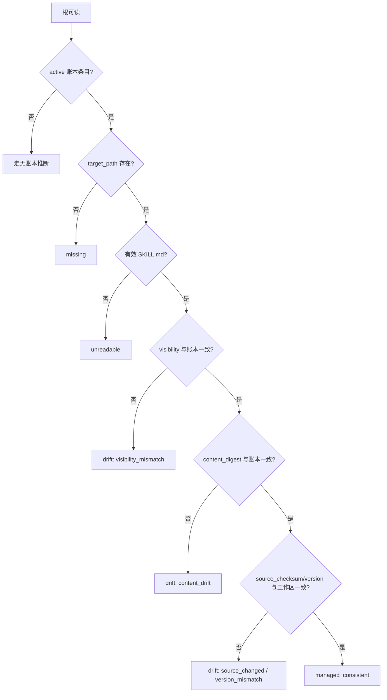
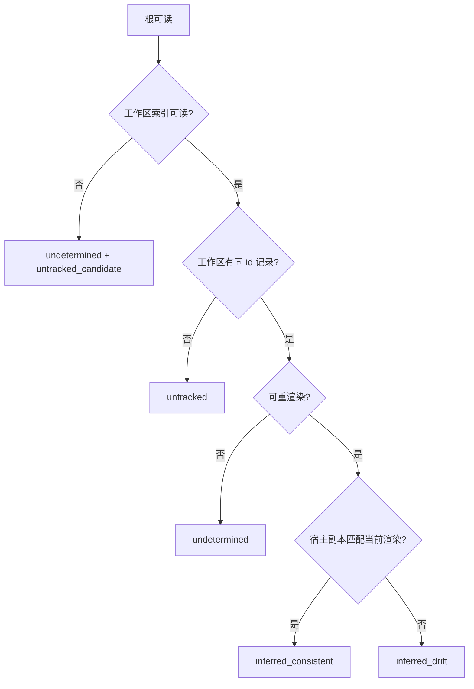

# M4c 宿主盘点设计（账本前置、宿主根目录、只读盘点与 GUI）

| 项目 | 内容 |
|---|---|
| 文档名称 | M4c 宿主盘点设计 |
| 文档路径 | `docs/design/m4c-host-inventory.md` |
| 文档状态 | **设计稿，待评审**（2026-10-18；已吸收四项需求裁决） |
| 设计依据 | 需求 9.3.7（M4c-R1 ~ R9）、9.4.7、9.5、9.6；第 10 章；`docs/research/m4c-host-inventory-2026-10-18.md`；`docs/research/maintainability-audit-2026-10-18.md` |
| 设计边界 | 只设计，不实现、不改契约、不改代码、不改 `docs/reviews/`；文中字段、结构体与流程为设计约定 |
| 关键前置 | 内置宿主 `host_landings` 账本批次；P0 结构护栏；宿主扩展点三处合一（P1-a 已完成：`adapter_forms` / `landing_roots` / 注册表） |

> 本文按「账本 → 宿主根 → 识别/去重 → 对账 → CLI/GUI → 三平台探针 → 契约/迁移」组织。所有分类都区分「账本权威」「推断」「无法判定」，不把推断写成权威结论。

---

## 0. 结论先行

### 0.1 已采纳的需求裁决

| 编号 | 裁决 | 设计落点 |
|---|---|---|
| D-01 | 补建内置宿主 `host_landings.yaml`，作为 M4c 前置独立批次；范围补上分发生命周期 | 第 2 章 |
| D-02 | `uninstall` 扩展 `--host`，清理指定宿主副本 + 账本；属契约变更 | 第 2.5 节 |
| D-03 | 历史副本（v0.3.0 及之前）无账本时只做推断纳管 / 未纳管，与权威分类显式区分 | 第 2.7、5 章 |
| D-04 | `root_role` 全量分组（user / system / platform / project）；主计数只算 user | 第 3 章 |
| D-05 | 顶层 / 递归按宿主约定；Cursor 递归，其余默认顶层；sub-skills / references / examples 不计数 | 第 3.5、4.2 节 |
| D-06 | 采用 `scan --inventory`；与 `--kind` / `--root` / `--dry-run` 互斥；未初始化工作区可运行 | 第 6 章 |
| D-07 | 三平台用 fixture 探针；真实用户目录登记待真机项，不伪造实测 | 第 8 章 |
| D-08 | P0 结构护栏全量前置；P1 只前置与 M4c 相撞的宿主三处合一与 dispatch scan 段 | 第 11 章、跨文档阶段建议 |
| D-09 | 原件卸载默认阻断未清理宿主；`--host all` 显式清理全部宿主副本 | 第 2.5.1 节 |

### 0.2 三个关键设计决定

1. **账本与插件 landings 双源并存、读取合并（推荐 v0.4.0）**：内置宿主写 `host_landings.yaml`；`x-` 宿主继续使用 `plugin_index.yaml` 的 `landings`。M4c 通过统一的 `LandingView` 读取两源。理由与迁移成本见 2.6。
2. **宿主根由注册表统一描述**：新增只读 `inventory_roots[]`（角色、基址、路径模板、发现深度、来源、消费方），与分发默认根 `landing_roots[]` 分离；形态绑定与默认根已由注册表数据驱动。该批次同时兑现 M5-R7 的「新增宿主不改内核分支」。
3. **主计数与全量展示分离**：`summary.main` 只计 `user` 角色唯一技能；`system` / `platform` / `project` 作为独立分组展示并可折叠；`untracked` 与 `undetermined` 分开，不把无工作区场景混入权威四分类。

### 0.3 不在本设计内

1. 不实现二期 `untracked` 导入 / `missing` 修复动作；只保留 UI 占位与数据结构；
2. 不验证宿主是否实际加载、不启动宿主、不执行 Skill 内容；
3. 不扫描 IDE 扩展、宿主插件缓存（包括 Codex `~/.codex/plugins/cache`）、宿主运行时；
4. 不把 `host_landings` 纳入可移植 export / import（见 2.8）；
5. 不重写 M4b 插件契约；不把 `plugin_index.landings` 强制迁移到新账本。

---

## 1. 设计范围与术语

### 1.1 范围

| 本期设计覆盖 | 不在本期 |
|---|---|
| 内置宿主账本 schema、写入/更新/删除时机、历史副本推断 | 二期导入/修复动作 |
| `uninstall --host` 契约变更与失败回滚 | 宿主运行时加载验证 |
| 宿主根目录模型、`root_role`、发现深度、共享根去重 | 第三方可加载适配器 |
| `scan --inventory` 语法、执行流程、结构化输出 | 新指令 |
| GUI 盘点视图字段与交互 | UI 大改版 / 新页面族 |
| 三平台 fixture 探针 | 真实用户目录三平台实测（待真机） |

### 1.2 术语

| 术语 | 含义 |
|---|---|
| 宿主根 | 某宿主某角色下的技能目录（或规则目录）；一个宿主可有多根 |
| `root_role` | `user` / `system` / `platform` / `project`；决定主计数与展示分组 |
| `root_origin` | `default` / `config` / `legacy` / `observed`；说明根从哪来 |
| 物理技能目录 | 解析真实路径后的技能目录身份，用于跨宿主去重 |
| 账本条目 | `host_landings.yaml` 或 `plugin_index.landings` 中的一条宿主落位记录 |
| 权威 | 有账本 + 可复现摘要/路径，可直接判定 |
| 推断 | 无账本，依据工作区记录 + 确定性重渲染推断 |
| 无法判定 | 缺工作区记录 / 缺基线 / 账本不可读，不能归入权威四分类 |
| 主计数 | `user` 角色下的唯一技能数；不是所有角色总和 |

---

## 2. 内置宿主账本设计（M4c 前置批次）

### 2.1 存放位置与文件形态

**文件**：`<workspace>/host_landings.yaml`

**理由**：

1. 与 `skill_index.yaml` 的工作区目标投影分离，避免 `targets[]` 语义污染；
2. 与 `plugin_index.yaml` 的插件账本分离，避免把内置宿主与插件宿主混成一个生命周期；
3. 原子写、独立锁、独立 schema 版本，便于后续单独演进；
4. 只记录宿主落位运行时事实，不进入元文件 / 索引声明区。

**顶层结构（设计约定）**：

```yaml
schema_version: '1'
tool_version: 0.4.0
generated_at: 2026-10-18T00:00:00Z
landings:
  - skill_id: code-review
    source_version: 1.2.0
    host_id: claude
    target_path: /home/u/.claude/skills/code-review
    format: skill
    visibility: visible
    state: active
    origin: distributed
    source_checksum: sha256:...
    content_digest: sha256:...
    adapter_ref: claude
    registry_version: '1'
    created_at: 2026-10-18T00:00:00Z
    updated_at: 2026-10-18T00:00:00Z
```

账本只记录 `host_id` 与 `target_path`。`root_role` / `root_id` 是宿主根属性，由注册表与配置在读取时判定，不固化进账本；`host_key` / `plugin_id` 只属于 `plugin_index.landings`，内置账本不出现。`target_path` 使用绝对路径，便于宿主根移动后仍可定位；输出到 GUI 时可按工作区 / 家目录做显示裁剪。

### 2.2 字段语义

| 字段 | 类型 | 必填 | 语义 |
|---|---|---|---|
| `schema_version` | 字符串 | 是 | 账本结构版本，首版 `'1'` |
| `tool_version` | 字符串 | 是 | 写入工具版本，用于诊断 |
| `generated_at` | 时间 | 是 | 最近一次账本写入时间 |
| `skill_id` | 字符串 | 是 | Skill 标识 |
| `source_version` | 字符串 | 否 | 落位时 Skill 版本，用于版本漂移解释 |
| `source_ref` | 字符串 | 否 | 落位时来源引用 |
| `host_id` | 字符串 | 是 | 内置宿主标识；不得以 `x-` 开头 |
| `target_path` | 字符串 | 是 | 实际宿主副本目录或规则文件路径（绝对路径） |
| `format` | 枚举 | 是 | `skill` / `rules`；`entry` 不落盘，不得入账本 |
| `visibility` | 枚举 | 是 | `visible` / `disabled`；`rules` 只允许 `visible` |
| `state` | 枚举 | 是 | `active` / `orphaned` |
| `origin` | 枚举 | 是 | `distributed`（本次分发写入）/ `adopted`（对既有副本首次纳管） |
| `source_checksum` | 字符串 | 是 | 落位时工作区记录的 checksum |
| `content_digest` | 字符串 | 是 | 宿主副本内容树摘要，算法见 2.3 |
| `adapter_ref` | 字符串 | 是 | 渲染使用的适配器 / 形态 |
| `registry_version` | 字符串 | 是 | 写入时的宿主注册表版本 |
| `created_at` / `updated_at` | 时间 | 是 | 首次入账 / 最近变更 |

**唯一键**：`skill_id + host_id + target_path`。同一 Skill 在同一宿主同一路径只保留一条；重复落位更新 `updated_at`、`content_digest`、`source_checksum`、`visibility`。不同宿主共享同一物理路径时按宿主各记一条；账本不去重，读取层去重。

### 2.3 `content_digest` 算法

`content_digest` 必须能区分「内容漂移」与「可见性切换」：

1. 对技能目录：
   - 递归列出目录下所有文件（不跟随符号链接）；
   - 将禁用标记 `SKILL.md.disabled` 规范化为 `SKILL.md`（规则文件 `.mdc.disabled` 规范化为 `.mdc`），避免 enable/disable 改变内容摘要；
   - 按相对路径（正斜杠、UTF-8 排序）排序；
   - 按 `kernel/core/integrity` 的同一口径，对每个文件累加「相对路径 UTF-8、一个空字节、文件字节流」，全部累加后只做一次 SHA-256；
   - 空目录 / 只有标记文件的目录仍产生稳定摘要。
2. 对规则文件：
   - 规范化禁用后缀后，按同一「相对路径 + 空字节 + 文件字节流」口径计算；
   - 若未来规则载体是多文件，按目录算法处理。
3. 不把 mtime / atime / 权限位纳入摘要；它们不能稳定表达内容。
4. `content_digest` 只覆盖宿主副本内容，不覆盖工作区原件；`source_checksum` 单独记录工作区原件摘要。

**禁止**：先逐文件求哈希、再对哈希列表求第二次聚合哈希；那是第二套算法，会导致账本与 `update --check` 的漂移判定分叉。

**比较优先级**：

1. 若 `adapter_ref` / `registry_version` 与当前不同，先按当前注册表 + 适配器重渲染；若宿主副本匹配当前预期，判一致，原因记 `render_baseline_changed`，不算漂移；
2. 否则比较 `content_digest`；不一致判 `content_drift`；
3. 再比较 `source_checksum` / `source_version`；不一致判 `source_changed` / `version_mismatch`；
4. 再比较 `visibility`；不一致判 `visibility_mismatch`。

### 2.4 写入 / 更新时机

| 命令 | 写入动作 | 顺序 / 失败口径 |
|---|---|---|
| `install --host` | 成功落位后 upsert `active`，`origin: distributed` | 先备份既有副本 → 落位 → 计算摘要 → 写账本；账本写失败则恢复备份 / 删除新副本，返回失败 |
| `update --host` | 成功重落位后更新摘要、checksum、版本、时间；保留 `created_at` | 先备份 → 重落位 → 摘要 → 写账本；失败回滚宿主副本；工作区更新按既有 lifecycle 语义 |
| `enable --host` | 成功后 `visibility: visible`；无账本时 upsert `origin: adopted` | 先改名 → 同步同一物理路径的全部活跃记录 → 账本失败则改回原文件名 |
| `disable --host` | 成功后 `visibility: disabled`；无账本时 upsert `origin: adopted` | 先改名 → 同步同一物理路径的全部活跃记录 → 账本失败则改回原文件名 |
| `uninstall --host` | 删除指定宿主副本并把账本条目标为 `orphaned`（保留审计） | 先备份 → 删除副本 → 标记账本；任一步失败回滚；共享根仍有其他活跃宿主时拒绝 |
| `uninstall <id>`（无 `--host`） | 先检查 active 宿主账本；有记录则拒绝并列出未清理宿主；无记录才按既有卸载 | 默认报 `E-LANDING-002`，提示逐宿主 `uninstall --host` 或显式 `--host all`；不得静默留下新孤儿 |
| `uninstall <id> --host all` | 显式清理该 Skill 的全部宿主副本，并把全部相关账本标为 `orphaned` | 需要确认；不改工作区原件；与 `--hard` / `--kind plugin` 互斥；共享副本只删除一次 |
| `restore` | 不写宿主账本；宿主副本保持原状 | 恢复后账本 `source_checksum` 可能过期，M4c 显示漂移 / 待重分发 |
| `scan --inventory` | **不写** | 纯只读 |

**账本与内容的一致性**：

1. 账本是审计事实，不是内容源；宿主副本内容仍是实际状态；
2. 账本写失败不回退工作区记录（既有 lifecycle 已提交），但宿主副本必须回滚到写前状态，并在输出中报告 `ledger_write_failed`；
3. 若回滚也失败，保留账本缺失 + 宿主副本，下一次盘点按推断处理，输出明确 `rollback_failed`；
4. 账本文件损坏时，分发命令在写前拒绝，避免覆盖可恢复数据；盘点将该账本下的结论标为 `insufficient`，并以 `E-LANDING-001` 报告，不虚报四分类。

**事务边界**：本批次保证「宿主副本 + 账本」相互原子；工作区中心库 / 索引仍沿用既有 lifecycle 事务。若账本写失败，宿主副本回滚、命令失败，工作区记录保留为既有语义；要实现「工作区 + 宿主 + 账本」单一事务需要更大的生命周期编排重构，列入开放点，不冒充本批次已解决。

### 2.5 `uninstall --host` 契约变更

**语法（设计）**：

```text
skill-manager uninstall <标识> --host <宿主|all> [--dry-run] [--yes]
```

**语义**：

1. 只作用于指定宿主真实根内的该 Skill 副本；不删除工作区中心库、不删除工作区目标副本、不改变索引 `status` / `targets[]`；
2. 先备份宿主副本到工作区备份载体；备份失败即中止；
3. 删除宿主副本目录（技能形态）或规则文件（规则形态）；
4. 把 `host_landings` 对应条目标为 `orphaned`（内置宿主），或把 `plugin_index.landings` 对应条目标为 `orphaned`（`x-` 宿主），保留审计轨迹；账本更新失败则恢复副本；
5. `--dry-run` 只列出将删除的宿主路径、备份位置与账本条数，不写；
6. 非交互环境必须 `--yes`；工作区外写入沿用轻确认 / 提升确认规则；
7. **确认级别为常规**（删除宿主副本），非交互必须 `--yes`；不升到强制删除档位；
8. **`--hard` 与 `--host` 互斥**：一期不做「删一个宿主副本同时删工作区原件」的歧义组合；需要清工作区时先/后执行普通 `uninstall`；
9. `--kind plugin` 与 `--host` 互斥：插件包卸载走 `uninstall --kind plugin`；`--host` 只做 Skill 副本级清理；
10. `agents-md` 等不可落盘形态返回参数类错误（没有可删除的宿主副本）。

**输出载荷（新增字段）**：

```text
data:
  host, host_root, target_path, removed, ledger_state: orphaned | none,
  backup, workspace_unchanged: true, legacy: boolean
```

**失败口径**：

| 场景 | 行为 |
|---|---|
| 宿主根缺失 / 不可读 | 不删除任何东西；账本保持 `active`；报告根不可用并返回失败；不标记 `orphaned`（可重试） |
| 副本不存在、账本 active | 把账本条目转为 `orphaned`，报告 `copy_missing`；不创建新副本 |
| 共享根仍有其他 active 宿主 | 拒绝 `E-LANDING-001`；不删除副本、不改任何宿主记录；提示使用 `--host all` |
| 副本存在、无账本（历史） | 允许删除；输出 `legacy: true`，提示这是推断副本 |
| 备份失败 | 中止，副本与账本均不变 |
| 副本删除失败 | 中止，账本不变 |
| 账本更新失败 | 从备份恢复副本，报告失败 |

#### 2.5.1 原件卸载的孤儿闭环

`uninstall <id>`（不带 `--host`）是「删除工作区原件 / 记录」的操作，不是「清理宿主副本」。既然已有账本，必须利用它防止白建：

1. 卸载前读取 `host_landings` 的 active 条目；**同时读取 `plugin_index.landings` 的 active 条目**（否则插件宿主仍会留下孤儿，闭环不完整）；
2. 若存在任一条目，默认拒绝，返回 `E-LANDING-002`，载荷列出 `host_id` / `target_path` / `ledger_source`，并提示：
   - 逐个清理：`uninstall <id> --host <host>`；
   - 一次性清理全部宿主：`uninstall <id> --host all`；
3. `--host all` 只清理全部宿主副本，并把相关账本标为 `orphaned`；工作区原件保留；之后用户可再执行 `uninstall <id> --hard`；
4. `uninstall <id> --hard` 在存在 active 宿主账本时同样拒绝；不允许「删原件同时隐式删所有宿主」的单一命令；
5. 历史无账本宿主副本无法被 `E-LANDING-002` 拦截；M4c 会以 `inferred` / `untracked` 展示，二期 cleanup / 导入再处理；
6. `--kind plugin` 仍走插件包卸载，不参与 `--host` / `--hard` 组合。
7. 原件卸载成功、且两个账本均无 active 记录后，物理清除 `host_landings` 中该 `skill_id` 的 `orphaned` 记录；`plugin_index.landings` 按 M4b 规则保留 `orphaned`。该清除是「彻底清理」的唯一边界，单宿主或 `--host all` 不删除审计记录。

**错误码**：

| 码 | 级别 | 含义 |
|---|---|---|
| `E-LANDING-001` | 错误 | 账本不可用 / schema 不兼容 / 共享根单宿主卸载冲突（写入前拒绝、盘点降级或操作拒绝） |
| `E-LANDING-002` | 错误 | 原件卸载被阻断：仍有 active 宿主副本 / 账本记录 |

`E-LANDING-002` 的 `remedy` 必须给出逐宿主与 `--host all` 两条可执行路径；不得只给「先清理」。

### 2.6 与 M4b `plugin_index.landings` 的统一 / 并存

| 方案 | 做法 | 优点 | 代价 / 风险 | 结论 |
|---|---|---|---|---|
| A 统一迁移到 `host_landings` | 插件 landings 全量迁入新账本，`plugin_index` 去掉 / 弃用 `landings` | 单一账本、单一读取模型 | `plugin_index` schema 破坏性变更；v0.3.0 工作区需迁移；插件卸载/禁用/重置路径全改；测试与备份链路大改 | **不推荐 v0.4.0** |
| B 双源并存、读取合并 | 内置写 `host_landings`；插件继续 `plugin_index.landings`；M4c 合并为 `LandingView` | 不破坏 M4b 契约；v0.3.0 无需迁移；风险局部 | 两套字段；插件账本无 `content_digest`，一致性需重渲染；长期需统一 | **推荐 v0.4.0** |
| C 双写镜像 | 每次插件落位同时写两处 | 读取简单 | 双写一致性、失败回滚、重复事实源 | **禁止** |

**推荐 B 的理由**：

1. 插件 `landings` 已随 v0.3.0 发布并有测试；迁移的收益只是「少一个文件」，但会引入破坏性 schema 变更与历史迁移；
2. M4c 的读取层可以吸收差异：内置账本有 `content_digest`，插件账本用确定性重渲染补足；
3. `uninstall --host` 对 `x-` 宿主把 `plugin_index.landings` 条目标为 `orphaned`，不需要改插件 schema；
4. 未来若要统一，另立 `plugin_index` v2 / 迁移计划；M4c 不把统一作为前置。

**技术债登记**：双源是 v0.4.0 的过渡态，不是终态。计划与 `CHANGELOG` 必须登记「两源 → 单账本统一」技术债：触发条件（plugin_index v2 / 下一次分发契约变更）、影响面（schema、迁移、备份、测试）与回滚路径；不得因为读取层合并成功就把双源写成最终架构。

**统一读取模型 `LandingView`**：

```text
LandingView:
  ledger_source: host_landings | plugin_landings | none
  skill_id, host_id, host_key?, target_path
  state: active | orphaned
  visibility: visible | disabled | unknown
  content_digest?: string          # 仅 host_landings 有
  source_checksum?: string         # 仅 host_landings 有
  source_version?: string
  adapter_ref?, registry_version?
  plugin_id?                        # 仅 plugin_landings
  origin?: distributed | adopted
```

**插件账本的权威边界**：

1. `active` + 路径不存在 → `missing` 权威；
2. `active` + 路径存在 → managed 权威；一致 / 漂移由重渲染判定，内容证据标 `inferred`；
3. `orphaned` / 插件 disabled / manifest 无效 → 非计数状态，不参与主四分类；
4. 插件账本没有 `content_digest` 时，不允许把「路径存在」直接判成「一致」。

### 2.7 历史副本推断

| 条件 | 分类 | 证据 |
|---|---|---|
| 无账本；工作区有记录；宿主副本有效；确定性重渲染匹配 | `inferred_consistent`（展示为「推断纳管」） | `inferred` |
| 无账本；工作区有记录；宿主副本有效；重渲染不匹配 | `inferred_drift` | `inferred` + 差异 |
| 无账本；工作区无记录；宿主副本有效 | `untracked` | `authoritative`（工作区可读） |
| 无账本；工作区索引缺失/不可读；宿主副本有效 | `undetermined` + `untracked_candidate` | `insufficient` |
| 无账本；工作区有记录；无宿主副本 | `not_distributed` | `insufficient`（不得判 missing） |
| 无账本；宿主副本无有效 `SKILL.md` | `unreadable` | `insufficient` |

历史副本不会在 `scan --inventory` 中被自动回填；首次 `enable/disable --host` 或后续分发可以 `origin: adopted` 入账。二期确认后的修复 / 导入可以批量纳管，但必须另行设计。

### 2.8 备份 / 导出 / 导入

| 对象 | 是否纳入 | 理由 |
|---|---|---|
| `export` / `import` | **不纳入** | 账本含本机绝对路径与宿主运行时事实，跨机器导入会产生虚假 managed / missing；导出物保持可移植 |
| 卸载备份 | **不纳入内容备份** | 卸载备份针对工作区 Skill 内容；单宿主与 `--host all` 把账本标为 `orphaned`，原件卸载成功后再清除该 Skill 的 `orphaned` 记录 |
| `restore` | **不恢复账本** | 恢复 Skill 内容不等于恢复宿主副本；账本保持现状，后续盘点显示推断 / 漂移 |
| 诊断报告 / 盘点输出 | 可包含脱敏摘要 | 用于支持，不改变可移植契约 |

**结论**：`host_landings.yaml` 是本机运行时账本，不是可移植数据；丢失可由推断重建，不能作为业务内容备份。

### 2.9 账本损坏 / 迁移

1. 账本不存在：视为空账本；M4c 全部走推断，不报整体失败；
2. 账本 YAML / schema 损坏：`scan --inventory` 报 `E-LANDING-001`（已在第七份规范与结果规范登记），对账降级为 `insufficient`；分发命令写前拒绝，避免覆盖；
3. `schema_version` 不支持：拒绝写入；盘点报告版本不兼容；
4. v0.3.0 工作区没有账本：不自动创建；下一次 `install/update/enable/disable --host` 才创建；
5. 迁移不做隐式写；需要写时由明确命令触发。

### 2.10 契约变更清单（账本批次）

| 文档 / 资产 | 变更 |
|---|---|
| `docs/specification/host-landings.spec.md` | 新增账本规范（结构、字段、算法、写入时机、状态） |
| `schemas/host_landings.schema.json` | 新增 schema |
| `docs/specification/cli-contract.md` | `uninstall --host` 语法、语义、选项、退出码；指令数仍 16 |
| `docs/specification/result-and-exit-codes.md` | `E-LANDING-001` / `E-LANDING-002` 登记 |
| `docs/specification/host-registry.spec.md` / schema | `adapter_forms` / `landing_roots` / `inventory_roots` 扩展（宿主三处合一；P1-a 已落地） |
| `docs/requirements.md` 9.3.7 | 补记账本前置与 `uninstall --host` 需求增量（按变更记录流程） |
| `kernel` / `gui` / `tests` | 实现阶段产物，不在本设计修改 |

> 账本批次是 M4c 前置，不与 M4c 扫描实现混在一个批次；它先独立接受 558 项测试与契约测试。

---

## 3. 宿主根目录与角色模型

### 3.1 根目录描述结构

> **P1-a 实现对齐（2026-10-19）**：本节字段以宿主注册表规范 3.5.1 至 3.5.3 与 `contract/src/host-roots.ts` 为准。分发默认根使用 `landing_roots[]`；盘点候选根使用 `inventory_roots[]`；字段名采用 `adapter_forms`、`depth`、`origin`、`consumed_by`。注册表条目的证据由顶层 `evidence` 承载，尚待真机确认的候选根用 `pending_verification` 标记。

注册表需要一份**只读库存根**描述，与分发默认根 `landing_roots[]` 分离：

```text
InventoryRootDefinition:
  root_id: string                 # 稳定标识，如 codex/legacy-user、doubao/platform
  role: user | system | platform | project
  origin: default | legacy       # config 仅由 selector 运行时追加
  kind: skill | rules | external
  base: home | env | workspace | absolute
  path_template: string
  env_var?: string
  platform?: any | win32 | darwin | linux
  depth: direct | recursive
  consumed_by?: string[]
  platform_notes?: string
  pending_verification?: boolean
```

`inventoryRootsForHost()` / `inventoryRootsForAll()` 把它展开为统一视图；`host.<id>.root` / `host.<id>.rules_root` 在运行时作为额外 `origin: config`、`role: user` 的根追加，不写回注册表。

**为什么单独建 `inventory_roots[]`**：

1. 现有 `roots[]` 是**分发**模板，描述「写到哪里」；
2. 库存根包含 system / platform / legacy / project 等只读或观察根，不能与可写分发根混用；
3. M4c 需要 `role`、`depth`、`origin`、`consumed_by`，这些都是宿主事实，应放在注册表；
4. 与宿主三处合一一起做，避免 M4c 再写一套 hostId 分支。

### 3.2 内置宿主根目录表（设计定稿）

| root_id | host | role | origin | 路径 | depth | consumed_by |
|---|---|---|---|---|---|---|
| `claude/user` | claude | user | default | `~/.claude/skills` | direct | claude, cursor |
| `claude/project` | claude | project | default | `<workspace>/.claude/skills` | direct | claude, cursor |
| `codex/agents-user` | codex | user | default | `~/.agents/skills` | direct | codex, cursor, dsh |
| `codex/legacy-user` | codex | user | legacy | `~/.codex/skills` | direct | codex |
| `codex/system` | codex | system | default | `~/.codex/skills/.system` | direct | codex |
| `codex/project` | codex | project | default | `<workspace>/.agents/skills` | direct | codex, cursor, dsh |
| `cursor/user-skills` | cursor | user | default | `~/.cursor/skills` | **recursive** | cursor |
| `cursor/project-skills` | cursor | project | default | `<workspace>/.cursor/skills` | **recursive** | cursor |
| `cursor/user-rules` | cursor | user | default | `~/.cursor/rules` | direct | cursor |
| `cursor/project-rules` | cursor | project | default | `<workspace>/.cursor/rules` | direct | cursor |
| `doubao/user` | doubao | user | default | `<agent workspace>/.user_skills` | direct | doubao |
| `doubao/platform` | doubao | platform | default | `<agent workspace>/.skills` | direct | doubao |
| `agents-md/project` | agents-md | project | default | `<workspace>/AGENTS.md` | direct | codex, cursor |
| `deepseek` | deepseek | — | — | 不适用，无候选根 | — | — |

说明：

1. `user` 是主计数角色；`system` / `platform` 折叠展示；`project` 单独分组；`legacy` 不是角色，Codex `.codex/skills` 的 `role=user`、`origin=legacy`；
2. `~/.codex/skills/.system` 作为独立 system 根，避免把 `.system` 当成一个无 `SKILL.md` 的坏技能；
3. 豆包 `.skills` 是平台持有、只读；`.user_skills` 是用户根；`.agents/skills` 尚无一手证据，本批不写入静态候选根；
4. `agents-md` 是规则文件载体，不作为技能根；`deepseek` 不适用；`cursor` 的规则根只作为非技能根展示；
5. 配置覆盖以 `host.<id>.root` / `host.<id>.rules_root` 追加额外 user 根（`origin=config`），不替换静态候选根；盘点读取层负责物理去重。

### 3.3 第三方 `x-` 根

1. 只取 `loadPluginCatalog()` 中 `enabled` 且 manifest 有效的插件；
2. profile 的 `roots[]` 进入统一视图；`kind=skill` 计入技能盘点，`rules` 作为非技能根展示，`entry` 不产生物理根；
3. `scope: project` → `role=project`；`scope: global` → `role=user`（通常是用户级落位根）；
4. `origin=config`（global 根必须显式配置）；
5. `depth` 默认 `direct`；插件 manifest 没有递归声明，不猜测；
6. `consumed_by` 至少包含该 `x-` 宿主自身；内置根与插件根输出同一 `InventoryRootView` 形状。

### 3.4 根状态与隔离

| 状态 | 触发 | 处理 |
|---|---|---|
| `ok` | 根存在、可读、是目录 | 扫描 |
| `empty` | 根存在、可读、无有效副本与损坏副本 | 计 0，标空 |
| `missing` | 根不存在 / 宿主未安装 | 跳过，标未安装 |
| `unreadable` | 权限 / IO / 不是目录 | 跳过，标不可读 |
| `unconfigured` | 无默认根、环境变量缺失或未配置 | 跳过，标未配置 |
| `not_applicable` | agents-md entry / deepseek 等无物理技能形态 | 不计数 |

单根失败不影响其他根；单技能失败不影响同根其他技能。插件 disabled / manifest 无效不会进入根枚举；该根不出现，不是根级读失败。

### 3.5 发现深度（宿主级规则）

| 宿主 / root | 深度 | 理由 |
|---|---|---|
| Claude user / project | direct | 注册表 `<root>/<id>/SKILL.md`；官方技能包 |
| Codex user / legacy / project | direct | 顶层技能目录；避免 `references/examples` 误计 |
| Codex system | direct | `.system` 下每个子目录一个 system 技能 |
| Cursor user / project | **recursive** | 官方明确任意层级 `.cursor/skills` 递归发现 |
| 豆包 platform / user | direct | 本机 141 个顶层技能；`sub-skills` / `references` 是资产 |
| `agentskills` | direct | 调用方指定技能根；不假设递归 |
| `x-` skill | direct（默认） | 插件 manifest 无递归声明 |
| `agents-md` | 非技能 | 规则文件 |
| `deepseek` | 不适用 | 无技能机制 |

**不计数**：`sub-skills`、`references`、`examples`、`assets` 等嵌套 `SKILL.md`；它们属于技能内部资产，除非宿主官方规则明确把它们作为独立技能（Cursor 的递归发现例外）。扫描结果可保留 `nested_skill_files` 诊断计数，但不进主计数 / 四分类。

### 3.6 主计数与展示分组

1. **主计数**：`summary.main` = `role=user` 的唯一物理技能数；
2. **全量分组**：`user` / `system` / `platform` / `project` 四组都展示；`system` / `platform` 默认折叠，标注「系统 / 平台内置」；`project` 单独展示；
3. **去重**：主计数按物理技能目录去重；同一物理技能被多个宿主消费只算一次；
4. **宿主交叉展示**：每个宿主分组仍显示该技能；`consumers` 标注消费方；
5. **不把平台技能误当用户安装**：豆包 `.skills` 141 个只进 `platform` 组，不进 `summary.main`；Codex `.system` 5 个只进 `system` 组。

### 3.7 与宿主三处合一（P1-a 已完成）

P1-a 前宿主扩展有三处分散定义：

1. `kernel/core/hosts/registry-data.ts`；
2. `kernel/core/adapters/index.ts` 的 `FORM_BY_HOST`；
3. `kernel/core/adapters/roots.ts` 的 `defaultRootFor()`。

P1-a 已完成「宿主三处合一」：

1. 注册表增加 `adapter_forms`、`landing_roots[]` 与 `inventory_roots[]`；
2. `adapter_forms` 驱动形态实现，`FORM_BY_HOST` 已删除；
3. `defaultRootFor()` 只展开 `landing_roots`，不再按 hostId 分支；
4. 新增宿主验收：只改注册表条目 + 形态实现（仅新形态时），不改 selector / dispatch。

这是 P1 中**唯一必须前置于 M4c**的拆分项；理由：M4c 的根枚举与角色模型必须复用同一宿主事实源，否则会再产生一套 hostId 分支。

---

## 4. 识别、去重与跨宿主展示

### 4.1 有效 `SKILL.md` 的三层判定

| 层 | 判据 | 失败状态 | 是否计数 |
|---|---|---|---|
| 可读 | `SKILL.md` 存在、可读、frontmatter 可解析 | `unreadable` / `invalid_yaml` | 否 |
| 宿主可识别 | 至少含字符串 `name` / `description`；宿主另有要求按注册表 | `invalid_meta` | 否 |
| 工作区元数据合格 | `skill_meta` 完整 schema | `workspace_invalid` | 只影响对账证据，不影响宿主清点 |

完整 `skill_meta` schema 不参与宿主技能计数；否则手工放入宿主的 Skill 会因为缺少 `skill_meta.yaml` 被错误排除。

### 4.2 去重键与伪代码

```text
resolveRoot(root) -> realpath(root)
scanRoot(root):
  entries = direct children (or recursive for Cursor)
  for each candidate dir:
    if candidate contains valid SKILL.md (or SKILL.md.disabled):
      physical = realpath(candidate)
      key = normalizePhysicalKey(physical, platform)
      item = { key, physical, root_id, host_id, visibility, ... }

normalizePhysicalKey(path, platform):
  p = realpath.native(path)
  if platform == 'win32' or platform == 'darwin': p = p.toLocaleLowerCase()
  return p
```

规则：

1. 不按内容哈希去重——不同技能可以内容相同；
2. 不按目录名去重——同名不同目录可能是不同技能；
3. 符号链接 / junction 解析后落在登记根之外或成环 → `unsafe_link`，不跟随；
4. 同一物理目录被多个根 / 宿主枚举到 → 只保留一个主物理条目，每个宿主视图引用它；
5. `consumers` 取注册表消费关系 + 外部消费方；外部消费方不单独作为宿主分组；
6. 目录名与 `name` 不一致：保留并标 `id_mismatch` 警告；不静默丢弃。

### 4.3 可见性

1. `SKILL.md` 存在、`SKILL.md.disabled` 不存在 → `enabled`；
2. `SKILL.md` 不存在、`SKILL.md.disabled` 存在 → `disabled`；
3. 两者都存在 / 都不存在 → `unreadable` / `invalid`；
4. 规则文件同理：`.mdc` / `.mdc.disabled`；
5. 可见性不改变内容摘要；`content_digest` 对标记文件做规范化；
6. 不假设所有宿主都用同一禁用机制；输出 `visibility` + `visibility_evidence`（`suffix` / `ledger` / `unknown`）。

### 4.4 跨宿主展示

输出模型是「物理技能 + 宿主视图」：

```text
PhysicalSkill:
  physical_key, physical_path, skill_id, version?, name?, description?
  consumers: string[]
  host_views: HostView[]

HostView:
  host_id, root_id, root_role, target_path, visibility
  reconciliation, evidence, ledger_source?
```

主计数按 `PhysicalSkill` 去重；宿主分组按 `HostView` 展示；同一技能在 Claude / Cursor 下都可见，但只算一份。

---

## 5. 对账判定

### 5.1 数据来源与权威等级

| 数据 | 来源 | managed 权威 | content 权威 |
|---|---|---|---|
| 内置宿主落位记录 | `host_landings.yaml` active 条目 | `authoritative` | `authoritative`（content_digest） |
| 插件宿主落位记录 | `plugin_index.landings` active + 插件 enabled/valid | `authoritative` | `inferred`（需重渲染；账本无摘要） |
| 工作区 Skill 记录 | `skill_index.yaml` + `skill_meta.yaml` | `inferred` | `inferred`（可做重渲染基线） |
| 宿主副本实际内容 | 文件系统读取 | 事实 | 事实 |
| 工作区索引缺失 / 不可读 | 文件系统 / 加载结果 | `insufficient` | `insufficient` |

### 5.2 有账本路径（权威）



**注意**：如果 `adapter_ref` / `registry_version` 变化，先按当前注册表重渲染；匹配则 `managed_consistent` + `render_baseline_changed`，不直接判漂移。

### 5.3 无账本路径（推断）



**无工作区路径**：只输出宿主清点 + `untracked_candidate`；四分类对账标 `undetermined`，不得把宿主技能直接判成权威未纳管 / 缺失。

### 5.4 分类定义

| 分类 | 权威条件 | managed 证据 | content 证据 | 是否计数 |
|---|---|---|---|---|
| `managed_consistent` | active 账本 + 内容/可见性/来源匹配 | `authoritative` | 内置 `authoritative` / 插件 `inferred` | 是 |
| `drift` | active 账本 + 内容/可见性/来源不匹配 | `authoritative` | 内置 `authoritative` / 插件 `inferred` | 是 |
| `untracked` | 工作区可读 + 无记录 + 无 active 账本 | `authoritative` | — | 是 |
| `missing` | active 账本 + 路径不存在 + 根可读 | `authoritative` | — | 是 |
| `inferred_consistent` | 无账本 + 工作区记录 + 重渲染匹配 | `inferred` | `inferred` | 是，但标推断 |
| `inferred_drift` | 无账本 + 工作区记录 + 重渲染不匹配 | `inferred` | `inferred` | 是，但标推断 |
| `undetermined` | 工作区不可读 / 缺基线 / 账本损坏 | `insufficient` | `insufficient` | 否（非计数状态） |
| `not_distributed` | 工作区有记录、无副本、无账本 | `insufficient` | — | 否 |
| `unreadable` | 副本存在但无效 / 不可读 | `insufficient` | — | 否 |
| `orphaned` | 账本 `orphaned` / 插件卸载 | — | — | 否 |

**关键**：`inferred_consistent` / `inferred_drift` 不是权威分类；GUI / CLI 必须显示「推断：无账本」。

### 5.5 漂移原因

| 原因 | 判据 |
|---|---|
| `content_drift` | `content_digest` / 逐文件摘要不一致 |
| `source_changed` | 工作区 checksum 与账本 `source_checksum` 不同 |
| `version_mismatch` | 工作区版本与账本 `source_version` 不同 |
| `visibility_mismatch` | 账本 `visibility` 与副本标记不同 |
| `render_baseline_changed` | adapter / registry 版本变化但当前重渲染仍匹配（不算漂移） |
| `missing` | 账本 active + 路径不存在 |
| `unreadable` | 路径存在但无有效 `SKILL.md` |

漂移输出必须带逐文件差异（内容变更 / 新增 / 删除）优先；无逐文件基线时给聚合摘要，并标 `content_evidence: aggregate`。

### 5.6 判定伪代码

```text
classify(hostView):
  if hostView.rootStatus != ok: return nonCounting(rootStatus)
  if !hostView.valid: return nonCounting('unreadable')

  if workspaceState != ok:
    return undetermined(workspace_unavailable, untracked_candidate=true)

  ledger = activeLandingFor(hostView)
  if ledger:
    if !exists(ledger.target_path): return missing(authoritative)
    if !validSkill(ledger.target_path): return unreadable()
    if ledger.visibility != observedVisibility: return drift(visibility_mismatch)
    if !digestMatches(ledger, observed): return drift(content_drift)
    if !sourceMatches(ledger, workspaceRecord): return drift(source_changed/version_mismatch)
    return managed_consistent(authoritative)

  record = workspaceRecordFor(hostView.skill_id)
  if record == null: return untracked(authoritative)
  expected = render(record, hostView.adapter)
  if expected == null: return undetermined(no_baseline)
  if treeEquals(expected, observed): return inferred_consistent(inferred)
  return inferred_drift(inferred, diff)
```

### 5.7 示例（不依赖真实宿主写入）

| 场景 | 结果 |
|---|---|
| `host_landings` active，路径存在，digest/checksum 匹配 | `managed_consistent` / authoritative |
| `host_landings` active，路径不存在 | `missing` / authoritative |
| 无账本，工作区有记录，重渲染匹配 | `inferred_consistent` / inferred |
| 无账本，工作区有记录，重渲染不匹配 | `inferred_drift` / inferred |
| 无账本，工作区无记录 | `untracked` / authoritative |
| 工作区索引缺失 | `undetermined` + `untracked_candidate` |
| 插件 landing active，路径存在，重渲染匹配 | `managed_consistent` / managed authoritative + content inferred |
| 插件 landing active，路径不存在 | `missing` / authoritative |

### 5.8 证据字段

每个条目输出：

```text
classification: managed_consistent | drift | untracked | missing |
                inferred_consistent | inferred_drift | undetermined |
                not_distributed | unreadable | orphaned
evidence:
  managed: authoritative | inferred | insufficient
  content: authoritative | inferred | insufficient
  source: authoritative | inferred | insufficient
ledger_source: host_landings | plugin_landings | none
evidence_refs:
  - host_landings:line? / plugin_index:landing_id / skill_index:record_id
  - adapter_ref, registry_version
drift_reasons: string[]
diff: [{ path, change: changed|added|removed, before, after }]
untracked_candidate: boolean
```

---

## 6. CLI 设计：`scan --inventory`

### 6.1 语法与互斥

```text
skill-manager scan --inventory [--json]
```

| 组合 | 处理 |
|---|---|
| `--inventory` + `--kind` | 拒绝，`E-INPUT-002` |
| `--inventory` + `--root` | 拒绝，`E-INPUT-002` |
| `--inventory` + `--dry-run` | 拒绝，`E-INPUT-002`（本身已只读，避免两套语义） |
| `--inventory` + `--workspace` | 允许；工作区只用于读记录，不要求已 `init` |
| `--inventory` 无 `--workspace` | 使用既有默认工作区解析；索引缺失不影响宿主清点 |

不新增指令；指令总数保持 16。

### 6.2 执行流程

```text
scanHandler(args):
  if args.options.inventory:
    return inventoryScan(args)       # 必须在索引存在性检查之前
  if args.options.kind == 'plugin':
    return pluginScan(args)
  ...既有 scan（写路径）...

inventoryScan(args):
  layout = layoutOf(workspaceRootOf(args))   # 不要求目录存在
  workspace = loadWorkspaceEvidence(layout)  # missing | unreadable | ok
  roots = enumerateInventoryRoots(hostRegistry, pluginCatalog, layout, config)
  items = []
  for root in roots:
    if root.status != ok: continue
    items += scanRootReadOnly(root)
  physical = dedupeByRealPath(items)
  classify(physical, workspace, ledgers)
  return buildResult('scan', findings, [], { data: inventoryPayload })
```

**关键**：`inventoryScan` 不得调用 `scanWorkspace()`、不得使用会创建锁文件的 `withLock`、不得写 `last_scan_at`、不得写索引 / 账本。

### 6.3 工作区状态

| 状态 | 条件 | 对账影响 |
|---|---|---|
| `ok` | `skill_index.yaml` 可读且可解析 | 可做 untracked / inferred / authoritative |
| `missing` | 索引不存在 | 不做权威四分类；输出 untracked_candidate + undetermined |
| `unreadable` | 索引存在但不可读 / 损坏 | 同上，附诊断 |

无工作区时仍输出：

1. 宿主清点（按 host / role / root）；
2. `summary.main` 的 user 角色技能数；
3. `summary.untracked_candidates` + `untracked` 候选清单；
4. 每条的 `undetermined` / `workspace_unavailable` 标记；
5. 二期导入入口（GUI 占位，不执行）。

### 6.4 结构化输出

```text
data:
  scanned_at: string
  workspace: { root, state: ok|missing|unreadable }
  summary:
    main: number                     # 仅 role=user 的唯一技能
    roles: { user, system, platform, project }
    classifications: { managed_consistent, drift, untracked, missing,
                       inferred_consistent, inferred_drift,
                       undetermined, not_distributed, unreadable, orphaned }
    untracked_candidates: number
    evidence: { authoritative, inferred, insufficient }
  roots[]:
    root_id, host_id, display_name, host_group: builtin|plugin,
    role, origin, kind, path, depth, status, consumed_by[]
  hosts[]:
    host_id, display_name, host_group, roots[], counts, items[]
  items[]:
    skill_id, name?, version?, physical_key, physical_path,
    host_id, root_id, root_role, target_path,
    visibility: visible|disabled|unknown,
    recognition: valid|invalid_meta|no_skill_file|invalid_yaml|unreadable|unsafe_link,
    classification, evidence, ledger_source,
    untracked_candidate: boolean,
    evidence_refs[], drift_reasons[], diff[], untracked_import_hint?
  excluded[]:
    kind: host|plugin|root|path, id, reason
```

**主计数**：`summary.main` 只计 `role=user` 的唯一物理技能；`summary.roles` 是四角色的分别计数；`summary.classifications` 是全部角色的分类统计，GUI 必须同时显示口径。

**不计数项**：

1. `role=system` / `platform` 的技能不进 main，但在 roles / 分组中展示；
2. `role=project` 不进 main，单独展示；
3. `undetermined` / `not_distributed` / `unreadable` / `orphaned` 不进四分类主统计；
4. `nested_skill_files` 只作诊断，不计入 items。

### 6.5 退出码与问题

| 情形 | 退出码 | 说明 |
|---|---:|---|
| 盘点成功，部分根不可读 / 未配置 | 0 | `ok: true`，问题项 / 数据状态呈现 |
| 参数互斥冲突 | 2 | 既有输入类错误 |
| `host_landings` 损坏 / 版本不受支持 / 活跃记录矛盾 | 1 | `E-LANDING-001`；仍返回宿主清点部分结果，相关对账结论标 `insufficient` |
| 工作区索引不可读 / 缺失 | 0 | `workspace.state` + `undetermined`；不伪造四分类 |
| 无法读取任何宿主根 | 0 | 返回空结果 + 全部排除原因；不伪造失败 |
| 内部异常 | 1 | 既有 IO / 未预期错误 |

问题码已由第七份规范与结果规范登记为 `E-LANDING-001` / `E-LANDING-002`；根状态仍放在数据状态中，不塞进问题码。

### 6.6 只读实现约束

允许的 fs API：`readdir` / `readdirSync`、`lstat` / `lstatSync`、`stat` / `statSync`、`realpath` / `realpathSync.native`、`readFile` / `readFileSync`、`open`（只读）。

禁止：`mkdir`、`writeFile`、`rename`、`rm`、`copyFile`、`createWriteStream`、`withLock`、任何临时文件 / 缓存 / 日志写入。

快照断言：

1. 工作区 + 所有被扫描根的递归清单（相对路径、类型、大小、SHA-256、mtime）；
2. 扫描前后完全一致；atime 不纳入；
3. 索引 / 账本 mtime 不变；无新增文件；
4. 无网络、无宿主启动。

### 6.7 性能

1. 不设持久缓存；一次盘点在内存完成；
2. 顶层枚举 + frontmatter 解析；数百技能预计 < 1 s；本机 141 + 20 项为 82 + 17 ms（调研实测）；
3. GUI 异步调用，进度 / 部分结果；
4. 单根上限定由设计实现阶段测量，不在本设计写死阈值。

---

## 7. GUI 设计

### 7.1 视图承载

新增 `hosts` 视图（`View = 'dashboard' | 'validation' | 'backup' | 'plugins' | 'settings' | 'hosts'`），复用现有页面族与组件风格；不新增页面族、不重做导航。

### 7.2 布局

```text
宿主盘点
  [主计数] 用户安装：N     [刷新]
  [角色分组]
    user      N
    system    N（折叠，系统内置）
    platform  N（折叠，平台内置）
    project   N（折叠，项目级）
  [分类]
    已纳管且一致 / 漂移 / 未纳管 / 缺失
    推断纳管 / 推断漂移 / 无法判定
  [宿主列表]
    Claude  [user]  [root 状态]  [消费方]
    Codex   [user] [system] [legacy] ...
    豆包    [user] [platform]
    x-...   [project]
  [未纳管候选]
    id / 宿主 / 路径 / 版本 / 指纹 / [导入（二期）]
  [不可读 / 不适用 / 根缺失]
```

### 7.3 交互

1. 进入视图自动触发一次 `scan --inventory`；刷新按钮显式触发；不做后台定时；
2. 主计数固定 user 角色；切换角色分组只改变展示，不改变主计数；
3. `system` / `platform` 默认折叠并标注「系统 / 平台内置」；
4. 未纳管清单显示「导入工作区（二期）」占位；一期禁用；
5. 空工作区仍展示宿主技能；若工作区索引缺失，分类区显示「无工作区无法判定」，不显示伪四分类；
6. 单宿主失败显示局部分组错误，不使整页空白；
7. 盘点期间窗口可交互；不显示任何写入 / 删除 / 启用按钮。

### 7.4 数据来源

GUI 只消费 `scan --inventory --json` 的 `data`；不自行推导分类、不去重、不读取宿主目录。

---

## 8. 三平台 CI fixture 探针

### 8.1 目标

在三平台 runner 上验证：

1. 路径解析（`join` / 大小写 / 分隔符）；
2. 根枚举与 `root_role`；
3. 顶层 vs Cursor 递归；
4. 共享根物理去重 / 消费方；
5. 四分类 / 推断 / 无法判定；
6. 只读快照。

### 8.2 fixture 设计

`scripts/probe-host-inventory.mjs`（设计名，计划阶段定）：

```text
temp/
  workspace/
    skill_index.yaml (optional)
    skills/
  host-roots/
    claude/user/...
    codex/user/...
    codex/system/...
    codex/legacy/...
    cursor/user/...
    doubao/platform/...
    doubao/user/...
    shared/agents/skills/...
    x-host/...
  plugin/...
```

通过 `config set host.<id>.root` / `plugin.<plugin_id>.<host_key>.root` 指向 fixture，不触碰真实宿主目录。共享根：让 codex/cursor 指向同一 `shared/agents/skills`，验证唯一计数与 `consumers`。

### 8.3 断言

1. 主计数只含 user 角色；
2. system / platform 不进 main，但在分组可见；
3. Cursor fixture 的嵌套技能被递归发现，其他宿主不递归；
4. 同一物理技能在多个宿主下只算一份；
5. 有账本 / 无账本 / 无工作区三类路径分类正确；
6. 扫描前后 fixture 树哈希 / 目录项 / mtime 不变；
7. 无真实 `~/.claude` / `~/.codex` / 豆包目录写入。

### 8.4 真实用户目录

macOS / Linux 真实 `~/.claude/skills`、`~/.codex/skills`、`~/.cursor/skills` 等原生布局登记为**待真机项**（EX-08 模式）：需要真实宿主安装 / 用户环境，不伪造“已实测”，不阻塞设计。

---

## 9. 契约变更与迁移

### 9.1 账本批次（M4c 前置）

| 变更 | 类型 | 影响 |
|---|---|---|
| 新增 `host-landings.spec.md` + schema | 新契约 | 内置账本 |
| `uninstall --host` | 指令选项扩展 | 契约变更；仍 16 条指令 |
| `host_registry` 可选 `adapter_forms` / `landing_roots` / `inventory_roots` | 注册表扩展 | 宿主三处合一；分发行为不变 |
| `E-LANDING-001` / `E-LANDING-002` | 问题码 | 已由 L-1 登记；001 账本 / 绑定不可用，002 原件卸载阻断 |
| 需求 9.3.7 增补 | 需求变更 | 账本前置 / uninstall --host 增量 |

### 9.2 M4c 批次

| 变更 | 类型 |
|---|---|
| `scan --inventory` | 选项扩展，仍 16 条指令 |
| 输出 `data` 结构 | 新输出形状；按结果规范登记 |
| GUI `hosts` 视图 | 视图扩展，不新增页面族 |
| 三平台 fixture 探针 | 验证脚本，不属实现交付 |

### 9.3 v0.3.0 → v0.4.0 迁移

1. 旧工作区没有 `host_landings.yaml`：不自动创建；首次分发 / 启用 / 禁用时才创建；
2. 旧宿主副本：无账本，M4c 标推断；
3. 插件 landings：不迁移，继续 `plugin_index`；
4. `export/import`：不包含账本，保持可移植；
5. 版本建议：账本 + M4c 契约变更合并为 v0.4.0；最终在计划中确认。

---

## 10. M4c 需求逐条对照

| 需求 | 设计落点 | 验收方式 |
|---|---|---|
| M4c-R1 盘点入口 / 可见结果 | 6、7 章 | 空 / 非空 / 混合夹具；CLI/GUI 一致 |
| M4c-R2 扫描范围 / 根解析 | 3 章 | 7 内置 + 2 x-；根状态逐项 |
| M4c-R3 识别 / 去重 / 跨宿主 | 4 章 | 共享根 fixture；唯一计数 / consumers |
| M4c-R4 四分类 | 5 章 | 有账本 / 无账本 / 无工作区矩阵 |
| M4c-R5 只读 | 6.6 节 | 前后树哈希 / 目录项一致 |
| M4c-R6 CLI 只读模式 | 6 章 | 互斥 / 未初始化 / 结构化输出 |
| M4c-R7 GUI | 7 章 | 角色折叠 / 主计数 / 空状态 |
| M4c-R8 插件范围 | 2.6、3.3 | 启用 / 禁用 / 卸载；rules/entry 不计数 |
| M4c-R9 二期预留 | 0.3、7.3 | 导入 / 修复无入口 |
| 账本前置（需求裁决） | 2 章 | 账本批次独立测试 |
| 三平台 fixture（需求裁决） | 8 章 | windows / ubuntu / macos CI |

---

## 11. 风险、开放点与批次依赖

### 11.1 风险

| 编号 | 风险 | 应对 |
|---|---|---|
| R-M4C-01 | 账本与内容非同一原子写 | 宿主副本备份 + 回滚；账本写失败报告；不把推断当权威 |
| R-M4C-02 | 插件 landings 无摘要，内容判定只能推断 | 重渲染 + `content_evidence: inferred`；未来统一再补摘要 |
| R-M4C-03 | 历史副本大量无账本 | `origin: adopted` / inferred；不做隐式回填 |
| R-M4C-04 | 根范围 / platform 技能被误当用户安装 | `root_role` + main 只算 user；system/platform 折叠 |
| R-M4C-05 | 递归把 references 误计 | 宿主级 depth；默认 direct |
| R-M4C-06 | 只读模式误触写路径 | 独立 `inventoryScan`；禁止 `withLock`；快照断言 |
| R-M4C-07 | 三平台真实目录未验证 | fixture CI + 真机待补项，不伪造 |
| R-M4C-08 | `uninstall --host` 语义歧义 | 只清理指定宿主副本 + 账本；`--hard` 互斥；不改工作区 |

### 11.2 开放点

| 编号 | 问题 | 建议 |
|---|---|---|
| O-M4C-01 | `E-LANDING` 两码的边界 | **已定稿（L-1）**：001 为账本 / 绑定不可用，002 为原件卸载被 active 账本阻断；见第七份规范第 8 章 |
| O-M4C-02 | 插件的 `content_digest` 是否未来补齐 | 若要统一，另立 plugin_index v2；M4c 先重渲染 |
| O-M4C-03 | `agentskills` 配置根的 role 判定（user vs project） | 按路径是否在 workspace 内决定；输出 origin=config |
| O-M4C-04 | 豆包 `.agents/skills` 是否确认 | 保持待确认；不默认扫描 |
| O-M4C-05 | `scan --inventory` 的根进度 / 取消 | 设计可选；不阻塞一期 |
| O-M4C-06 | `--host all` 对历史无账本副本的覆盖边界 | 只清账本已知副本；历史副本由 M4c inferred / untracked 展示，二期处理 |

### 11.3 批次依赖

```text
P0 结构护栏（全量）
  → 账本批次（host_landings + uninstall --host + contract）
  → 宿主三处合一 + dispatch scan 段拆分（P1 前置）
  → M4c CLI
  → M4c GUI
  → 后续 P1（lifecycle / plugins manifest）
  → P2（App.vue / e2e / 文档图）
```

---

## 12. 附录：设计示例

### 12.1 `host_landings.yaml` 最小示例

```yaml
schema_version: '1'
tool_version: 0.4.0
generated_at: 2026-10-18T00:00:00Z
landings:
  - skill_id: code-review
    source_version: 1.2.0
    host_id: codex
    target_path: /home/u/.agents/skills/code-review
    format: skill
    visibility: visible
    state: active
    origin: distributed
    source_checksum: sha256:0123456789abcdef0123456789abcdef0123456789abcdef0123456789abcdef
    content_digest: sha256:fedcba9876543210fedcba9876543210fedcba9876543210fedcba9876543210
    adapter_ref: codex
    registry_version: '1'
    created_at: 2026-10-18T00:00:00Z
    updated_at: 2026-10-18T00:00:00Z
```

### 12.2 `scan --inventory --json` 最小输出

```json
{
  "ok": true,
  "command": "scan",
  "findings": [],
  "changes": [],
  "exit_code": 0,
  "data": {
    "scanned_at": "2026-10-18T00:00:00Z",
    "workspace": { "root": "/home/u/.skill-manager", "state": "missing" },
    "summary": {
      "main": 20,
      "roles": { "user": 20, "system": 5, "platform": 141, "project": 0 },
      "classifications": {
        "managed_consistent": 0,
        "drift": 0,
        "untracked": 0,
        "missing": 0,
        "inferred_consistent": 0,
        "inferred_drift": 0,
        "undetermined": 20,
        "not_distributed": 0,
        "unreadable": 0,
        "orphaned": 0
      },
      "untracked_candidates": 20
    },
    "roots": [],
    "hosts": [],
    "items": [],
    "excluded": []
  }
}
```

### 12.3 无工作区时的行为

1. 主计数仍显示 user 角色技能数；
2. `untracked_candidate` 显示宿主技能；
3. 分类区显示「无工作区无法判定」；
4. 不显示「缺失」；
5. GUI 导入按钮为二期占位。

---

**设计结束**。本文档只定义设计，不包含实现代码；账本、契约与选项变更须先按变更记录登记，再进入实现。
