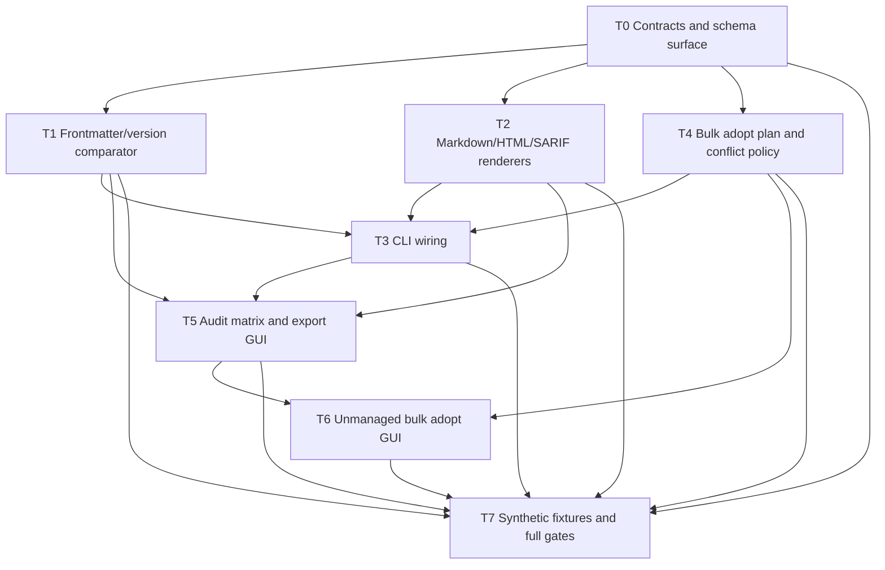

# M6 Bulk Adopt and Audit Report Export Implementation Plan

> **For agentic workers:** REQUIRED SUB-SKILL: Use superpowers:subagent-driven-development (recommended) or superpowers:executing-plans to implement this plan task-by-task. Steps use checkbox (`- [ ]`) syntax for tracking.

**Goal:** Deliver cross-host audit drift details, report export, and safe batch adoption without adding commands or weakening existing per-item transaction boundaries.

**Architecture:** Reuse M5 `ReconcileSelection` and `executeReconcilePlan`; add a thin bulk-selection/policy adapter for `reconcile --action adopt --bulk`. Keep audit comparison and report rendering as read-only/pure modules, then connect CLI and GUI presentation layers.

**Tech Stack:** TypeScript, Node.js 22, Vue 3, Electron, node:test, existing `yaml`, existing `ajv`, SARIF 2.1.0 JSON Schema, Markdown/HTML/SARIF renderers.

**Spec:** `docs/design/m6-bulk-adopt-audit-report.md`

## Global Constraints

- 指令总数保持 **17**；adopt 是 `reconcile --action adopt`，不得新增独立 `adopt` 指令。
- 8 字段 Result 封装、7 个退出码与既有 JSON 键保持不变；新增字段全部可选。
- `reconcile` 继续按 `ReconcilePlanItem` 逐项事务；单 item 失败不污染整批。
- audit 只读：除用户显式 `--output` 目标文件外，工作区、账本与宿主前后字节不变。
- `--format` 只接受 `markdown|html|sarif`；`--json` 与 `--format` 互斥。
- 报告和 CLI 固定英文；GUI 标签使用 `vue-i18n`。
- HTML 必须自包含，无外部 JS/CSS/CDN/字体；所有用户内容 HTML-escape。
- SARIF 必须能通过 2.1.0 JSON Schema 校验；artifact URI 不包含用户 home 绝对路径。
- frontmatter drift 仅在 ≥2 个可读副本组内比较；单副本不比较。
- version 取值顺序：顶层 `version` → `metadata.version` → 缺失；全部缺失只记 note。
- R22 五组合成冲突夹具必须全部覆盖。
- 文件行数/复杂度 ratchet 保持 0 超阈值；不触碰 `docs/reviews/`。

---

## 文件结构

| 文件 | 责任 |
|---|---|
| `contract/src/reconcile.ts` | bulk selection、conflict policy、adopt preview、bulk summary 类型 |
| `contract/src/host-inventory.ts` | drift subtype、frontmatter/version diff、drift 分项汇总 |
| `contract/src/audit-report.ts` | report format、metadata、document 类型 |
| `contract/src/index.ts` | 新 contract 类型出口 |
| `kernel/audit/audit-frontmatter.ts` | frontmatter 快照、组内字段与 version 比较 |
| `kernel/audit/report-render.ts` | 纯函数 markdown/html/sarif renderer |
| `kernel/audit/report-write.ts` | CLI 报告文件原子写入 |
| `kernel/dispatch/scan/audit-projection.ts` | 将比较结果投影到 audit rows/summary |
| `kernel/dispatch/scan/options.ts` | inventory format/output 参数 |
| `kernel/dispatch/scan/inventory.ts` | audit data 到 CLI presentation input |
| `kernel/dispatch/reconcile/adopt-bulk.ts` | bulk candidates、排序、limit、策略、summary |
| `kernel/dispatch/reconcile/options.ts` | bulk/role/limit/rename/force 参数校验 |
| `kernel/dispatch/reconcile/adopt-source.ts` | 单条 adopt 的 conflict policy 落地 |
| `kernel/dispatch/reconcile/plan.ts` | adopt preview 与实际目标 ID |
| `kernel/entry/cli.ts` | raw report stdout / Result mode 分流 |
| `gui/renderer/src/components/audit/AuditMatrixView.vue` | 审计矩阵、summary、状态与证据 |
| `gui/renderer/src/components/audit/AuditExportMenu.vue` | 三种格式导出菜单 |
| `gui/renderer/src/components/unmanaged/UnmanagedBulkAdoptDialog.vue` | adopt-specific 预览和三区块包装 |
| `gui/renderer/src/components/HostInventoryView.vue` | 副本/审计切换、批量成功后刷新 |
| `gui/main/inventory-export.ts` | 保存对话框、格式过滤、kernel `--output` 调用 |
| `gui/preload/index.ts` | 暴露受控的 audit-report 导出 IPC |

---

## Dependency Graph



Numeric order is not execution order: T4 must precede T3 because T3 wires the implemented bulk runtime. T1/T2 may run in parallel after T0.

---

### Task 0: Contract and Schema Surface

**Files:**
- Modify: `contract/src/host-inventory.ts`
- Modify: `contract/src/reconcile.ts`
- Create: `contract/src/audit-report.ts`
- Modify: `contract/src/index.ts`
- Modify: `docs/specification/cli-contract.md`
- Modify: `docs/specification/result-and-exit-codes.md`
- Test: `tests/contract/m6-contract-shape.test.ts`

**Interfaces:**
- Produces: `DriftSubtype`, `FrontmatterFieldDiff`, `VersionDiff`, extended `InventoryAuditRow` / `InventoryAuditSummary`.
- Produces: `AdoptConflictPolicy`, `BulkAdoptPolicy`, `AdoptPreview`, `BulkAdoptSummary`, extended `ReconcileSelection` / `ReconcilePlanSummary`.
- Produces: `AuditReportFormat`, `AuditReportMeta`, `AuditReportDocument`.

- [ ] **Step 1: Write failing contract tests**

```ts
test('M6 contract: drift detail fields are additive', () => {
  const row: InventoryAuditRow = {
    skill_id: 'demo',
    target: 'claude',
    scope: 'global',
    host_id: 'claude',
    expected_enabled: true,
    ledger_state: 'active',
    status: 'drift',
    evidence: { managed: 'authoritative', content: 'inferred', source: 'authoritative' },
    reasons: [],
    observed_at: '2026-10-23T00:00:00Z',
    drift_subtype: 'frontmatter',
    frontmatter_diffs: [
      {
        field: 'description',
        values: [
          { host_id: 'claude', root_role: 'user', copy_path: '/claude/a', value: 'one' },
          { host_id: 'codex', root_role: 'user', copy_path: '/codex/a', value: 'two' },
        ],
      },
    ],
  };
  assert.equal(row.drift_subtype, 'frontmatter');
});

test('M6 contract: bulk adopt and report types are optional/additive', () => {
  const selection: ReconcileSelection = { mode: 'batch', action: 'adopt', roots: [], apply: false, bulk: true };
  assert.equal(selection.bulk, true);
  const result: Result = { ok: true, command: 'scan', findings: [], changes: [], exit_code: 0 };
  assert.deepEqual(Object.keys(result).sort(), ['changes', 'command', 'exit_code', 'findings', 'ok']);
});
```

- [ ] **Step 2: Run the focused test and verify the missing types fail compilation**

Run: `node --test tests/contract/m6-contract-shape.test.ts`

Expected: FAIL because the M6 fields/types are not declared.

- [ ] **Step 3: Add the minimal contract types**

Add the exact optional fields from design sections 2.1–2.5. Preserve all current status values, including `unmapped` and `workspace_only`. Add `adopt_preview` to `ReconcilePlanItem`, `bulk` to `ReconcilePlanSummary`, and additive fields in `ReconcileSelection`.

- [ ] **Step 4: Register CLI contract additions without adding commands**

Document:

```text
reconcile --action adopt --bulk [--role <user|system|platform|project>] [--limit N] [--dry-run] [--rename|--force]
scan --inventory --audit --format markdown|html|sarif [--output PATH]
```

Record that `--format` and `--json` are mutually exclusive.

- [ ] **Step 5: Run contract verification**

Run: `npm run check:contract && npm run typecheck:contract && node --test tests/contract/m6-contract-shape.test.ts`

Expected: all pass; command count remains 17.

- [ ] **Step 6: Commit**

```bash
git add contract/src/host-inventory.ts contract/src/reconcile.ts contract/src/audit-report.ts contract/src/index.ts docs/specification/cli-contract.md docs/specification/result-and-exit-codes.md tests/contract/m6-contract-shape.test.ts
git commit -m "feat(contract): M6 bulk adopt and audit report types"
```

---

### Task 1: Audit Frontmatter and Version Comparator

**Files:**
- Create: `kernel/audit/audit-frontmatter.ts`
- Create: `kernel/audit/index.ts`
- Modify: `kernel/dispatch/scan/audit-projection.ts`
- Test: `tests/unit/m6-audit-frontmatter.test.ts`
- Test: `tests/e2e/m6-audit-drift.test.ts`

**Interfaces:**
- Consumes: `InventoryAuditRow`, `FrontmatterFieldDiff`, `VersionDiff`, core `readSkillFrontmatter`.
- Produces: `compareFrontmatterGroup(copies: AuditFrontmatterCopy[]): AuditFrontmatterComparison`.

```ts
interface AuditFrontmatterCopy {
  skill_id: string;
  host_id: string;
  root_role: HostRootRole;
  copy_path: string;
  frontmatter: Record<string, unknown> | null;
  unreadable_reason?: string;
}

interface AuditFrontmatterComparison {
  comparable: boolean;
  frontmatter_diffs: FrontmatterFieldDiff[];
  version_diff?: VersionDiff;
  metadata_incomplete: boolean;
}
```

- [ ] **Step 1: Write failing comparator tests**

```ts
function copy(
  host: string,
  frontmatter: Record<string, unknown> | null = { name: 'demo', description: 'demo' },
): AuditFrontmatterCopy {
  return {
    skill_id: 'demo',
    host_id: host,
    root_role: 'user',
    copy_path: `/${host}/skills/demo`,
    frontmatter,
  };
}

test('M6 drift: a single copy is never compared', () => {
  assert.equal(compareFrontmatterGroup([copy('one')]).comparable, false);
});

test('M6 drift: description differs across two copies', () => {
  const result = compareFrontmatterGroup([copy('a', { description: 'A' }), copy('b', { description: 'B' })]);
  assert.equal(result.frontmatter_diffs[0]?.field, 'description');
});

test('M6 drift: version falls back to metadata.version', () => {
  const result = compareFrontmatterGroup([copy('a', { metadata: { version: '1.0.0' } }), copy('b', { version: '1.0.0' })]);
  assert.equal(result.version_diff, undefined);
});

test('M6 drift: all missing versions produce note, not drift', () => {
  const result = compareFrontmatterGroup([copy('a'), copy('b')]);
  assert.equal(result.version_drift, false);
  assert.equal(result.metadata_incomplete, true);
});
```

- [ ] **Step 2: Run test and verify RED**

Run: `node --test tests/unit/m6-audit-frontmatter.test.ts`

Expected: FAIL because the module does not exist.

- [ ] **Step 3: Implement the pure comparator**

Implement exact normalization:

- compare `name`, `description`, `license`, `compatibility`, `allowed-tools`;
- include copy path in each value record;
- read version as top-level then `metadata.version`;
- return `comparable=false` for fewer than two readable copies;
- return `metadata_incomplete=true` when every version is missing;
- never classify a single copy as drift.

- [ ] **Step 4: Integrate subtype decisions into audit projection**

In `audit-projection.ts`, preserve existing status calculation. For `status=drift`, apply priority:

```text
checksum evidence mismatch -> checksum
checksum same + frontmatter difference -> frontmatter
checksum/frontmatter same + version difference -> version
all versions missing -> no subtype + metadata_incomplete reason
```

Add `drift_by_subtype` counts to summary.

- [ ] **Step 5: Run unit and e2e audit tests**

Run: `node --test tests/unit/m6-audit-frontmatter.test.ts tests/e2e/m6-audit-drift.test.ts`

Expected: pass for single-copy skip, each field mismatch, version fallback, all-missing note, checksum precedence, and insufficient evidence.

- [ ] **Step 6: Commit**

```bash
git add kernel/audit/audit-frontmatter.ts kernel/audit/index.ts kernel/dispatch/scan/audit-projection.ts tests/unit/m6-audit-frontmatter.test.ts tests/e2e/m6-audit-drift.test.ts
git commit -m "feat(audit): M6 frontmatter and version drift comparison"
```

---

### Task 2: Audit Report Renderers and Golden Snapshots

**Files:**
- Create: `kernel/audit/report-render.ts`
- Create: `tests/fixtures/audit-report/sample.json`
- Create: `tests/fixtures/audit-report/expected.md`
- Create: `tests/fixtures/audit-report/expected.html`
- Create: `tests/fixtures/audit-report/expected.sarif`
- Create: `tests/fixtures/sarif/sarif-2.1.0.schema.json`
- Test: `tests/unit/m6-report-render.test.ts`

**Interfaces:**
- Consumes: `InventoryAuditData`, `AuditReportMeta`, `AuditReportFormat`.
- Produces: `renderAuditReport(format, audit, meta): AuditReportDocument`.

- [ ] **Step 1: Write failing golden and SARIF schema tests**

```ts
for (const format of ['markdown', 'html', 'sarif'] as const) {
  test(`M6 report: ${format} golden output`, () => {
    assert.equal(renderAuditReport(format, sample.audit, sample.meta).content, readExpected(format));
  });
}

test('M6 report: SARIF validates against 2.1.0 schema', () => {
  const sarif = JSON.parse(renderAuditReport('sarif', sample.audit, sample.meta).content);
  assert.equal(validateSarif(sarif), true);
});

test('M6 report: HTML has no external assets or scripts', () => {
  const html = renderAuditReport('html', sample.audit, sample.meta).content;
  assert.doesNotMatch(html, /<script|<link|@import|https?:\/\//i);
});
```

- [ ] **Step 2: Run test and verify RED**

Run: `node --test tests/unit/m6-report-render.test.ts`

Expected: FAIL because renderer and fixtures do not exist.

- [ ] **Step 3: Implement the renderer**

Implement:

- Markdown overview, skill matrix, missing-by-host list, severity-sorted findings;
- HTML document with inline CSS, escaped text, no JS/CDN/fonts;
- SARIF 2.1.0 with 7 rules, stable `partialFingerprints`, sanitized artifact URIs;
- deterministic sorting and fixed English labels.

- [ ] **Step 4: Add and validate golden fixtures**

Generate the fixture with the implementation, manually review all three outputs, save them as expected files, and validate SARIF against the vendored official schema using existing `ajv`.

- [ ] **Step 5: Run renderer tests**

Run: `node --test tests/unit/m6-report-render.test.ts`

Expected: 3 snapshot checks pass; SARIF schema check passes; HTML external-resource check passes.

- [ ] **Step 6: Commit**

```bash
git add kernel/audit/report-render.ts tests/fixtures/audit-report tests/fixtures/sarif/sarif-2.1.0.schema.json tests/unit/m6-report-render.test.ts
git commit -m "feat(audit): M6 markdown html sarif report renderers"
```

---

### Task 3: CLI Wiring for Bulk Adopt and Report Export

**Files:**
- Modify: `kernel/dispatch/reconcile/options.ts`
- Modify: `kernel/dispatch/scan/options.ts`
- Modify: `kernel/dispatch/scan/inventory.ts`
- Create: `kernel/audit/report-write.ts`
- Modify: `kernel/entry/cli.ts`
- Test: `tests/e2e/m6-cli-bulk-adopt.test.ts`
- Test: `tests/e2e/m6-cli-report-output.test.ts`

**Interfaces:**
- Consumes: T2 `renderAuditReport` and T4 bulk behavior through the existing reconcile dispatch.
- Produces: CLI `reconcile --action adopt --bulk` and `scan --inventory --audit --format|--output`.

- [ ] **Step 1: Write failing CLI tests**

```ts
test('M6 CLI: reconcile bulk adopts deterministic user candidates', async () => {
  const result = await json(['reconcile', '--action', 'adopt', '--bulk', '--role', 'user', '--limit', '2', '--dry-run', '--json']);
  assert.equal(result.data.summary.bulk.candidates, 2);
  assert.equal(result.data.summary.bulk.limited, 2);
});

test('M6 CLI: rename and force are mutually exclusive', async () => {
  assert.equal((await run(['reconcile', '--action', 'adopt', '--bulk', '--rename', '--force'])).code, 2);
});

test('M6 CLI: markdown writes raw stdout without output', async () => {
  const result = await run(['scan', '--inventory', '--audit', '--format', 'markdown']);
  assert.match(result.out, /^# Skill audit/m);
});

test('M6 CLI: output writes report and returns Result envelope', async () => {
  const result = await json(['scan', '--inventory', '--audit', '--format', 'sarif', '--output', output, '--json']);
  assert.equal(result.data.report.format, 'sarif');
  assert.equal(existsSync(output), true);
});
```

- [ ] **Step 2: Run tests and verify RED**

Run: `node --test tests/e2e/m6-cli-bulk-adopt.test.ts tests/e2e/m6-cli-report-output.test.ts`

Expected: FAIL because new options are rejected or report routing is absent.

- [ ] **Step 3: Register and validate options**

Add parser/registry entries for:

```text
--bulk (boolean)
--limit (single value)
--rename (boolean)
--force (boolean)
--format (single value: markdown|html|sarif)
--output (single path)
```

Keep the command count at 17 and update `cli-contract.md`.

- [ ] **Step 4: Implement CLI presentation routing**

In `entry/cli.ts`:

- `format` + no `output`: print raw report only and return audit result exit code;
- `format` + `output`: write target atomically, then return standard Result with report metadata;
- `format` + `json`: parameter error;
- fatal report generation: write no partial file and return standard error envelope.

- [ ] **Step 5: Run CLI tests and full parser regression**

Run: `node --test tests/e2e/m6-cli-bulk-adopt.test.ts tests/e2e/m6-cli-report-output.test.ts tests/unit/parsers.test.ts`

Expected: all pass; old parser behavior unchanged.

- [ ] **Step 6: Commit**

```bash
git add kernel/dispatch/reconcile/options.ts kernel/dispatch/scan/options.ts kernel/dispatch/scan/inventory.ts kernel/audit/report-write.ts kernel/entry/cli.ts tests/e2e/m6-cli-bulk-adopt.test.ts tests/e2e/m6-cli-report-output.test.ts
git commit -m "feat(cli): M6 bulk adopt and audit report formats"
```

---

### Task 4: Bulk Adopt Selection and Conflict Policy

**Files:**
- Create: `kernel/dispatch/reconcile/adopt-bulk.ts`
- Modify: `kernel/dispatch/reconcile/adopt-source.ts`
- Modify: `kernel/dispatch/reconcile/plan.ts`
- Test: `tests/unit/m6-adopt-bulk.test.ts`
- Test: `tests/e2e/m6-adopt-bulk-conflicts.test.ts`

**Interfaces:**
- Consumes: `BulkAdoptPolicy`, `ReconcilePlanItem`, `AdoptPreview`, existing `prepareAdopt`.
- Produces: `bulkAdoptCandidates(candidates: Candidate[], policy: BulkAdoptPolicy): Candidate[]`.
- Produces: `resolveAdoptConflict(input: { requestedId: string; sourceDigest: string; index: SkillIndex; reservedIds: Set<string>; policy: AdoptConflictPolicy }): { targetId: string; conflict: AdoptPreview['conflict'] }`.
- Produces: `adopt_preview` on planned items and optional `summary.bulk`.

- [ ] **Step 1: Write the five required failing conflict scenarios**

Add these exact test names and final assertions:

| Test | Required assertion |
|---|---|
| `M6 conflict 1: same frontmatter name across hosts` | first item `succeeded`; second item `skipped` with `reason=duplicate_skill_id` |
| `M6 conflict 2: same frontmatter name across roles` | user item follows policy; system/platform item is `skipped` with `non_user_role_read_only` |
| `M6 conflict 3: workspace ID exists with identical content` | result is `skipped`; workspace bytes unchanged; reason is `same_content_existing_skill` |
| `M6 conflict 4: workspace ID exists with different content` | default result is `skipped`; reason is `different_content_existing_skill`; a later unrelated item still succeeds |
| `M6 conflict 5: rename and force boundaries` | rename resolves `-2`, force replaces only the same ID, unrelated occupied targets fail, and `--rename --force` returns input error |

Each test asserts per-item status, reason, target path, and that later items still execute.

- [ ] **Step 2: Run tests and verify RED**

Run: `node --test tests/unit/m6-adopt-bulk.test.ts tests/e2e/m6-adopt-bulk-conflicts.test.ts`

Expected: FAIL because bulk selection and policy are absent.

- [ ] **Step 3: Implement deterministic bulk candidate selection**

Filter to adoptable classifications, deduplicate physical keys, apply roles, then limit. Sort by:

```text
skill_id, host_id, root_role, physical_key
```

Default role is `user`. Explicit non-user roles are planned as skipped by the existing write guard.

- [ ] **Step 4: Implement conflict policy in the single-item adopt path**

- same ID + same content: skipped; `--rename` does not duplicate;
- same ID + different content: default skipped; rename chooses the next valid `-N`; force replaces via backup + atomic writes;
- target occupied by another Skill: failed, never overwritten;
- rename reserves IDs across the full stable batch;
- force still rejects non-user roles, shared-root violations, and unrelated path conflicts.

- [ ] **Step 5: Populate plan preview and execute through existing executor**

Fill `adopt_preview` with source path, requested/resolved ID, description, version, conflict, and policy. Do not change `executeReconcilePlan` into a batch transaction.

- [ ] **Step 6: Run bulk and conflict tests**

Run: `node --test tests/unit/m6-adopt-bulk.test.ts tests/e2e/m6-adopt-bulk-conflicts.test.ts tests/e2e/reconcile-batch.test.ts tests/e2e/reconcile-failure-matrix.test.ts`

Expected: all pass; old batch reconcile tests remain green.

- [ ] **Step 7: Commit**

```bash
git add kernel/dispatch/reconcile/adopt-bulk.ts kernel/dispatch/reconcile/adopt-source.ts kernel/dispatch/reconcile/plan.ts tests/unit/m6-adopt-bulk.test.ts tests/e2e/m6-adopt-bulk-conflicts.test.ts
git commit -m "feat(reconcile): M6 bulk adopt conflict policies"
```

---

### Task 5: Audit Matrix and Report Export GUI

**Files:**
- Create: `gui/renderer/src/components/audit/AuditMatrixView.vue`
- Create: `gui/renderer/src/components/audit/AuditExportMenu.vue`
- Modify: `gui/renderer/src/components/HostInventoryView.vue`
- Modify: `gui/main/inventory-export.ts`
- Modify: `gui/preload/index.ts`
- Modify: `gui/renderer/src/i18n/locales/en.ts`
- Modify: `gui/renderer/src/i18n/locales/zh-CN.ts`
- Test: `tests/contract/m6-audit-gui.test.ts`
- Test: `scripts/gui-smoke.mjs`

**Interfaces:**
- Consumes: T1 audit rows/summary and T3 `scan --format --output`.
- Produces: Audit tab, matrix table, export menu, report save IPC.

- [ ] **Step 1: Add failing UI/contract tests**

```ts
const view = readFileSync('gui/renderer/src/components/HostInventoryView.vue', 'utf8');
const matrix = readFileSync('gui/renderer/src/components/audit/AuditMatrixView.vue', 'utf8');
const exportMenu = readFileSync('gui/renderer/src/components/audit/AuditExportMenu.vue', 'utf8');
const exportHandler = readFileSync('gui/main/inventory-export.ts', 'utf8');
assert.match(view, /scan', '--inventory', '--audit'/);
assert.match(view, /<AuditMatrixView/);
assert.match(matrix, /drift_by_subtype/);
assert.match(exportMenu, /markdown/);
assert.match(exportMenu, /html/);
assert.match(exportMenu, /sarif/);
assert.match(exportHandler, /--format/);
assert.match(exportHandler, /--output/);
```

Also extend GUI smoke fixture with audit rows containing all three drift subtypes and a saved/canceled export.

- [ ] **Step 2: Run focused tests and verify RED**

Run: `node --test tests/contract/m6-audit-gui.test.ts`

Expected: FAIL because view and export controls are absent.

- [ ] **Step 3: Implement AuditMatrixView**

Render summary counters, skill × host matrix, subtype badges, host-missing list, reasons/evidence, and empty/loading/error states. Add i18n keys in both locales.

- [ ] **Step 4: Implement export path**

`AuditExportMenu` emits one of three formats. Main process shows save dialog with format filter and invokes:

```text
scan --inventory --audit --format <fmt> --output <path> --json
```

The renderer receives `{ canceled, path?, error? }` and never constructs filesystem paths.

- [ ] **Step 5: Run GUI contract and smoke tests**

Run: `node scripts/gui-smoke.mjs`

Expected: existing 88 checks plus audit matrix, 3-format menu, save success/cancel/error checks pass; en/zh-CN key parity remains exact.

- [ ] **Step 6: Commit**

```bash
git add gui/renderer/src/components/audit gui/renderer/src/components/HostInventoryView.vue gui/main/inventory-export.ts gui/preload/index.ts gui/renderer/src/i18n/locales tests/contract/m6-audit-gui.test.ts scripts/gui-smoke.mjs
git commit -m "feat(gui): M6 audit matrix and report export"
```

---

### Task 6: Unmanaged Bulk Adopt GUI

**Files:**
- Create: `gui/renderer/src/components/unmanaged/UnmanagedBulkAdoptDialog.vue`
- Modify: `gui/renderer/src/components/HostInventoryView.vue`
- Modify: `gui/renderer/src/i18n/locales/en.ts`
- Modify: `gui/renderer/src/i18n/locales/zh-CN.ts`
- Test: `tests/contract/m6-unmanaged-adopt-ui.test.ts`
- Test: `scripts/gui-smoke.mjs`

**Interfaces:**
- Consumes: T4 conflict/plan behavior, T5 audit matrix tab, existing `InventoryActionDialog`.
- Produces: adopt-specific wrapper with policy explanation, progress, summary, and audit refresh.

- [ ] **Step 1: Add failing GUI smoke checks**

```ts
check(
  '未纳管批量采纳入口复用选择栏',
  (await evaluate("document.querySelector('[data-testid=\"batch-action-adopt\"]') !== null")) === true,
);
check(
  '采纳预览展示源/目标/frontmatter/冲突',
  await waitFor(
    "['源路径','目标','frontmatter','冲突'].every((text) => document.querySelector('[data-testid=\"inventory-action-dialog\"]')?.innerText.includes(text))",
  ),
);
check(
  '冲突项失败不阻断后续采纳',
  (await evaluate("document.querySelector('[data-testid=\"batch-summary\"]')?.innerText.includes('失败 1')")) === true,
);
check(
  '批量采纳后切到审计视图',
  (await evaluate("document.querySelector('[data-testid=\"audit-matrix\"]') !== null")) === true,
);
```

- [ ] **Step 2: Run smoke target and verify RED**

Run: `node scripts/gui-smoke.mjs`

Expected: FAIL at the new unmanaged bulk adopt checks.

- [ ] **Step 3: Implement the wrapper without duplicating execution logic**

`UnmanagedBulkAdoptDialog` owns only adopt labels, conflict-policy display, selected-target summaries, and the post-success audit refresh event. It reuses `InventoryActionDialog` for one preview and per-item apply/progress/cancel/summary.

- [ ] **Step 4: Wire audit refresh**

When at least one item succeeds, call `scan --inventory --audit` and switch `HostInventoryView` to the audit tab. Preserve failed/skipped details until the user closes the dialog.

- [ ] **Step 5: Run GUI smoke**

Run: `node scripts/gui-smoke.mjs`

Expected: complete pass, including cancel boundary, non-user checkbox disabled, and en/zh-CN parity.

- [ ] **Step 6: Commit**

```bash
git add gui/renderer/src/components/unmanaged gui/renderer/src/components/HostInventoryView.vue gui/renderer/src/i18n/locales tests/contract/m6-unmanaged-adopt-ui.test.ts scripts/gui-smoke.mjs
git commit -m "feat(gui): M6 unmanaged bulk adopt flow"
```

---

### Task 7: Synthetic Fixture Matrix and Full Gates

**Files:**
- Create: `tests/helpers/m6-fixtures.ts`
- Test: `tests/e2e/m6-adopt-bulk-conflicts.test.ts`
- Test: `tests/unit/m6-report-render.test.ts`
- Test: `tests/e2e/m6-cli-report-output.test.ts`
- Modify: `scripts/gui-smoke.mjs`
- Modify: `scripts/gui-smoke-fixtures.mjs`

**Interfaces:**
- Consumes: all T0–T6 outputs.
- Produces: reusable M6 fixture builders and final acceptance evidence.

- [ ] **Step 1: Centralize the five conflict fixtures**

Create helper builders for:

```text
same-name-cross-host
same-name-cross-role
existing-same-content
existing-different-content
rename-or-force-boundary
```

Each builder writes real `SKILL.md` files and must be usable by unit and e2e tests.

- [ ] **Step 2: Add report hard-gate assertions**

Run each format against the same audit fixture and assert:

- Markdown/HTML/SARIF golden snapshots match;
- SARIF parses and passes the vendored schema;
- HTML contains no external script/style/CDN/font reference;
- report metadata has no absolute `C:\Users\<name>` or `/home/<name>` path;
- audit snapshot bytes are unchanged except the explicit output file.

- [ ] **Step 3: Run cross-surface acceptance tests**

Run:

```bash
node --test tests/unit/m6-audit-frontmatter.test.ts tests/unit/m6-report-render.test.ts tests/unit/m6-adopt-bulk.test.ts tests/e2e/m6-cli-bulk-adopt.test.ts tests/e2e/m6-cli-report-output.test.ts tests/e2e/m6-adopt-bulk-conflicts.test.ts tests/e2e/m6-audit-drift.test.ts
node scripts/gui-smoke.mjs
```

Expected: all M6 tests pass; SARIF schema passes; five conflict fixtures pass; GUI audit/export/bulk checks pass.

- [ ] **Step 4: Run full repository gates**

Run:

```bash
npm run check
npm run lint
npm run typecheck
npm run format:check
npm test
npm run build
```

Expected: all exit 0; command count still 17; existing tests do not regress; complexity and file-size ratchet have 0 new violations.

- [ ] **Step 5: Verify worktree and rollback artifacts**

Run: `git status --short && git diff --check`

Expected: only intended files; no temp report files, audit caches, or fixture residue.

- [ ] **Step 6: Commit**

```bash
git add tests/helpers tests/e2e tests/unit scripts/gui-smoke.mjs scripts/gui-smoke-fixtures.mjs
git commit -m "test(m6): close adopt conflicts and report acceptance"
```

---

## Requirement Coverage

| Requirement | Planned tasks |
|---|---|
| R20 | T5, T6 |
| R21 | T0 `adopt_preview`, T4, T6 |
| R22 | T0 policy types, T4, T7 |
| R23 | T4; executor behavior from M5 |
| R24 | T4 through existing adopt-source |
| R25 | T5, T6 |
| R26 | T0, T3, T4 |
| R27 | T2, T3 |
| R28 | T2, T3 |
| R29 | T2, T3, T7 |
| R30 | T2, T3, T7 |
| R31 | T3, T5 |
| R32 | T1, T2, T5 |
| R33 | T1, T2, T5 |
| R34 | T0, T1, T5 |
| R35 | T0, T3, T7 |

## Review Gates

1. T0 reviewer verifies only additive contract fields and command count 17.
2. T1 reviewer verifies single-copy no-drift and version fallback.
3. T2 reviewer verifies three golden outputs and SARIF schema validation.
4. T4 reviewer verifies all five conflict fixtures and unchanged per-item transaction.
5. T3 reviewer verifies raw-vs-Result output modes and no partial file.
6. T5/T6 reviewer verifies GUI i18n parity and audit read-only snapshot.
7. T7 reviewer runs the full gates and confirms 0 new complexity/size violations.
