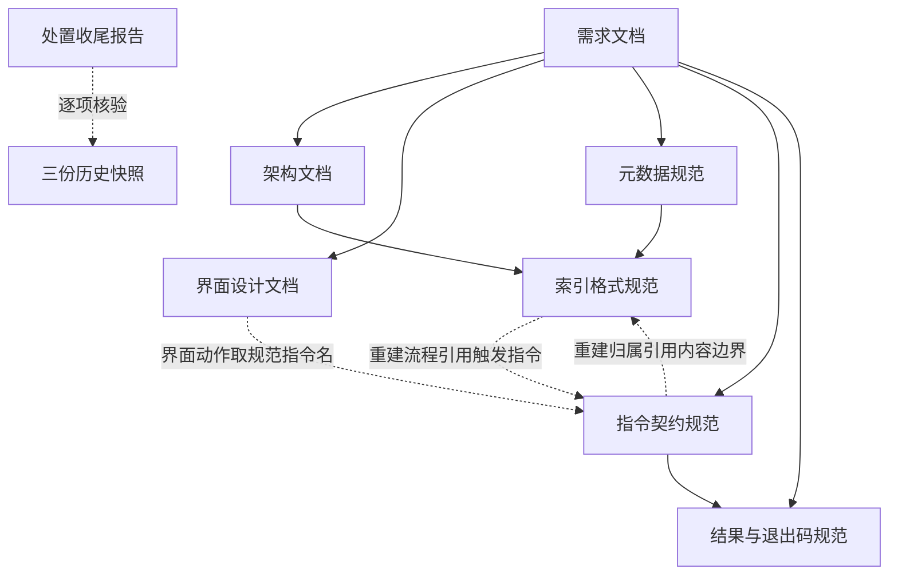

# skill-manager 项目文档阶段小结

| 项目 | 内容 |
|---|---|
| 文档名称 | 项目文档阶段小结 |
| 文档路径 | `docs/reviews/2026-10-13-documentation-milestone.md` |
| 出具日期 | 2026-10-13 |
| 当前阶段 | 一期，文档阶段已完备，尚未进入实现阶段 |
| 文档总量 | 11 份，合计 7738 行 |
| 结论 | 文档体系可支撑进入实现阶段；有 **4 项决策待确认** 与 **2 项内容待补充**，其中 1 项建议在冻结前处理 |

> 本小结只做梳理与状态记录，不改动任何既有文档，也不包含实现代码。

---

## 1. 小结目的

本文档回答三个问题：当前有哪些文档、各自承担什么职责；哪些内容已经冻结、哪些还开着；进入实现阶段之前还需要确认什么。

---

## 2. 文档清单与职责

### 2.1 基线文档

| 文档 | 行数 | 职责 | 状态 |
|---|---|---|---|
| [`docs/requirements.md`](../requirements.md) | 1104 | 需求基线。功能需求 FR-01 至 FR-12、指令清单、数据模型需求、非功能需求、边界与排除项 | 待评审 |
| [`docs/architecture.md`](../architecture.md) | 1216 | 架构基线。四层架构、模块划分与越权规则、数据流、目录规划、通信与打包方案、扩展预留 | 待评审 |
| [`docs/ui-design.md`](../ui-design.md) | 882 | 界面基线。信息架构、页面原型、组件清单、视觉与交互规范、一期范围 | 一期设计稿，待评审 |

### 2.2 契约规范

| 文档 | 行数 | 职责 | 版本 |
|---|---|---|---|
| [`docs/specification/skill-meta-spec.md`](../specification/skill-meta-spec.md) | 602 | 元数据契约。标识、时间、哈希与 YAML 四类基础规则，元文件与索引的字段定义，六类校验规则 | 1 |
| [`docs/specification/index-format.md`](../specification/index-format.md) | 303 | 索引文件级契约。位置、结构不变量、写入时机、投影规则、一致性校验、重建与迁移 | 1 |
| [`docs/specification/cli-contract.md`](../specification/cli-contract.md) | 614 | 指令契约。十五条指令的语法、参数、行为、输出载荷与确认级别 | 1 |
| [`docs/specification/result-and-exit-codes.md`](../specification/result-and-exit-codes.md) | 373 | 返回契约。结果封装结构、三十九个问题码、退出码取值与派生规则 | 1 |

### 2.3 历史记录与核对报告

| 文档 | 行数 | 性质 | 是否可变 |
|---|---|---|---|
| [`docs/research/skill-plugin-manager-research.md`](../research/skill-plugin-manager-research.md) | 1863 | 同类项目调研（2026-10-12） | 否，快照 |
| [`docs/reviews/2026-10-12-requirements-review.md`](2026-10-12-requirements-review.md) | 329 | 需求文档评审，登记 47 项问题 | 否，快照 |
| [`docs/reviews/2026-10-13-consistency-check.md`](2026-10-13-consistency-check.md) | 226 | 全库一致性核对，登记 10 项 | 否，快照 |
| [`docs/reviews/2026-10-13-remediation-summary.md`](2026-10-13-remediation-summary.md) | 226 | 处置收尾报告，含补记与未关闭清单 | 是，以补记承接 |

---

## 3. 文档关系

实线为内容派生关系，虚线为交叉引用关系。需求文档是全部活文档的源头；架构文档补充索引的文件级约定；界面设计文档与指令契约规范之间以指令名为唯一连接点。

---

## 4. 已关闭项汇总

### 4.1 需求文档评审（2026-10-12 快照）

登记 47 项，其中 6 项为 P0。**逐项对照表尚未产出**，详见 7.3 节。

### 4.2 全库一致性核对（2026-10-13 快照）

| 分类 | 数量 | 状态 |
|---|---|---|
| 冲突与缺口 C-01 至 C-06 | 6 | 全部关闭 |
| 完善性建议 N-01 至 N-04 | 4 | 全部关闭 |

### 4.3 处置收尾时新发现项

| 编号 | 内容 | 状态 |
|---|---|---|
| R-01 | 索引重建的指令归属未在契约侧闭合 | 已关闭，见收尾报告补记一 |
| R-02 | 原型草图某一行显示宽度不一致 | 未处置，外观瑕疵 |
| R-03 | 使用说明与模式文件两处计划内待补充 | 计划内保留 |
| R-04 | 追溯映射与修订记录的位置差异 | 已接受的差异 |
| R-05 | 索引重建的双向引用需同步维护 | 新增提示项 |

### 4.4 已冻结的关键约定

下列约定已在多份文档间对齐并经过一致性核对，视为稳定：一期功能范围 FR-01 至 FR-12；十五条指令及其规范名；结果封装与退出码 0 至 6；问题码三段式与三十九个登记码；工作区目录布局与索引、元文件的命名；索引的记录区与配置区重建语义；状态取值及其中英对照的单一出处。

---

## 5. 待补充内容

| 项 | 位置 | 说明 |
|---|---|---|
| 使用说明 | 需求文档附录 C 登记为待补充 | 面向使用者的操作指引，属计划内交付物 |
| 模式文件 | 架构文档 4.1 仓库树中的 `schemas/` | 四份 JSON Schema，供外部校验与编辑器提示使用，属实现阶段交付物 |

上述两项均已在文档中如实标注为待补充或规划状态，不属于遗漏。

---

## 6. 待确认决策

| 编号 | 决策点 | 当前状态 | 影响 |
|---|---|---|---|
| AD-07 | 界面构建工具选型 | 架构文档建议采用 Vite，必要时配合 electron-vite，标注为待确认 | 影响渲染层构建流水线 |
| AD-08 | 桌面打包工具选型 | 架构文档建议采用 electron-builder，标注为待确认 | 影响三类桌面产物的打包与签名流程 |
| AD-09 | 内核分发形态 | 架构文档按内核实现语言的三种情形分别定义，标注为待确认，依赖内核技术选型 | 影响主进程与内核的调用方式 |
| 技术选型 | 内核实现语言未锁定 | 架构文档在仓库树与打包章节两处明确留白，声明目录职责与分层不受语言选择影响 | 影响 AD-09、依赖清单与构建脚本 |

前两项与第四项互相耦合：内核语言确定后，AD-09 才能定；内核形态确定后，打包流水线的产物布局才能定。

---

## 7. 进入实现阶段前建议处理的事项

### 7.1 正式宣布一期冻结

需求文档末尾声明「一期功能清单在进入实现阶段后冻结，后续变更需先更新本文档再实施」，但冻结动作本身尚未施行。建议在开工前完成一次确认，把 FR-01 至 FR-12 与十五条指令正式标记为冻结状态。

### 7.2 补齐内核技术选型

这是当前唯一会同时影响架构、契约与构建的未决项。它不改变任何已定契约的形式，但决定 AD-09 的落点与 `schemas/` 的产出方式。

### 7.3 补一份需求评审 47 项的逐项对照表

2026-10-12 的需求评审登记了 47 项问题并给出「不通过，需修订后复审」的结论。此后各批次修订中，部分问题已随之消解，但**没有任何文档记录这 47 项各自的当前状态**。一致性核对覆盖的是跨文档口径，不等于对那 47 项的复审。

抽查显示至少下列两项仍未见闭合：

| 原编号 | 内容 | 现状 |
|---|---|---|
| AMB-01（P0） | 禁用缺少可验收的效果标准 | 需求文档已要求落位处理必须是宿主可识别的做法，但验收标准仍只检查索引状态与文件存在，未增加任何验证「宿主确实不再视为可用」的条目 |
| CON-04（P1） | 记录失效缺少承载机制 | 需求文档要求把磁盘上消失的记录「标记为失效」，但元数据规范与索引格式规范的状态取值只有启用与禁用；规范把失效处理为校验时检测的结论并给出问题码，界面则把它呈现为第三种卡片状态。三处对「失效是存储状态还是检测结论」的理解不一致 |

建议在冻结前做一次逐项复核，产出一份对照表，明确每项为已闭合、部分闭合或转为遗留。这既是复审结论的落地，也避免实现阶段被中途翻旧账。

### 7.4 两处表述的可选优化

R-02 的原型草图对齐与 R-04 的章节位置差异均不影响实现，可在后续修订中顺手处理，不构成开工前置条件。

---

## 8. 建议的下一步

| 顺序 | 动作 | 理由 |
|---|---|---|
| 1 | 确定内核实现语言与技术栈 | 唯一阻塞架构落地的未决项，且决定打包与分发形态 |
| 2 | 补需求评审 47 项的逐项对照表 | 冻结前的最后一次内容体检，避免开工后翻旧账 |
| 3 | 完成一期冻结确认 | 冻结后才能把变更成本转移到实现阶段 |
| 4 | 确认 AD-07 与 AD-08 的打包选型 | 可在实现期间并行推进，不阻塞内核开发 |
| 5 | 产出 `schemas/` 与使用说明 | 实现阶段的交付物，随实现推进补齐 |

---

**报告结束。** 本报告只做文档状态梳理，不修改任何既有文档，也不包含实现代码。
