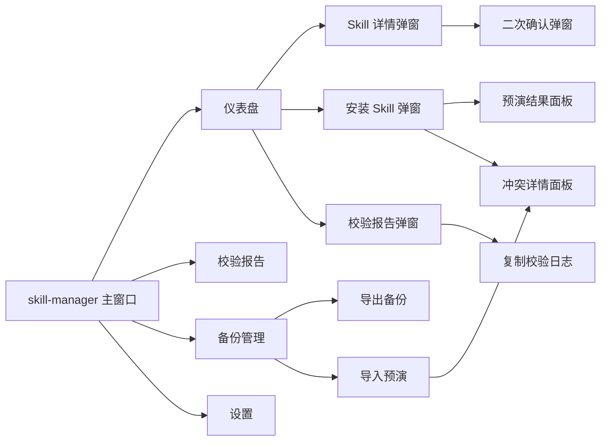
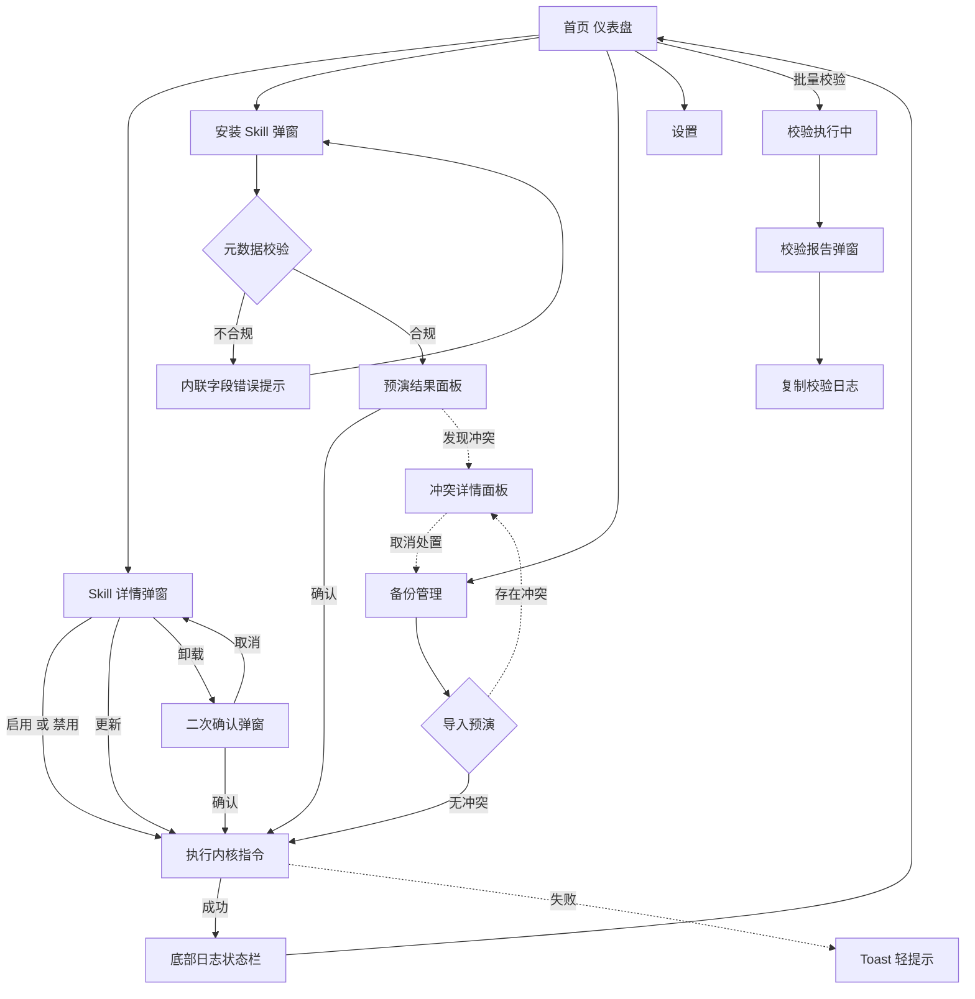
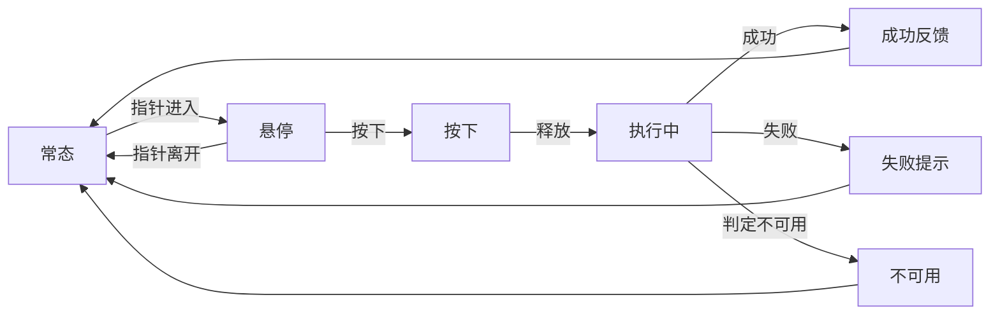

# skill-manager UI/UX 设计文档

| 项目 | 内容 |
|---|---|
| 文档名称 | skill-manager 界面与体验设计文档 |
| 文档路径 | `docs/ui-design.md` |
| 产品形态 | Electron 桌面管理端 |
| 主题强调色 | 香槟金 `#D7B979` |
| 视觉基调 | 低饱和中性色为主，香槟金作点缀 |
| 上游需求 | [`docs/requirements.md`](requirements.md) |
| 上游架构 | [`docs/architecture.md`](architecture.md) |
| 文档状态 | 一期设计稿，待评审 |

> 本文档只描述界面结构、交互流程、视觉规范与原型草图，**不包含任何前端代码**。文中出现的颜色值、字号、间距均为设计规范定义。

---

## 0. 文档说明

### 0.1 设计边界

界面层是可视化外壳，只负责三件事：**呈现状态、收集操作意图、展示结果**。

| 约束 | 说明 |
|---|---|
| 不判断业务规则 | 按钮是否可点、卡片是否置灰、操作是否允许，一律依据内核返回的判定结果，界面不自行推断 |
| 不做数据加工 | 校验结论、依赖满足情况、冲突检测结果、内容指纹比对结果均来自内核，界面只做分组与排序 |
| 不触碰文件系统 | 所有涉及路径的操作由内核完成，界面上的路径选择通过系统原生文件选择器取得 |
| 不产生第二份逻辑 | 界面上的一切操作最终都落到一条既有指令上，界面不新增任何指令 |

### 0.2 界面与内核指令的对应关系

界面上的每一个动作都对应一条内核指令，这是界面与内核之间唯一的连接方式。

| 界面动作 | 对应内核指令 |
|---|---|
| 建立工作区（首次启动引导） | `init` |
| 设置页读取与修改配置 | `config get`、`config set` |
| 首页列表加载 | `list` |
| Skill 详情弹窗 | `inspect` |
| 安装 Skill | `install` |
| 启用 / 禁用 | `enable`、`disable` |
| 更新 | `update` |
| 卸载 | `uninstall` |
| 批量校验、校验报告 | `validate` |
| 详情弹窗内的依赖检查展示 | `deps` |
| 导出备份 / 导入备份 | `export`、`import` |
| 扫描当前环境、重建索引 | `scan` |
| 底部日志栏 | 各指令返回的结果封装，不是一条独立指令 |

上表覆盖指令契约规范的全部十五条指令，指令名与命令行完全一致，界面不做映射或改写。界面上的纯视图动作不属于本表范围，例如复制校验日志、展开与折叠分组、切换状态过滤条件，这些动作不调用内核。

### 0.3 与工作区目录约定的关系

界面不直接读写工作区，但需要在若干位置正确呈现工作区的目录约定。目录约定的正式定义见需求文档第 4.3 节与索引格式规范。

| 界面位置 | 涉及的工作区条目 | 界面职责 |
|---|---|---|
| 设置页 | 索引文件 `skill_index.yaml`、Skill 目录 `skills/` | 展示工作区路径；修改配置必须经 `config set`，界面不得直接改写索引 |
| 详情弹窗 | 中心库 `skills/` 下该 Skill 的独占目录，以及各落位目标的路径 | 展示路径，不写入；内容与状态均通过 `inspect` 取得 |
| 卸载二次确认 | `skills/` 与备份目录 `backups/` | 展示将被移除的路径，并说明中心库原件保留与备份位置 |
| 底部日志栏 | 日志目录 `logs/` | 呈现结果封装中的记录；完整日志留在日志目录，不在界面内持久化 |
| 校验报告 | 索引文件与各 Skill 的元文件 | 呈现问题码与修复建议；不得自行修复任何文件 |

---

## 1. 项目 UI 设计概述

### 1.1 设计定位

skill-manager 是一款**工具类桌面管理端**，服务于开发者的日常资产盘点与环境维护。它的设计定位可以概括为三句话：

1. **工程感优先**：界面气质接近开发者熟悉的包管理器与构建工具界面——信息密度高、层级克制、不喧宾夺主；
2. **简约专业，不花哨**：不使用大面积渐变、不使用装饰性插画、不使用夸张动效，视觉重心始终落在状态与数据上；
3. **克制中的精致**：以香槟金作为唯一的强调色，在关键操作、激活态与品牌标识上使用，让工具界面具备可被记住的质感。

### 1.2 设计目标

| 目标 | 具体衡量方式 |
|---|---|
| 降低操作成本 | 高频动作（查看、启用、禁用）在首页一次点击内可达，无需进入多级页面 |
| 状态一眼可读 | Skill 的启用状态、校验健康度、最近变更，在列表层即可判断，不依赖进入详情 |
| 校验信息可行动 | 每条警告与错误都附带问题码与可直接执行的修复建议，而不是只给一句错误描述 |
| 告警不打扰 | 轻提示与重告警分级呈现，避免每次操作都打断用户 |
| 长时使用不疲劳 | 低饱和中性色系、低对比阴影、稳定的间距节奏，适合长时间盯屏 |
| 单套界面适配桌面窗口 | 一套布局覆盖从最小窗口到全屏的宽度区间，不做移动端适配 |

### 1.3 设计理念

**信息优先。** 界面的第一职责是把「当前环境里有什么、处于什么状态、有没有问题」讲清楚。所有视觉决策都从属于这个目标：能用文字与状态标签表达的，不用图标暗示；能用对齐与留白分组的，不用分隔装饰。

**香槟金只做点缀。** 香槟金 `#D7B979` 是全篇唯一的强调色，但它的使用面积受到严格限制：仅用于品牌标识、当前导航项、主操作按钮、聚焦描边与关键数据强调。它**不作为正文文字颜色**——香槟金与浅色背景的对比度不足以承载长文本阅读，这一点在视觉规范中有明确约束。

**中性色承担主体。** 背景、卡片、分割线、正文全部使用低饱和的暖调中性色。暖调是为了与香槟金形成同族关系，避免金色显得突兀；低饱和是为了降低长时间查看的视觉疲劳。

### 1.4 设计原则

| 原则 | 落地方式 |
|---|---|
| 状态先于操作 | 卡片上先呈现状态标签与健康度，再呈现操作入口 |
| 危险操作不可逆推 | 卸载等高危动作必须二次确认，且确认文案写明具体影响范围 |
| 结果永远可追溯 | 每次操作的结果都进入底部日志栏，最近一次动作始终可见 |
| 空态与异常态同等对待 | 每个页面都设计空态、加载态、错误态三套呈现 |
| 密度可调但默认紧凑 | 默认使用紧凑卡片，保证一屏内可见尽量多的 Skill |

---

## 2. 用户角色与使用场景

### 2.1 目标用户

| 角色 | 特征 | 核心诉求 |
|---|---|---|
| **开发者（主要）** | 同时使用多套编码工具，环境里装着几十个 Skill，来源混杂 | 快速看清装了哪些、哪些重复、哪些该关掉；操作可预期、可回退 |
| **Skill 创作者（次要）** | 自己开发 Skill，需要反复安装、校验、更新、对比 | 校验反馈足够具体，能直接定位到字段；更新前能看清差异 |
| **团队维护者（延伸）** | 为团队维护一套共享 Skill 集合 | 备份导出导入可靠，冲突与覆盖有明确提示 |

### 2.2 高频使用场景

#### 场景一：摸清家底

开发者换了新机器，或者接手了同事的环境。打开 skill-manager，首页直接列出全部已管理 Skill，并能看到每个 Skill 的来源类型与状态。他不需要逐个翻找隐藏目录，也不需要记住各个工具各自的 Skill 路径。

**关键设计支撑**：首页列表的信息密度、来源类型标签、按状态与来源过滤。

#### 场景二：临时关掉一个 Skill

某个 Skill 在某些任务里会干扰输出。开发者想要临时关掉它，但不希望删除文件、丢掉来源信息。他在首页找到该卡片，点开详情，点「禁用」。卡片变为降低透明度的禁用态，底部日志栏出现一条成功记录。之后想恢复时，同样的路径点「启用」即可。

**关键设计支撑**：详情弹窗的操作按钮组、禁用态的视觉区分、状态变更后的局部刷新与日志反馈。

#### 场景三：安装新 Skill 并立刻发现格式问题

开发者拿到一个 Skill 目录，或者一份元数据文件。他点顶部「安装 Skill」，选择本地目录或导入元数据文件，表单在输入过程中就实时校验元数据是否合规。若有字段不合规，错误直接内联在对应输入项下方，并给出具体的字段名与期望格式，而不是等到提交后才报错。

**关键设计支撑**：安装弹窗的双入口、实时校验、内联错误提示。

#### 场景四：批量体检

环境运行一段时间后，开发者想确认所有 Skill 是否仍然健康。他点顶部「批量校验」，等待完成后自动打开校验报告弹窗，看到「正常 / 警告 / 错误」三类分组统计，展开具体条目，每条都有问题码与修复建议，可以一键复制整份报告日志发给同事。

**关键设计支撑**：批量校验入口、报告弹窗的归类与统计、复制日志。

#### 场景五：换机器前先备份

开发者准备重装系统。他打开「备份管理」，点「导出备份」，把元信息与状态导出为一份文件。到新机器后点「导入备份」，导入前先看到预演结果——哪些是新增、哪些会覆盖、哪些有冲突，确认后才真正写入。

**关键设计支撑**：备份管理页、导入预演、冲突提示。

---

## 3. 信息架构与页面流转

### 3.1 信息架构

一期界面为**单窗口应用**，采用侧边导航加主体内容区的经典管理端结构。全部信息层级不超过三层。

| 层级 | 页面 | 说明 |
|---|---|---|
| 一级 | 首页仪表盘 | 应用默认入口，Skill 卡片列表与顶部工具栏 |
| 一级 | 校验报告 | 查看历次校验结果与当前环境健康度 |
| 一级 | 备份管理 | 导出、导入与备份记录 |
| 一级 | 设置 | 工作区路径、目标位置、界面偏好 |
| 二级 | Skill 详情弹窗 | 从卡片进入，展示单个 Skill 的完整元信息与操作入口 |
| 二级 | 安装 Skill 弹窗 | 从顶部工具栏进入，两种安装方式与实时校验 |
| 二级 | 校验报告弹窗 | 批量校验完成后弹出，也可从校验报告页打开 |
| 三级 | 二次确认弹窗 | 卸载等不可逆操作前的确认 |
| 三级 | 冲突详情面板 | 安装或导入时发现冲突后的处置入口 |



### 3.2 页面流转图

下图包含主流程与异常流。**异常流用虚线表示**，涵盖操作失败提示、冲突处置与二次确认三条分支。



### 3.3 Skill 状态与可用操作

卡片与详情弹窗上的操作入口，随 Skill 状态变化。**操作是否可用由内核判定，界面只依据返回结果呈现可用与不可用两态。**

| Skill 状态 | 可用操作 | 不可用操作及原因提示 |
|---|---|---|
| 已启用 | 禁用、更新、卸载、查看详情 | 无 |
| 已禁用 | 启用、更新、卸载、查看详情 | 无 |
| 来源为本地目录 | 启用、禁用、卸载、查看详情 | 更新不可用，提示该来源不支持更新 |
| 来源未知 | 启用、禁用、卸载、查看详情 | 更新不可用，提示需先补全来源 |
| 记录已失效 | 卸载、重新登记 | 启用、禁用、更新不可用，提示磁盘上已不存在该 Skill |
| 依赖未满足 | 启用、禁用、查看详情 | 启用需先处理依赖，详情内展示依赖缺口与建议 |

### 3.4 异常流转清单

| 编号 | 触发条件 | 呈现方式 | 用户可执行的下一步 |
|---|---|---|---|
| E-01 | 安装时元数据不合规 | 停留在安装弹窗，错误内联到对应字段，并给出字段名与期望格式 | 修正后重新提交 |
| E-02 | 安装或导入时发现命名或落位冲突 | 打开冲突详情面板，逐条列出冲突对象与占用路径 | 取消，或指定新的目标位置 |
| E-03 | 卸载确认被取消 | 关闭确认弹窗，回到详情弹窗，环境无任何变化 | 重新发起或关闭详情 |
| E-04 | 指令执行失败 | Toast 提示，写明问题码与修复建议，结果同时写入底部日志栏 | 按建议修正后重试 |
| E-05 | 校验过程中发现内容漂移 | 归入报告的警告项，指明发生漂移的 Skill 与具体文件 | 在详情弹窗查看指纹比对结果 |
| E-06 | 索引文件损坏或版本不受支持 | 首页显示阻断式空态，提供重建索引入口（调用 `scan`） | 按引导重建 |

---

## 4. 页面原型详细设计

### 4.1 首页仪表盘

#### 布局分区

首页由四个区域组成：**侧边导航栏、顶部操作工具栏、主体 Skill 卡片列表区、底部日志状态栏**。

#### 原型草图

```text
+--------------------------------------------------------------------------------------+
|  skill-manager                                                               -  o  x |
+----------------+---------------------------------------------------------------------+
|  仪表盘      * |  [ + 安装 Skill ]   [ 批量校验 ]   [ 导出备份 ]   [ 导入备份 ]        |
|  校验报告    2 +---------------------------------------------------------------------+
|  备份管理      |  已管理 24 项     [ 全部 ] [ 已启用 20 ] [ 已禁用 4 ]               |
|  设置          |                                                                     |
|                |  +--------------------------------+  +--------------------------------+ |
|                |  | code-review           v1.2.0   |  | guardrails            v0.9.1   | |
|                |  | 已启用                          |  | 已禁用                          | |
|                |  | Review a code change for       |  | Enforce repository rules for   | |
|                |  | correctness, style and risk.   |  | generated code.                | |
|                |  | 来源 Git   更新于 2026-10-12    |  | 来源 本地  更新于 2026-09-30    | |
|                |  +--------------------------------+  +--------------------------------+ |
|                |  +--------------------------------+  +--------------------------------+ |
|                |  | docx                          |  | pdf                  警告 1    | |
|                |  | 已启用                          |  | 已启用                          | |
|                |  | Create and edit Word files.    |  | Read and create PDF files.     | |
|                |  | 来源 Git   更新于 2026-10-09    |  | 来源 Git  更新于 2026-10-11     | |
|                |  +--------------------------------+  +--------------------------------+ |
+----------------+---------------------------------------------------------------------+
| 12:04:31   校验完成：24 项通过，2 项警告，0 项错误                                     |
| 12:03:58   更新成功：code-review  v1.2.0 -> v1.3.1                                   |
+--------------------------------------------------------------------------------------+
```

#### 侧边导航栏

| 项 | 说明 |
|---|---|
| 仪表盘 | 默认选中项，当前项左侧有一条香槟金指示条，图标与文字使用强调色 |
| 校验报告 | 右侧显示未处理告警数量的计数徽标，数量为 0 时不显示 |
| 备份管理 | 无徽标 |
| 设置 | 无徽标 |

导航栏固定宽度，不随窗口缩放变化；窗口高度不足时导航项支持纵向滚动。

#### 顶部操作工具栏

| 按钮 | 层级 | 触发行为 |
|---|---|---|
| 安装 Skill | 主操作，使用香槟金实心按钮 | 打开安装 Skill 弹窗，确认后调用 `install` |
| 批量校验 | 次操作，描边按钮 | 调用 `validate` 执行全量校验，按钮进入不确定态加载并显示已用时长 |
| 导出备份 | 次操作，描边按钮 | 打开系统文件保存对话框并调用 `export`，完成后 Toast 提示 |
| 导入备份 | 次操作，描边按钮 | 打开系统文件选择对话框并调用 `import`，随后进入导入预演 |

工具栏不设搜索输入框，一期也不为其预留占位。**关键词检索、排序与组合筛选均属二期能力**，依据需求文档附录 B 中「列表与详情查询」的后续迭代范围。

#### 主体卡片列表区

**列表头部**：显示已管理总数与状态过滤分段控件。列表顺序按标识升序，一期不提供排序方式选择。

**卡片信息结构**（自上而下四行）：

| 行 | 内容 | 视觉处理 |
|---|---|---|
| 第一行 | 标识与版本号 | 标识使用界面正文字体并加中等字重；版本号使用等宽字体、辅助色 |
| 第二行 | 状态标签 | 已启用为成功色描边标签，已禁用为中性色实心标签 |
| 第三行 | 简短描述 | 最多两行，超出以省略号截断，悬停显示完整内容 |
| 第四行 | 来源类型与更新时间 | 辅助色小字，来源类型用文字标签而非图标 |

卡片右上角在**已启用且存在未处理告警**时显示一个警告色小圆点，不显示数字，避免卡片信息过载。

**卡片交互状态**：

| 状态 | 视觉表现 |
|---|---|
| 常态 | 白色表面，一级阴影，无边框 |
| 悬停 | 上浮一级阴影，边框转为香槟金浅色描边，光标变为手型 |
| 聚焦（键盘导航） | 香槟金描边环，与悬停态区分 |
| 已禁用 | 整体不透明度降至 60%，状态标签同步降饱和 |
| 加载中 | 卡片区域显示骨架占位，骨架使用次级表面色 |
| 已失效 | 卡片左侧显示错误色竖条，状态标签替换为「记录已失效」 |

**卡片状态的判定优先级**：卡片呈现三种互斥状态，判定顺序固定为「失效 → 禁用 → 启用」，取最先命中者。

| 判定顺序 | 条件 | 呈现 |
|---|---|---|
| 1 | 索引中的运行期结论为校验不通过 | 失效卡片（错误色竖条 + 「记录已失效」标签），无论该 Skill 是否被用户启用 |
| 2 | 运行期结论通过，且用户状态为禁用 | 已禁用卡片（降不透明度） |
| 3 | 运行期结论通过，且用户状态为启用 | 常态卡片（成功色状态标签） |

次序不可颠倒：**校验不通过比用户启停更优先**——一个已被用户启用的 Skill 若校验不通过，仍按失效呈现，避免用户误以为它可正常使用。两者语义完全不同，界面不得把失效显示成「已禁用」。

#### 底部日志状态栏

| 属性 | 说明 |
|---|---|
| 高度 | 固定两行可见，可向上拖拽展开为日志面板 |
| 内容 | 最近若干条操作记录，每条含时间戳、动作描述、结果状态 |
| 结果状态 | 成功为成功色圆点，失败为错误色圆点，进行中为加载指示 |
| 交互 | 点击失败记录展开修复建议；支持一键复制全部日志 |
| 空态 | 无操作记录时显示「暂无操作记录」 |

#### 空态与异常态

| 场景 | 呈现 |
|---|---|
| 尚未登记任何 Skill | 居中空态，说明如何开始，主按钮为「安装 Skill」并调用 `install`，次按钮为「扫描当前环境」并调用 `scan` |
| 过滤后无结果 | 列表区内联空态，提示当前过滤条件，提供清除过滤入口 |
| 索引文件不存在 | 阻断式空态，说明索引缺失，主按钮为「重建索引」并调用 `scan` |
| 索引文件损坏 | 阻断式空态，说明损坏原因，主按钮为「重建索引」并调用 `scan`，同时保留损坏文件副本的提示，并说明配置区需从备份恢复 |

### 4.2 Skill 详情弹窗

#### 触发方式

点击首页任意卡片唤起。弹窗以卡片位置为起点做轻微缩放入场，遮罩层不使用纯黑，而是使用主背景色加深并降低透明度，保持整体色调统一。

#### 原型草图

```text
+--------------------------------------------------------------------------------+
|  code-review                                                             [ x ] |
|  已启用    v1.2.0    来源 Git    更新于 2026-10-12 12:03                        |
+--------------------------------------------------------------------------------+
|  基础元信息                                                                     |
|    标识        code-review                                                     |
|    描述        Review a code change for correctness, style and risk.           |
|    作者        yourname                   许可证    MIT                        |
|    落位目标    claude   全局   副本   已启用                                    |
|                codex    项目   副本   已禁用                                    |
+--------------------------------------------------------------------------------+
|  依赖                                                                          |
|    diff-parser        >= 1.0        已安装 v1.1.2                  正常        |
|    runtime node       >= 22         检测到 v22.9.0                 正常        |
+--------------------------------------------------------------------------------+
|  触发关键词      [ code review ]   [ diff ]   [ pre-merge ]                     |
+--------------------------------------------------------------------------------+
|  文件校验                                                                       |
|    内容指纹      a91f...3c7e        与索引一致                                  |
|    最近校验      2026-10-12 12:04   无警告                                      |
+--------------------------------------------------------------------------------+
|                            [ 禁用 ]   [ 更新 ]   [ 卸载 ]            [ 关闭 ]   |
+--------------------------------------------------------------------------------+
```

#### 内容分区说明

| 分区 | 内容 | 呈现要点 |
|---|---|---|
| 头部 | 标识、状态标签、版本、来源类型、更新时间 | 状态标签与卡片保持一致；版本使用等宽字体 |
| 基础元信息 | 标识、描述、作者、许可证、落位目标列表 | 落位目标按行展开，每行含目标、作用域、落位方式、启用状态 |
| 依赖列表 | 依赖对象、版本约束、当前状态、检查结论 | 满足项使用成功色，缺失或不满足项使用错误色并附修复建议 |
| 触发关键词 | 关键词标签组 | 标签使用中性底、香槟金描边；一期不支持在界面内编辑 |
| 文件校验信息 | 内容指纹、最近校验时间、漂移结论 | 指纹使用等宽字体并截断显示，悬停显示完整值 |
| 校验结论 | 运行期结论的取值与其问题明细 | 结论为校验不通过时使用错误色并逐条列出问题码与修复建议；明细为空时显示「暂无问题」。该结论来自索引，不由界面计算 |
| 操作按钮组 | 禁用（`disable`）或启用（`enable`）、更新（`update`）、卸载（`uninstall`） | 卸载为危险操作，使用错误色文字按钮；禁用为香槟金次按钮；更新为描边按钮 |

#### 操作按钮的可用性

按钮的可用与不可用状态完全依据内核返回的判定结果。不可用时按钮保持可见但降低不透明度，悬停显示一行原因说明，**不使用隐藏按钮或直接禁用且不给理由的做法**。

| 按钮 | 不可用条件（由内核返回） | 悬停提示文案示例 |
|---|---|---|
| `update` | 来源为本地目录或来源未知 | 该 Skill 的来源不支持更新 |
| `enable` | 依赖未满足 | 请先处理依赖缺口后再启用 |
| `uninstall` | 无 | 无 |

#### 卸载二次确认弹窗

卸载属于不可逆操作，必须经过二次确认。确认弹窗不使用通用文案，而是写明具体影响范围。

```text
+--------------------------------------------------------------+
|  确认卸载 code-review                                  [ x ] |
+--------------------------------------------------------------+
|  此操作将移除以下内容：                                       |
|                                                              |
|    claude   全局   ~/.claude/skills/code-review   3 个文件     |
|    codex    项目   .agents/skills/code-review     3 个文件     |
|                                                              |
|  中心库原件将保留，可从备份恢复。                             |
|  同一目录下其他 Skill 的文件不受影响。                        |
+--------------------------------------------------------------+
|                            [ 取消 ]      [ 确认卸载 ]         |
+--------------------------------------------------------------+
```

| 设计要点 | 说明 |
|---|---|
| 影响范围前置 | 逐条列出将被移除的目标路径与文件数量，用户无需猜测 |
| 保留说明 | 明确写出中心库原件保留与可从备份恢复，降低决策压力 |
| 按钮主次 | 取消为默认聚焦按钮；确认卸载使用错误色实心按钮，位置在右侧 |
| 键盘行为 | 支持回车确认与退出键取消；焦点默认落在取消，避免误触 |
| 高风险强化 | 目标数量大于一处时，确认按钮的文案附带处数，例如「确认卸载 2 处」 |

### 4.3 安装 Skill 弹窗

#### 两种安装方式

弹窗顶部使用分段控件在两种方式之间切换，切换时保留已填写内容。

| 方式 | 输入 | 说明 |
|---|---|---|
| 本地目录 | 目录路径，通过系统原生文件选择器取得 | 适合已经存在于本地、尚未纳入管理的 Skill |
| 导入元数据文件 | 文件路径，通过系统原生文件选择器取得 | 适合从其他环境迁移过来的 Skill 与配套元数据 |

#### 原型草图

```text
+--------------------------------------------------------------------------------+
|  安装 Skill                                                              [ x ] |
+--------------------------------------------------------------------------------+
|      ( 本地目录 )          ( 导入元数据文件 )                                   |
+--------------------------------------------------------------------------------+
|  来源路径    [ ~/Documents/code-review                       ]  [ 选择目录 ]   |
|  目标位置    [ claude    v ]      作用域    ( 全局 )  ( 项目 )                  |
|  落位方式    副本                                                              |
+--------------------------------------------------------------------------------+
|  元数据校验                                                                     |
|    [ ok ]  标识       code-review                                              |
|    [ !! ]  描述       必填字段，当前为空                                        |
|                       说明这个 Skill 做什么、在什么情况下使用                    |
|    [ ok ]  版本       1.2.0                                                    |
|    [ ok ]  目录名     与标识一致                                               |
|    [ w  ]  扩展字段   存在白名单外字段 tags，建议移入扩展元数据                  |
+--------------------------------------------------------------------------------+
|                                            [ 预演 ]   [ 取消 ]   [ 安装 ]       |
+--------------------------------------------------------------------------------+
```

#### 实时表单校验

校验在输入过程中实时进行，**不等提交后才报错**。每条校验项左侧使用一个状态标记表示结论：通过、警告、错误三级，与校验报告弹窗的分级保持一致。

| 校验项 | 依据 | 呈现 |
|---|---|---|
| 必填字段 | 元数据规范定义的必需字段 | 缺失时标记为错误，内联展示说明文案 |
| 标识格式 | 小写、短横线分隔、长度上限 | 不合规时标记为错误，示例展示期望格式 |
| 目录名一致性 | 目录名必须与标识一致 | 不一致时标记为错误，同时展示两侧取值 |
| 白名单外字段 | 元数据字段白名单 | 出现时标记为警告，列出具体字段名与建议处理方式 |
| 目标位置可达性 | 内核返回的目标校验结果 | 不可写时标记为错误 |

「安装」按钮在存在错误项时保持不可用，并显示一行原因；仅存在警告项时按钮可用，但需要在提交前二次确认。

#### 预演结果面板

提交后先调用 `install` 并携带预演选项，展示实际将要发生的变更，不直接写入。

| 区块 | 内容 |
|---|---|
| 新增 | 将写入的目标路径与文件数量 |
| 覆盖 | 将被更新的既有文件，标明原有内容与索引记录是否一致 |
| 冲突 | 发现命名冲突或落位映射冲突时，切换到冲突详情面板 |
| 中心库 | 将写入的位置与内容指纹 |

预演面板底部提供「确认安装」与「返回修改」两个动作，另有「导出预演结果」用于留存记录。

#### 冲突详情面板

在预演或导入预演中发现冲突时展开，逐条给出冲突对象、冲突类型与占用路径。

| 冲突类型 | 说明 | 可执行的处置 |
|---|---|---|
| 命名冲突 | 已存在同名 Skill，但来源不同 | 取消安装，或在目标位置选择覆盖并进入二次确认 |
| 落位映射冲突 | 两个 Skill 将写入同一路径 | 更换目标位置，或取消 |
| 目标占用冲突 | 目标路径已被非本工具管理的目录占用 | 取消，或提示用户手动处理后再试 |

### 4.4 校验报告弹窗

#### 触发方式

批量校验完成后自动打开；也可从侧边导航「校验报告」进入查看最近一次结果。

#### 原型草图

```text
+--------------------------------------------------------------------------------+
|  校验报告                                          2026-10-12 12:04      [ x ] |
+--------------------------------------------------------------------------------+
|   24 项通过            2 项警告            0 项错误                             |
|   [============================]   [==========]   [          ]                  |
+--------------------------------------------------------------------------------+
|  错误   0                                                                       |
|     （无）                                                                      |
+--------------------------------------------------------------------------------+
|  警告   2                                                                  [ - ]|
|     pdf                            W-DRIFT-001                                 |
|       内容指纹与索引记录不一致                                                  |
|       涉及文件   scripts/run.sh                                                |
|       建议       skill-manager validate pdf                                    |
|     guardrails                     W-FIELD-004                                 |
|       元数据存在白名单外字段  tags                                              |
|       建议       skill-manager validate guardrails                              |
+--------------------------------------------------------------------------------+
|  通过   24                                                                 [ + ]|
+--------------------------------------------------------------------------------+
|   [ 复制校验日志 ]                                             [ 关闭 ]         |
+--------------------------------------------------------------------------------+
```

#### 分级与配色

| 分级 | 色彩 | 说明 |
|---|---|---|
| 错误 | 错误色 | 阻断性问题，例如必需字段缺失、索引损坏、内容指纹严重不符 |
| 警告 | 警告色 | 不阻断使用但需要关注，例如白名单外字段、内容漂移、依赖版本偏低 |
| 通过 | 成功色 | 无问题项 |

顶部三色进度条按三类数量占比显示，让整体健康度一眼可见。三类分组均可折叠，默认展开警告与错误，折叠通过项。

**校验不通过记录的可见性**：运行期结论为校验不通过的 Skill，其问题码在报告中按级别归入错误组或警告组，**必须可见且不得被折叠隐藏**。界面上不得把这类记录表述为「已禁用」——二者语义不同：前者是校验未通过，后者是用户主动停用。

#### 明细条目结构

每条明细固定包含四行，**问题码必须完整展示且可复制**，便于与命令行输出对照：

1. 对象名与问题码；
2. 一行问题描述；
3. 涉及的文件或字段；
4. 可直接执行的修复建议。

#### 复制校验日志

点击「复制校验日志」将整份报告以纯文本复制到剪贴板，内容与命令行输出保持同构，包含统计、分级明细、问题码与修复建议。复制成功后以 Toast 确认，不打开新窗口。

---

## 5. 组件设计清单

### 5.1 全局通用组件

| 组件 | 用途 | 交互反馈 |
|---|---|---|
| **状态标签** | 表示 Skill 的启用状态、校验分级、依赖满足情况 | 只读组件，不可点击。悬停显示一行说明；禁用态标签随卡片一起降低不透明度 |
| **操作按钮** | 触发内核指令 | 四种层级：主按钮使用香槟金实心配深色文字；次按钮为描边；文字按钮用于低优先动作；危险按钮使用错误色文字或实心。按下时背景加深一档并轻微缩放，执行中转为内联加载态并保留原文案 |
| **弹窗** | 承载详情、安装、校验报告、二次确认 | 打开时遮罩淡入、内容轻微缩放入场；点击遮罩不关闭（避免误丢未提交内容），仅退出键与关闭按钮可关闭；二次确认弹窗默认聚焦取消按钮 |
| **提示 Toast** | 轻量结果反馈 | 从右下角滑入，停留数秒后自动淡出；同屏最多堆叠三条，超出时排队；不阻挡任何操作，可手动关闭；失败类 Toast 停留时间更长并附带修复建议入口 |
| **日志面板** | 承载最近操作记录 | 默认两行高度，可向上拖拽展开；点击失败记录展开修复建议；支持一键复制全部日志；新记录从顶部插入并做一次轻微高亮 |
| **卡片组件** | 列表中的单个 Skill | 悬停上浮并转为香槟金描边；聚焦态使用描边环以区分键盘导航；已禁用整体降不透明度；加载时以骨架占位替换内容 |
| **复选框** | 列表多选与过滤条件选择 | 选中时使用香槟金填充配深色勾选标记；半选状态用于分组；键盘空格键可切换 |
| **加载占位** | 列表与详情区的内容占位 | 使用次级表面色绘制骨架块，形状与真实内容一致；配合做极轻微的明暗呼吸动效，不使用旋转指示器 |

### 5.2 面向本项目的组合组件

| 组件 | 用途 | 交互反馈 |
|---|---|---|
| **分段控件** | 状态过滤、安装方式切换 | 选中项使用香槟金底配深色文字；切换时内容区做短促交叉淡入，不整页重绘 |
| **空状态块** | 无数据、无结果、索引缺失或损坏 | 三种变体：引导型（含主次动作）、过滤型（含清除过滤入口）、阻断型（含重建入口与原因说明） |
| **依赖状态行** | 详情弹窗中的单条依赖 | 左侧为依赖对象与版本约束，右侧为检查结论文本；不满足时整行使用错误色文字并展开修复建议 |
| **问题条目** | 校验报告中的单条明细 | 固定四行结构，问题码可单独复制；点击整行展开或折叠附加说明 |
| **冲突条目** | 冲突详情面板中的单条冲突 | 展示冲突类型、涉及对象与占用路径，右侧提供处置动作 |

---

## 6. 视觉设计规范

### 6.1 色彩系统

#### 品牌与强调色

| 名称 | 色值 | 用途 |
|---|---|---|
| 香槟金（主强调） | `#D7B979` | 品牌标识、当前导航指示、主按钮填充、聚焦描边、关键数据强调 |
| 香槟金·悬停 | `#E2CA92` | 主按钮与可交互强调元素的悬停态 |
| 香槟金·按下 | `#C2A25F` | 主按钮的按下态 |
| 香槟金·描边浅 | `#EADFC6` | 卡片悬停描边、标签描边、分区淡背景 |
| 香槟金·深 | `#8C7440` | 香槟金元素的深色变体，用于需要更高对比度的图标与细线 |

**对比度约束**：香槟金与白色的对比度约为 1.9:1，**低于正文文字的可用阈值**。因此香槟金只用于填充块、描边、图标与指示条，**不用于正文文字**。当香槟金作为按钮填充时，其上文字必须使用深色文字色，此时对比度约为 8.8:1，满足阅读要求。

#### 中性色

| 名称 | 色值 | 用途 |
|---|---|---|
| 主背景 | `#FAFAF8` | 应用窗口底色，带极轻微暖调，与香槟金同族 |
| 表面 | `#FFFFFF` | 卡片、弹窗、输入框底色 |
| 次级表面 | `#F4F3F0` | 分区底色、骨架占位、导航栏底色 |
| 分割线 | `#E6E4DF` | 表格线、分区边线、输入框边框 |
| 文字·主 | `#1F1E1C` | 标题、正文 |
| 文字·次 | `#5C5A55` | 描述、次要信息 |
| 文字·辅助 | `#8A8781` | 时间戳、版本号、提示文案 |
| 文字·禁用 | `#B4B1AB` | 不可用操作与失效记录 |

正文文字与主背景的对比度约为 15.9:1，长文阅读条件下无明显负担。

#### 语义色

| 名称 | 主色（填充、图标、描边） | 深色变体（文字） | 用途 |
|---|---|---|---|
| 成功 | `#4C8C6B` | `#356B4E` | 校验通过、操作成功、依赖满足 |
| 警告 | `#C98A34` | `#96631F` | 校验警告、内容漂移、白名单外字段 |
| 错误 | `#C05A4E` | `#8F3F35` | 校验错误、操作失败、危险操作 |
| 信息 | `#5B7FA6` | `#3F5D7D` | 中性提示、进行中状态 |

**与强调色的辨识约束**：警告色与香槟金同属暖色区间，存在误读风险。二者的区分依靠两点——香槟金为低饱和高明度，警告色为高饱和中等明度；且二者的使用位置互斥，香槟金只出现在品牌与主操作语境，警告色只出现在问题提示语境，不会并排出现。

### 6.2 字体规范

| 用途 | 字体 | 说明 |
|---|---|---|
| 界面文字 | 系统默认无衬线字体 | 跟随操作系统，中文与西文混排由其自行选择子集，保证渲染一致与启动迅速 |
| 数据文字 | 系统等宽字体 | 用于标识、版本号、内容指纹、文件路径、问题码、日志内容 |

#### 字号与字重

| 层级 | 字号 | 字重 | 行高 | 用途 |
|---|---|---|---|---|
| 页面标题 | 20 | 600 | 28 | 弹窗标题、页面主标题 |
| 应用标题 | 15 | 600 | 22 | 窗口标题栏与品牌区 |
| 区块标题 | 14 | 600 | 20 | 弹窗内的分区标题 |
| 卡片标题 | 13 | 600 | 18 | 卡片内的 Skill 标识 |
| 正文 | 13 | 400 | 20 | 描述、表单值 |
| 辅助文字 | 12 | 400 | 18 | 时间戳、来源类型、提示 |
| 标签文字 | 11 | 500 | 16 | 状态标签、关键词标签 |
| 等宽数据 | 12 | 400 | 18 | 版本号、路径、问题码、日志 |

字号体系偏小、密度偏紧，符合开发者工具的使用习惯。**中文与等宽字体混排时，等宽内容不参与自动换行**，避免路径与指纹被拆断。

### 6.3 间距规范

全局以 **4** 为间距基础单位，所有间距取值为其整数倍。

| 级别 | 取值 | 典型用途 |
|---|---|---|
| 极小 | 4 | 图标与相邻文字、标签内边距 |
| 小 | 8 | 同组控件之间、标签之间 |
| 中 | 12 | 卡片之间的横向与纵向间距 |
| 大 | 16 | 卡片内边距、表单行间距 |
| 加大 | 24 | 页面边距、分区之间的间距 |
| 特大 | 32 | 空状态块的上下留白 |
| 超大 | 48 | 阻断式空态的居中区域 |

### 6.4 圆角与阴影

#### 圆角

| 元素 | 圆角 | 说明 |
|---|---|---|
| 状态标签、关键词标签 | 4 | 保持工程感，不使用全圆角胶囊形 |
| 按钮、输入框 | 6 | 统一的小圆角语言 |
| 卡片 | 8 | 与按钮形成层级差异 |
| 弹窗 | 12 | 最大的圆角，强化浮层感 |
| 内容指纹、路径等数据块 | 4 | 与标签一致 |

#### 阴影

阴影颜色统一取自文字主色的低不透明度，不使用纯黑，避免灰色发脏。

| 级别 | 定义 | 用途 |
|---|---|---|
| 一级 | 垂直偏移 1、模糊半径 2、文字主色 6% 不透明度 | 卡片常态 |
| 二级 | 垂直偏移 4、模糊半径 12、文字主色 10% 不透明度 | 卡片悬停、下拉菜单、表格悬浮行 |
| 三级 | 垂直偏移 12、模糊半径 32、文字主色 16% 不透明度 | 弹窗与二次确认 |

层级规则：常态一级、交互时升至二级、浮层使用三级。**同一屏幕内不出现两个三级阴影**。

---

## 7. 交互设计规范

### 7.1 状态与反馈



| 反馈类型 | 规范 |
|---|---|
| 点击反馈 | 按下时背景加深一档并缩放至 98%，持续约 80 毫秒，释放后回到悬停态 |
| 悬停反馈 | 卡片上浮至二级阴影并转为香槟金浅描边；按钮底色加深一档；可点击行的底色转为次级表面 |
| 聚焦反馈 | 键盘导航时使用香槟金描边环，与鼠标悬停态在视觉上明确区分 |
| 加载反馈 | 延迟显示：操作耗时不足 800 毫秒时不出现加载指示，避免闪烁；超过阈值后按钮转为内联加载态并保留原文案 |
| 结果反馈 | 成功使用 Toast 加日志记录；失败使用 Toast 加可展开的修复建议，并保留在日志面板中 |
| 局部刷新 | 状态变更后只刷新受影响的卡片与详情内容，不整页重载，不丢失滚动位置 |

### 7.2 操作确认机制

按操作的可逆程度分为三级，**确认强度与不可逆程度成正比**。

| 级别 | 适用操作 | 确认方式 |
|---|---|---|
| 无需确认 | `enable`、`disable`、`inspect`、`export`，以及复制日志这类纯视图动作 | 直接执行 |
| 轻确认 | `import`，以及覆盖既有 Skill 的安装即 `install` | 在操作面板内以行内方式确认，二次点击同一按钮生效 |
| 强制二次确认 | 卸载即 `uninstall` | 弹出独立确认弹窗，逐条列出影响范围与文件数量，默认聚焦取消 |

二次确认弹窗的强制要求：

1. 不使用「确定要继续吗」这类通用文案，必须写明将被移除的具体路径与文件数量；
2. 明确写出保留项与可恢复性，例如中心库原件保留、可从备份恢复；
3. 危险动作按钮使用错误色，位置固定在右侧，且不与取消按钮并排紧邻。

### 7.3 消息通知分级

| 通道 | 使用场景 | 是否打断 |
|---|---|---|
| 行内提示 | 表单字段级校验、按钮不可用原因 | 不打断 |
| Toast 轻提示 | 操作成功、非阻断的失败、复制成功 | 不打断，自动消失 |
| 面板展开 | 冲突详情、依赖缺口、预演结果 | 不打断，由用户决定是否展开 |
| 弹窗告警 | 索引损坏、批量校验发现错误、二次确认 | 打断，需要用户明确响应 |

**分级原则**：能用行内提示解决的，不用 Toast；能用 Toast 解决的，不用弹窗。弹窗只用于两种情况——结果需要用户明确决策，或环境处于不可继续的状态。

### 7.4 快捷键预留

| 快捷键 | 作用 | 阶段 |
|---|---|---|
| 退出键 | 关闭最上层弹窗或面板 | 一期 |
| 聚焦搜索 | 定位到顶部搜索输入框 | 一期 |
| 上下方向键 | 在卡片列表中移动焦点 | 一期 |
| 回车 | 打开当前焦点的卡片详情 | 一期 |
| 新建安装 | 打开安装 Skill 弹窗 | 二期 |
| 全选与批量操作 | 列表多选 | 二期 |

一期只保留与「查看」相关的快捷键，**不为一期尚未支持的批量操作预留快捷键行为**。

---

## 8. 一期范围限定

### 8.1 一期实现范围

| 分类 | 内容 |
|---|---|
| 页面 | 首页仪表盘、校验报告页、备份管理页、设置页 |
| 弹窗 | Skill 详情弹窗、安装 Skill 弹窗、校验报告弹窗、二次确认弹窗、冲突详情面板 |
| 全局组件 | 状态标签、操作按钮、弹窗、Toast、日志面板、卡片、复选框、加载占位 |
| 交互能力 | 列表展示与状态过滤、单条 Skill 的启用禁用更新卸载、批量校验与报告、备份导出与导入预演、复制校验日志 |
| 视觉范围 | 单套浅色主题，香槟金强调色，桌面窗口自适应 |

### 8.2 二期迭代范围

以下内容**不在一期 UI 范围内**，界面上一期不提供入口，也不做占位：

1. 关键词检索、排序与组合筛选；
2. 主题切换与深色模式；
3. 列表多选与批量启用禁用等批量操作；
4. Skill 内容预览与版本差异对比视图；
5. 在线检索与市场浏览界面；
6. 多设备同步与合并冲突的可视化界面；
7. 审计与统计看板；
8. 自动更新与后台升级的设置界面。
9. 批量校验的实时进度上报与执行中途取消。

### 8.3 范围守则

界面上的每一个动作都必须能对应到一条既有内核指令。**若某个界面想法需要新增指令或需要界面自行判断业务规则，则该想法不在一期范围内。**

---

## 9. 设计风险评估

| 编号 | 风险 | 影响 | 应对设计 |
|---|---|---|---|
| R-01 | **窗口大小适配** | 窗口缩到最小时，侧边导航、工具栏、卡片列数与弹窗内容可能发生挤压或截断 | 定义最小窗口尺寸并在低于该尺寸时给出提示；卡片列表使用自适应列数，宽度不足时降为单列；工具栏在窄宽度下把次操作收进「更多」菜单；弹窗宽度使用上下限约束，内容区独立滚动，头部与底部操作区固定 |
| R-02 | **长文本溢出** | Skill 描述、错误说明、修复建议长度不可控，易造成卡片高度失控与布局跳动 | 卡片描述固定两行并以省略号截断，悬停或详情内展示全文；详情弹窗与报告条目内的长文本按字符宽度折行，不横向滚动；卡片高度使用统一栅格，不随内容变化；等宽数据类长文本单行截断并提供复制动作 |
| R-03 | **大量 Skill 列表性能** | 环境内 Skill 数量达到数百时，全量渲染可能导致滚动卡顿与悬停延迟 | 列表采用可视区域渲染，仅渲染视口内与邻近的卡片；卡片内的动态信息延迟加载，先呈现骨架；避免在卡片上使用高成本的模糊与多层阴影叠加；卡片悬停动效只使用位移与透明度两项属性；校验报告明细同样采用折叠加可视区域渲染 |
| R-04 | **文件路径过长展示** | 目标路径与落位路径往往很长，换行会破坏表格对齐，截断又会导致用户无法确认具体位置 | 路径在列表与弹窗中采用中段省略，保留盘符或根标记与末尾两级目录；悬停显示完整路径的浮层；等宽字体保证路径字符宽度一致；提供一键复制完整路径的动作；二次确认弹窗中不使用省略，改为换行完整展示，因为此处用户需要逐条核对 |
| R-05 | **强调色与警告色的辨识风险** | 香槟金与警告色同属暖色，可能让用户把「品牌强调」误读为「警告」 | 二者使用位置互斥，不同屏并排；警告色只在问题语境出现且伴随警示图标与问题码；状态标签不使用香槟金，只使用语义色与中性色 |
| R-06 | **中文与等宽字体混排行高不一致** | 同一行内中英文与等宽数据混排时，行高与基线可能不齐，影响精致感 | 等宽数据统一使用 12 号字并设定固定行高；不参与自动换行；混排行内的中文字号与等宽字号按视觉基线对齐，必要时为等宽片段设置补偿的上偏移 |
| R-07 | **禁用态与失效态语义混淆** | 已禁用是用户主动关闭的正常状态，记录已失效是异常状态，二者若视觉相近会被误判 | 已禁用使用中性色标签加整体降不透明度；记录已失效使用错误色竖条加错误色标签；二者在视觉上不使用相近的灰阶 |
| R-08 | **批量校验耗时的等待体验** | 校验 Skill 数量较多时，等待期可能达数十秒，界面若只有静态指示会让用户怀疑卡死 | 一期通信为请求响应式，内核不上报阶段性进度，因此界面采用三项应对：工具栏按钮进入不确定态加载，并显示由视图层自行计时的已用时长，让用户看到界面仍在运转；调用前后各向底部日志栏写入一条记录，分别标记校验开始与校验结束；校验期间不锁定界面，允许继续浏览列表与查看详情，完成后自动打开报告弹窗。实时进度上报与中途取消属二期能力，见 8.2 节 |

---

## 变更记录

### 修订批次 2026-10-13（一致性核对 C-01 与 C-02 处置）

来源：全库文档一致性核对报告中的 C-01 与 C-02。两项均以「界面收窄」的方式处置，未改动架构与契约。

| 序号 | 位置 | 改动前 | 改动后 | 依据 |
|---|---|---|---|---|
| 1 | 第 4.1 节工具栏的批量校验行 | 按钮进入加载态并显示进度 | 按钮进入不确定态加载并显示由视图层计时的已用时长 | C-01 |
| 2 | 第 9 章风险 R-08 的应对设计 | 要求展示已完成数量与当前处理对象，并在日志栏输出阶段记录 | 改为三项可在请求响应式通信下实现的做法：不确定态加载加已用时长、调用前后各写一条日志、不锁定界面；并注明实时进度与取消属二期 | C-01 |
| 3 | 第 8.2 节二期范围第 9 项 | 无 | 新增「批量校验的实时进度上报与执行中途取消」 | C-01 |
| 4 | 第 4.1 节原型草图顶栏 | 顶栏右侧绘有搜索输入框 | 移除搜索输入框，不做占位 | C-02 |
| 5 | 第 4.1 节工具栏说明 | 声明一期搜索为按名称与描述的关键词过滤 | 改为明确一期不提供关键词检索、排序与组合筛选 | C-02 |
| 6 | 第 4.1 节原型草图列表头与列表头部说明 | 绘有排序方式选择 | 移除排序方式选择，列表顺序固定按标识升序 | C-02 |
| 7 | 第 8.2 节二期范围第 1 项 | 高级搜索与组合筛选 | 关键词检索、排序与组合筛选 | C-02 |

### 计数校验（本批次）

| 校验项 | 结果 |
|---|---|
| 一期页面与弹窗数量 | 4 个页面与 5 个弹窗面板，未变动 |
| 一期交互能力 | 未新增；本次为收窄，移除了两项无契约支撑的一期能力 |
| 与架构文档的一致性 | 校验等待体验的表述不再与架构第 5.6 节排除的通信能力冲突 |
| 与需求文档的一致性 | 关键词检索与排序的归属与需求文档附录 B 的后续迭代范围一致 |

### 修订批次 2026-10-13（指令名对齐，处置 C-06）

来源：全库文档一致性核对报告中的 C-06。本次把所有界面动作描述改为规范指令名，并补入工作区目录约定的引用。

| 序号 | 位置 | 改动前 | 改动后 | 依据 |
|---|---|---|---|---|
| 1 | 第 0.2 节对应表 | 九行，用中文动作描述表示对应关系 | 十三行，全部改为规范指令名，覆盖契约的全部十五条指令；并说明纯视图动作不调用内核 | C-06 |
| 2 | 第 0.2 节 | 无覆盖性说明 | 补入说明：指令名与命令行完全一致，界面不做映射或改写 | C-06 |
| 3 | 第 0.3 节 | 无此节 | 新增「与工作区目录约定的关系」：列出设置页、详情弹窗、卸载确认、日志栏、校验报告五处涉及的工作区条目与界面职责 | C-06 |
| 4 | 第 3.4 节异常流转 E-06 | 提供重建索引入口 | 注明该入口调用 `scan` | C-06 |
| 5 | 第 4.1 节工具栏表 | 四行仅描述触发行为 | 四行分别补入 `install`、`validate`、`export`、`import` | C-06 |
| 6 | 第 4.1 节空态表 | 三行仅给出按钮文案 | 补入按钮对应的 `install` 与 `scan`，并说明索引损坏时配置区需从备份恢复 | C-06 |
| 7 | 第 4.2 节内容分区与可用性表 | 操作按钮组与不可用条件用中文描述 | 补入 `enable`、`disable`、`update`、`uninstall` | C-06 |
| 8 | 第 4.3 节预演结果面板 | 表述为「提交后先进入预演」 | 改为「调用 `install` 并携带预演选项」 | C-06 |
| 9 | 第 7.2 节确认级别表 | 三级适用操作用中文描述 | 补入 `enable`、`disable`、`inspect`、`export`、`import`、`install`、`uninstall` | C-06 |

### 计数校验（指令名对齐批次）

| 校验项 | 结果 |
|---|---|
| 指令覆盖 | 契约的十五条指令在界面上均有对应入口，无遗漏、无契约外指令 |
| 指令名写法 | 与指令契约规范的规范名逐字一致，未使用别名 |
| 一期页面与弹窗数量 | 4 个页面与 5 个弹窗面板，未变动 |
| 一期范围 | 未新增能力，本次仅做命名与引用对齐 |

### 修订批次 2026-10-14（CON-04 与 AMB-01 裁决的界面落地）

来源：逐项闭合对照表中的两项语义裁决。界面侧的改动集中在状态呈现与详情展示。

| 序号 | 位置 | 改动前 | 改动后 | 依据 |
|---|---|---|---|---|
| 1 | 第 4.1 节卡片交互状态 | 并列列出已禁用与已失效两种状态，未说明二者关系 | 新增「卡片状态的判定优先级」：失效优先于禁用、禁用优先于启用，并说明不得把失效显示成已禁用 | CON-04 |
| 2 | 第 4.2 节内容分区说明 | 只有文件校验信息一行，含内容指纹与漂移结论 | 新增「校验结论」一行，承载运行期结论的取值与问题明细，并注明该结论来自索引、不由界面计算 | CON-04 |

### 计数校验（CON-04 与 AMB-01 裁决批次）

| 校验项 | 结果 |
|---|---|
| 一期页面与弹窗数量 | 4 个页面与 5 个弹窗面板，未变动 |
| 指令覆盖 | 仍为契约的全部十五条指令，未新增界面动作 |
| 状态呈现 | 三种互斥状态的判定次序已明确，不再有歧义 |
| 一期范围 | 未新增能力，本次仅做状态呈现与详情展示的对齐 |

### 修订批次 2026-10-14（CON-09 裁决的界面落地）

来源：CON-09 的裁决结论——不合格 Skill 入索引但不进可用集合。

| 序号 | 位置 | 改动前 | 改动后 | 依据 |
|---|---|---|---|---|
| 1 | 第 4.4 节校验报告 | 只说明按错误与警告分组 | 新增「校验不通过记录的可见性」：其问题码必须可见且不得被折叠隐藏；界面不得将这类记录表述为已禁用 | CON-09 |

### 计数校验（CON-09 裁决批次）

| 校验项 | 结果 |
|---|---|
| 一期页面与弹窗数量 | 4 个页面与 5 个弹窗面板，未变动 |
| 指令覆盖 | 仍为契约的全部十五条指令，未新增界面动作 |
| 状态语义 | 校验不通过与用户禁用两套语义在卡片判定与报告呈现两处均已明确区分 |

---

**文档结束。** 本文档只描述界面结构、交互流程、视觉规范与原型草图，不包含任何前端实现代码。
